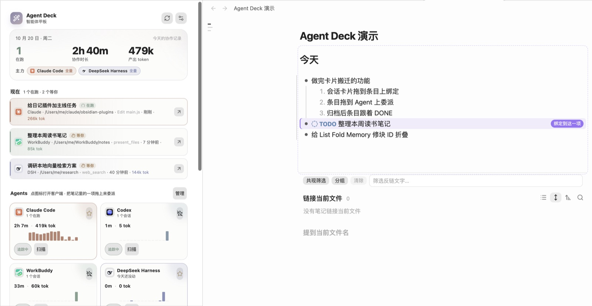
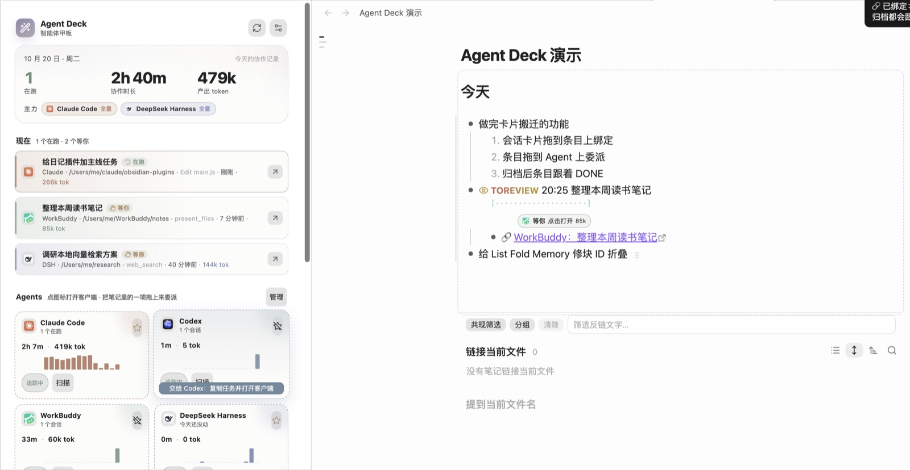
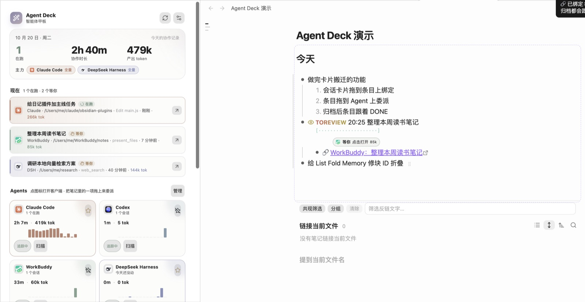
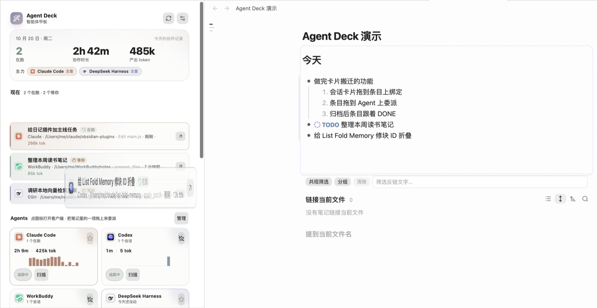
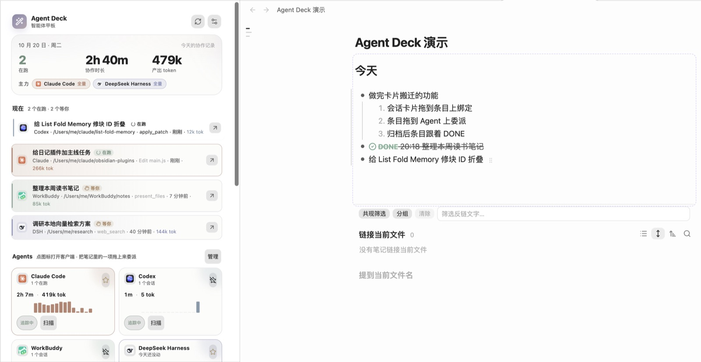
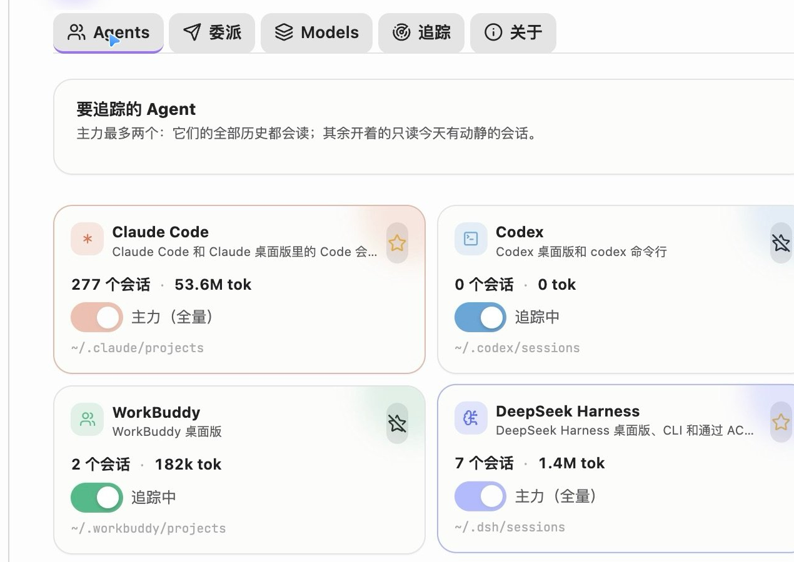
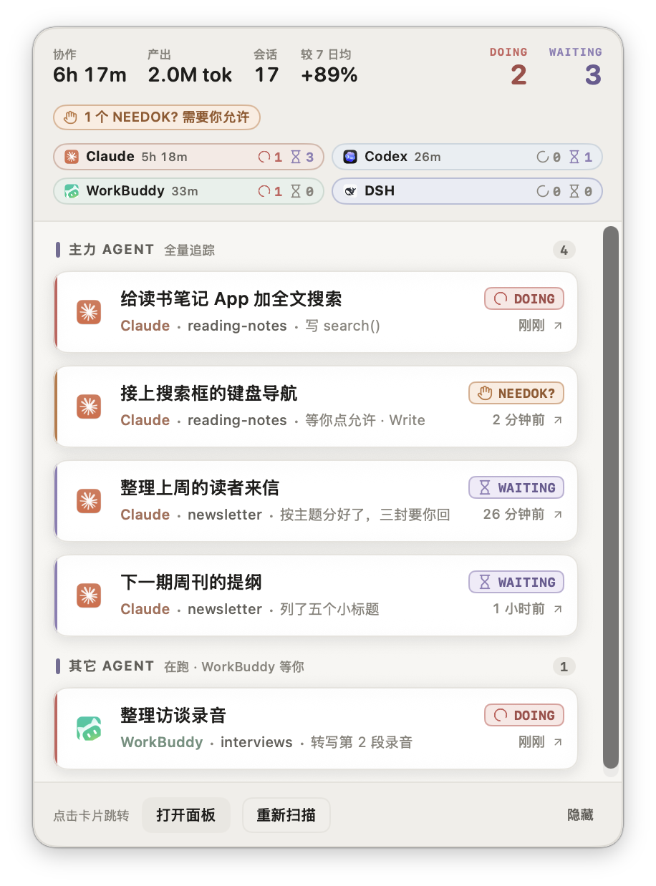
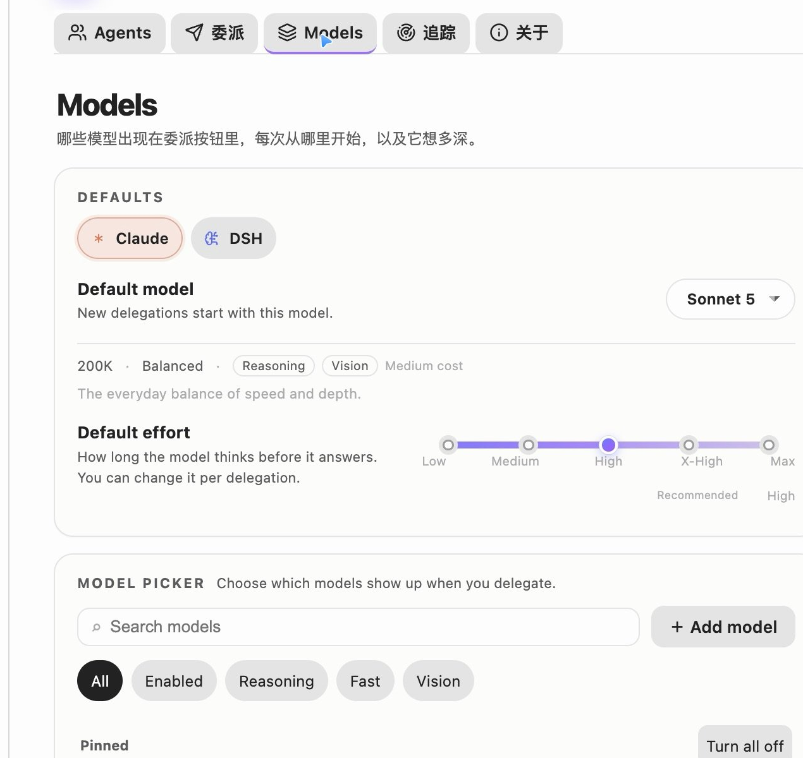

# Agent Deck

> Track every agent. Delegate from the line you are already looking at.

[中文](README.md) ｜ **English** ｜ [GitHub Releases](https://github.com/MatsuriMW/obsidian-agent-deck/releases) ｜ [Changelog](CHANGELOG.md)

<p align="center">
  <a href="https://github.com/MatsuriMW/obsidian-agent-deck/releases/download/1.2.1/agent-deck-demo-4k60.mp4"></a>
</p>

<p align="center">25-second demo (Chinese captions) · click for the <a href="https://github.com/MatsuriMW/obsidian-agent-deck/releases/download/1.2.1/agent-deck-demo-4k60.mp4">4K60 version with sound</a></p>

Agent Deck gathers the AI agent sessions scattered across separate clients onto one deck inside Obsidian: which agent is working, which one is waiting for you, and how far each has got, at a glance. To hand off work, delegate from the line you are writing; progress and the result come back to that same line. What you planned and what the agents did end up in the same journal.

It is an Obsidian plugin that reads the local session logs of **Claude Code, Codex, WorkBuddy, DeepSeek Harness and Antigravity**, shows what each agent is doing now, and tracks delegated tasks from the editor. Notes and the panel talk by drag and drop: drop a session card on a list item to bind it, drop a list item on an agent to delegate it. Only the line under the cursor gets a small paper-plane grip: click it to send the item with its children to your primary agent after a confirm (delegating a sub-item also carries its parent lines, up to the outermost list item, as context), double-click or ⌘-click to pick the agent. Once a line is bound to a session, the line-end pill becomes the progress surface.

It is the AI/agent tracking half of [Nautilus Spiral](https://github.com/MatsuriMW/nautilus-spiral), extracted into a standalone plugin and extended with a second primary agent, DeepSeek Harness, model/effort/mode selection, and a layered model picker.

**Contents**

- [Release notes](#release-notes)
- [Interface language](#interface-language)
- [Supported agents](#supported-agents)
- [How to use it](#how-to-use-it)
- [Recommended: use it with Nautilus Spiral](#recommended-use-it-with-nautilus-spiral)
- [What it does](#what-it-does)
- [macOS menu bar](#macos-menu-bar)
- [Human–AI journal](#humanai-journal)
- [What automatic records are useful for](#what-automatic-records-are-useful-for)
- [Delegate targets](#delegate-targets)
- [Deep links](#deep-links)
- [The status pill](#the-status-pill)
- [Runtime requirements](#runtime-requirements)
- [Installation](#installation)
- [Settings](#settings)
- [Compatibility with Nautilus Spiral](#compatibility-with-nautilus-spiral)
- [Privacy](#privacy)
- [FAQ](#faq)
- [Release provenance](#release-provenance)
- [Feedback and updates](#feedback-and-updates)
- [Credits](#credits)
- [License](#license)

## Release notes

Current version: **1.7.1**. Every change is listed in [CHANGELOG.md](CHANGELOG.md); builds are on [Releases](https://github.com/MatsuriMW/obsidian-agent-deck/releases).

### 1.7.1 · A simpler delegation footer and practical journaling guide

The confirmation sheet now has one Cancel / Send button pair on the right. The duplicate shortcut legend on the left is removed. Send keeps initial focus for Enter; Esc closes the sheet.

Confirm before starting is now Additional delegation instructions, with a default that proceeds when requirements are clear. The settings explain each log detail level and recommend detailed text with per-turn recording for development logs. Switching to latest progress preserves saved records.

This release also ships the local journal organization, record display, manual status selection and startup/cache fixes. The guide describes current behavior; see the changelog for the full changes.

### 1.7.0 · Journal layout and a destination you pick

A day's journal now keeps a fixed order: `## 已完成` on top (your hand-written `DONE` items are hoisted too, most conversation turns first), a rule, then `## 进行中` (still grouped by `### DOING` / `### PAUSED` and sorted by turn count), another rule, and finally your own notes. No blank line is left between a heading and the list under it. The `## AI · 进行中` / `## AI · 已完成` headings written earlier in 1.7.0 are renamed in place on the next run, and running it twice never stacks extra rules.

New **Archive finished logs to…**: pick a target file (any `.md` in the vault, defaulting to `Agent Deck/done/已完成任务.md`, remembering the last one) and the finished AI log moves out of the journal into it. Whether new content goes to the top or the end of that file is **Settings → Tracking → Archive order**; an existing date section keeps its place and is only re-sorted by turn count. Hand-written `DONE` items are never archived away.

### 1.6.0 · Chinese and English interface

The interface language follows Obsidian's own language setting: a Chinese Obsidian gets Chinese, every other language gets English, with nothing to configure. The 21 command-palette entries, settings, dashboard, task-line status pill, delegation and conversation dialogs, notices, context menus, AI record folding and the macOS menu bar all have English text. The Chinese source strings stay in the code as keys and are used as the fallback. Text written into your notes, task-line keywords and the prompts sent to the CLIs do not change with the interface language.

### 1.5.1 · Organized logs and context archiving

Use **归组未完成日志**, **归档已完成日志**, and **跳到正在做** in the dashboard. Unfinished task blocks move into the journal's **进行中** region, grouped by keyword (DOING, TOREVIEW, PAUSED, and others). Within each keyword, tasks with more conversation turns come first. Available session counts are combined per task; otherwise saved round numbers are used. Equal counts retain their order.

Completed tasks move to `Agent Deck/done/已完成任务.md` by default, grouped by source journal date. Tasks within a date are sorted by turn count, descending, including tasks archived in earlier batches. Set **追踪 → 自动记日记 → 已完成任务归档位置** to another vault-relative Markdown path. The archive is saved before the source block is removed. A write failure or concurrent edit keeps the source. Client archive detection still marks tasks DONE; all sessions attached to a task must be archived first.

Compaction preserves per-turn records in Markdown and adds a cumulative summary. Click **More** to reveal the summary and details in editing or reading view. Records show the latest AI conclusion by default and retain each manually expanded task across refreshes and reloads. Agent Deck owns this state and does not depend on Logseq Style Fold. Records replaced by older versions can only be recovered while their original session logs remain available. Recording and display are configured separately; choose the latest one, three or five conclusions, or start expanded or collapsed.

Internal block IDs, UUIDs, and session IDs stay in storage while being hidden in the interface. Explicit permission or confirmation waits trigger deduplicated in-app and system notifications. Text detection is limited to recognized requests; client states that are not exposed cannot be detected reliably.

Default Ctrl+Alt shortcuts: D delegate/task actions, A task menu, C conversation, N pending confirmation, X stop, and J jump to the active region. Open sessions by clicking. AI records reuse native Obsidian and Bullet folding; no separate O/R bindings are installed.

Under Delegation, disable task-line suggestions or customize their trigger (default @, preceded by whitespace). Parent and child tasks select independently; code and email text do not trigger suggestions. The confirmation prompt can be disabled or edited and is appended only when enabled.

### 1.4.0 · Task mentions and Dreaming

Type `@` in a list task to choose an agent. Type `/` to choose its model, then `/` again for reasoning effort:

```markdown
- TODO Review this material @codex/gpt-6.1-sol/high
```

The selection stays on that task line and is read when you send or drag it. Child tasks have independent selections. The detailed delegation dialog starts from the mention; changes in the dialog apply only to that dispatch. Custom models in Models are included. WorkBuddy uses client handoff, with model and effort configured in the client. Antigravity uses direct CLI delegation and in-plugin follow-up.

The new **Dreaming** settings page offers a manual run and an optional daily run. It reads the last fourteen journal days and notes attached to tracked delegation jobs, within a bounded input budget. AI records must already be written to notes. It reuses the journal model CLI, model and login; material goes to that CLI's model provider. Automatic runs require the plugin to be running and are disabled by default.

Memories are editable Markdown at `Agent Deck/长期记忆.md`, with source-note links, types and generation timestamps. The export command creates an independent `.md` copy in `Agent Deck/Exports/`, ready to copy out of the vault. Unchanged evidence does not invoke the model again.

Optional Telegram Companion synchronization reads the profile path from the running Companion plugin and updates only an Agent Deck section. Existing profile text is preserved, and no Telegram message is sent. If Companion is unavailable or its profile has not been created, the local memory remains available; run Dreaming again to retry. Synchronization is disabled by default. Automatic LLM Wiki ingestion and mandatory handoff for ordered tasks remain planned for the outline journal app.

## Interface language

The UI follows Obsidian's own language, with no separate switch and no restart: a Chinese Obsidian gets Chinese, every other language gets English.

- **Detection** — Obsidian stores its language in `localStorage` under `language`; `zh` and `zh-TW` mean Chinese, anything else means English. If that is missing the system locale is used, and English is the final fallback.
- **What is translated** — command palette, the six settings tabs, the dashboard, the task-line pill, drag hints, the delegation dialog, the conversation window, notices, context menus, AI record folding and the macOS menu bar.
- **What is not** — anything written into your notes (task-line keywords, `🔗` / `💬` / `⏱` lines, archive headings), file paths and default file names, values stored in settings, and the prompts sent to a CLI or a model. They are either read back by the plugin or are data.
- **macOS menu bar** — the Swift helper compiles its Chinese constants into the binary and the plugin pushes a `labels` map with each state snapshot, so a missing entry falls back to the original Chinese and an older snapshot cannot break.
- **Adding text** — `import { t } from "./i18n.js"`, use the Chinese sentence as the key, and add the English in the matching fragment under `src/locales/en/`. `node test/i18n.test.mjs` checks for missing translations, duplicate keys and placeholder mismatches. See [docs/ui-language.md](docs/ui-language.md).

## Supported agents

The current version tracks these five agents through their local session logs:

| Agent | Main log source | Progress | Delegation |
|---|---|---|---|
| Claude Code | `~/.claude/projects` and Code sessions in the Claude desktop app | TaskCreate / TaskUpdate / TodoWrite steps when available; conversation turns otherwise | Background CLI or interactive terminal |
| Codex | `~/.codex/sessions`, `archived_sessions` and session indexes | Conversation turns | App Server first turn with Desktop continuation, or terminal CLI |
| WorkBuddy | `~/.workbuddy/projects`, combined with `workbuddy.db` metadata | Conversation turns | Open the client and copy the task for you to paste and send |
| DeepSeek Harness (DSH) | zstd logs under `~/.dsh/sessions` and the local usage statistics interface | Conversation turns | Background delegation with model and effort selection |
| Antigravity | Original IDE logs and conversation history saved with plugin jobs | Conversation turns, planner replies and tool actions | Direct CLI delegation, in-plugin follow-up and text export |

All five can bind to journal tasks, create automatic entries and write conclusions back. State and token data depend on the fields each client actually logs. Archive detection is integrated for Claude, Codex, WorkBuddy and DSH; Antigravity archive detection is not currently guaranteed. Plugin-created Antigravity CLI sessions open the conversation inside Obsidian. Original Antigravity IDE sessions and the DSH client entry still open the app and copy the session ID.

Models can be added or edited in Models. Adding a model does not add another agent log reader. The plugin is developed and verified on macOS; client paths and navigation on other systems are unverified.

## How to use it

The plugin keeps explanatory text out of its UI; this section is the manual, and the switches live in the settings.

### The panel

| Area | What it shows / what you can do |
|---|---|
| Top bar | Session search (title, first message, project, last step, latest reply, model, agent; every space-separated word must match). While it has text the panel shows only the results, drawn from every scanned session; Esc clears it. Rescan, settings |
| Today card | Collaboration time (vs the 7-day average), output tokens (calls), sessions (prompts); a timeline of when each agent worked today; the three projects that took the most time |
| 现在 (Now) | Running and waiting sessions, up to six. Click a card to open the session; drag it into a note to bind it (see below); drag it up or down within the list to reorder (new sessions go on top); the × on a card (or right-click) removes it from 现在 |
| Agents | One card per agent: click the icon to bring the client forward, ⭐ to make it primary (1–2 primary agents: their full history is read; other agents only for sessions that moved today), toggle tracking, **扫描** to rescan. Drop a note item on a card to delegate |
| 最近 14 天 | Daily collaboration minutes stacked by agent; hover for numbers |
| 最近的会话 | Sessions from the last 7 days, filterable by state and agent |

**Tidy log / Archive to…**: the two buttons at the top of the dashboard. **Tidy log** rebuilds the current journal — finished tasks (hand-written `DONE` included) move to the top, then a rule, then the unfinished AI log grouped by keyword, then another rule, then your own content. Old section headings are folded away and repeated runs never stack rules. **Archive finished logs to…** moves the finished AI blocks out: choose a target file (default `Agent Deck/done/已完成任务.md`, last one remembered), and where it lands is decided by Settings → Tracking → Archive order (top of file / end of file). Hand-written `DONE` items stay in the journal.

**Where a click opens a session.** Claude Code desktop sessions use `claude://resume`, Codex desktop `codex://threads/<id>`, WorkBuddy `workbuddy://chat/<id>`; DeepSeek Harness can only be focused, so the session id goes to the clipboard. **Claude Code / Codex sessions running in a terminal** switch to the terminal tab that runs them (Terminal, iTerm2, Tern and Herdr select the tab; Warp has no scripting interface, so it is only brought forward); only when the process has exited is a new tab opened to resume. The terminal is **Auto** by default, chosen per machine: the terminal most of your running `claude` / `codex` CLI sessions live in (remembered in `~/.agent-deck/terminal.json`), else the last one recognised, else one that is open, else one that is installed, in the order Herdr → Tern → iTerm2 → Warp → Terminal. Settings → Tracking → Claude desktop lets you pin one, or send them to the desktop app instead.

### Drag: bind and delegate


Pin Agent Deck to a sidebar and drag between the note and the panel:

| Drag | Result |
|---|---|
| A session card from **现在** → a list item with text (ordered or unordered) | The text stays; the line gets the session's keyword (`DOING` / `TOREVIEW` / `NEEDOK` …) and a `🔗` child. From then on `💬`, status and `⏱` follow the session |
| A session card → an empty line, an empty item (`- `), or a paragraph | A new item `DOING 20:05 🤖 session title` is created there and bound, following the list's indent and numbering |
| A list item → an agent card | Delegation. Claude Code and DeepSeek Harness start a session in the background (default model Opus 5.5, configurable in the settings); when Claude Code finishes its first turn the session opens in the Claude desktop app, where you carry on. Codex runs its first turn through App Server, binds the persistent session and opens Desktop to continue. WorkBuddy copies the task to the clipboard for you to paste and send |
| ⌘-drag a session card onto an item | Leaves the item alone and creates a new bound item below it (and its children) |
| ⌘-drag an item onto Claude Code / Codex | Opens a new tab in your terminal running interactive `claude` / `codex` with the task as the first message; the session is bound back once it appears. With **open in terminal by default** on in the settings, it is the other way round. With Tern or Herdr as your terminal the task runs in a separate background session named "Agent Deck" (a space of that name in Herdr), and the terminal does not come forward; Claude Code starts in a trusted directory (the vault added with `--add-dir`) so it never stops at the trust prompt |
| An item → a session card in the panel | Binds that session to the item, no delegation |
| A delegated session gets its id | Its card flies from the agent card into **现在** |
| You archive the session in its client | The item becomes `DONE` + `⏱` and the `🔗` line is retired |

- **One-to-one.** A session is bound in one place. Dropping it elsewhere moves the binding; an auto-logged `🤖 …` line written for that session earlier is removed, so a task you already wrote and the agent's run of it merge into one line.
- **The grip ⠿.** The list item under the cursor shows a small grip at its end. **Click** it, confirm, and the item with its children goes to the default delegate (your primary agent) as one message; delegating a sub-item carries its parent line(s) up to the outermost list item as context, with siblings left out; the item then turns `DELEGATED`. **Double-click** or **⌘-click** to pick the agent (Claude Code, Codex, WorkBuddy, DeepSeek Harness), which works the same as dropping on that card; **drag** it onto an agent card in the sidebar, or drag a text selection. Agent cards turn dashed while you drag, and the hovered one says what dropping will do.
- **Dropping into a note** highlights the target line and labels it (bind / new item); headings, code blocks and tables don't accept drops.
- **⚠️ Terminal delegation is only verified on Tern and Herdr.** Opening `claude` / `codex` in a terminal works end to end on Tern and Herdr for both Claude Code and the Codex CLI: the session is bound back to the item, and clicking it switches to its tab. Terminal, iTerm2 and Warp are not tested yet. Like Claude Code, Codex starts in an already-trusted directory when the vault is not trusted, with the vault added through `--add-dir`, so it never stops at the trust prompt. Background delegation (a plain drop on Claude Code / DeepSeek Harness) is not affected.
- **Additional delegation instructions.** Append editable instructions to each delegation. By default, ask only about unclear requirements, scope or acceptance criteria; otherwise state the plan and continue. Disable or edit them under Delegation → prompt prefix/suffix.
- **Items that are not delegated**: agent-written ones (🤖), items already bound to a session, and items with a ⏱ record. Dropping them only says why.
- **With Nautilus Spiral**: when Nautilus draws its session progress line under a task, Agent Deck draws no pill there and the `🔗` entry is hidden when there is one binding and the progress row opens that same session. Its Markdown source remains. Links stay available when no matching progress row exists or multiple sessions are bound. Click Nautilus's progress line to open the session. This can be turned off in the settings.

| | |
|---|---|
|  |  |
|  |  |
|  |  |

## Recommended: use it with Nautilus Spiral

The two plugins are two halves of one setup:

| Plugin | Owns |
|---|---|
| [Nautilus Spiral](https://github.com/MatsuriMW/nautilus-spiral) | The daily note and the plan: spiral scheduling, timing, capacity, reviews — and the agent tracking display (inner rings, status bar, progress rows, `🔗` bindings) |
| Agent Deck | The AI write half: automatic journal logging, status write-back, `💬`, desktop child / side chat / subagent blocks, archive → `DONE`, and delegation from a task line |

To hand over: open **Settings → 追踪 → 停用螺旋日程里的 AI 写入** in Agent Deck, then reload Nautilus Spiral. Nautilus stops writing but keeps its schedule and tracking display; Agent Deck owns the note writes. Agent Deck also works on its own — you just lose Nautilus's planner and display.



## What it does

- **A dashboard for the agents on this Mac.** Running, waiting and quiet sessions for Claude Code, Codex, WorkBuddy, DeepSeek Harness and Antigravity, with project, last step, elapsed time and tokens. Click a row to open that session in its client.
- **Claude desktop side chats.** In the Claude desktop app a session can spawn another session that looks like a sibling in the sidebar. Agent Deck reads `spawnedFrom` from `claude-code-sessions/**/local_*.json`, indents the child under its parent, and labels the relationship; a session with an open side chat gets a badge, and the menu bar adds `side chat ×N`. Archived sessions drop out of **现在** and the recent list for every client: Claude desktop (`isArchived`), Codex (`threads.archived` in `state_*.sqlite`, plus the older `archived_sessions/`), WorkBuddy (`sessions.status` in `workbuddy.db`) and DeepSeek Harness (`archivedSessionIds` in `storages/workspace.json`).
- **Human–AI journal, moved in.** The AI half of Nautilus Spiral's journal flow now lives here: sessions are recorded into today's note (the selected local Claude / Codex CLI names them and matches existing task lines), status and elapsed time are written back, `💬` carries the last reply, child sessions / side chats / Claude Code subagents become nested blocks, and archiving a session marks its line `DONE`. Nautilus keeps the tracking display.
- **Write-back on bound lines.** A bound `🔗` session gets `💬`, its keyword follows the session (`DOING` / `TOREVIEW` / `NEEDOK` / `ERRORED` / `HITLIMIT`), and archiving writes `DONE` + `⏱` and retires the `🔗` line. While Nautilus's own AI tracking is still enabled Agent Deck stays out of the note, so the two never fight over the same lines.
- **Two primary agents, full history.** Pick up to two agents as primaries. They are read in full (all history, cross-day catch-up); every other enabled agent is only read for sessions that moved today.
- **Delegate from a task.** Click its paper plane, drop it onto an agent card, or press Ctrl+Alt+D. Bound tasks offer continue, inspect, stop, or delegate a new session. Preview the block and select a supported work destination before sending.
- **Progress only on bound lines.** A line with a `🔗` session or a running delegation gets a line-end pill. While the job runs the pill fills and shows the elapsed clock; the `×` cancels it. When the agent answers, the pill becomes **Done** and the result is written under the task as one `💬` line. Lines with no session stay clean.
- **Note-native records.** Delegation writes a `🔗` line under the task and changes the status to `DELEGATED`; the line is the source of truth. Delete the `🔗` line to unbind.
- **Layered model settings.** A global default model, a default effort slider, capability tags, search/filter, enable switches, pinned order and a per-row menu. Changes sit in an **Unsaved changes** bar until you save them.
- **Local only.** Everything is read from `~/.claude`, `~/.codex`, `~/.workbuddy`, `~/.dsh`, `~/.gemini/antigravity/brain` and the Claude desktop session list under `~/Library/Application Support/Claude/claude-code-sessions`. Tracking reads local files; delegation, summarization, and Dreaming send the selected material to the configured model service. The plugin stores its own aggregate in `usage.json` next to the plugin, so history survives log rotation.
- **Official app icons.** The dashboard, session rows, pills and settings use agent icons; the menu bar falls back to a glyph when an icon is unavailable; status, tool and window icons stay Lucide, and running states use a CSS spinner.
- **The agent summary lives in the macOS menu bar.** Obsidian's bottom-right status bar no longer carries the agent session summary. The status item is just an icon; click it for a solid, opaque panel of task cards you can jump from.



## macOS menu bar

The menu bar item is a tiny SwiftUI helper app compiled on first use; in the bar itself it is just an icon. It is not a second copy of the dashboard: it is the quick "what is running / what needs me" surface.

- **Solid, not glassy.** The panel is a borderless window with opaque surfaces. There is no `NSPopover`, no vibrancy and no frosted material, so text keeps its contrast on macOS 26. The light background is a near-white tint of the current Obsidian theme, and dark mode has its own solid palette.
- **Rows speak TODOseq.** Each card is tagged with a TODOseq keyword — `DOING`, `WAITING`, `NEEDOK?`, `HITLIMIT!`, `PAUSED`, `ERRORED`, `DONE`, `LATER`, `TODO` — with the same SVG icon and task-state colour TODOseq uses. `DOING` keeps its loader-circle spinning while the panel is open. The right side of the header counts `DOING` / `WAITING`, and any `NEEDOK?` session gets an orange reminder.
- **The header is today's numbers.** Four figures on the left: collaboration time, output tokens, session count, and how today compares with the average of the previous seven days (hidden when fewer than three of those days have usage). There is no icon or product name: the panel already hangs from the menu bar icon.
- **Cards are card-like.** White surface, 1px border, a soft shadow, a state-coloured rail, the agent's glyph badge, the project and the current step. Hovering lifts the card.
- **Five at a time.** The first five sessions are visible; the rest are a scroll away. The footer tells you how many sessions are in the list.
- **Right side, plus a shortcut.** The status item stays in the right side of the menu bar. If macOS hides it because the bar is full, press **⌃⌥⌘D** (Control + Option + Command + D) to open the panel from any app; press it again to close it. Escape or a click outside also closes it. The shortcut can be changed in **Settings → 追踪 → 菜单栏快捷键**; no Accessibility permission is needed.
- **Primary agents** (up to two) contribute more rows: all live sessions plus recent sessions from the last six hours, up to six per primary by default.
- **Other agents** contribute only sessions that are currently running, up to three per agent by default. In the all-enabled scope, WorkBuddy waiting sessions can also be listed.
- The header defaults to primary agents and agents currently running tasks. Idle primaries stay visible; other agents disappear when they stop running. Settings → Tracking → menu-bar agent scope can restore all enabled agents (`menuBarAgentScope: all`).
- Clicking a row opens the same deeplink as the dashboard. DeepSeek Harness focuses the client and copies the session id; Codex opens `codex://threads/<id>` and copies `codex resume <id>`.
- **打开面板** opens the Obsidian dashboard via `obsidian://agent-deck`; **重新扫描** triggers a scan; **隐藏** disables the menu bar from inside the panel.

The menu bar panel shares the dashboard's low-saturation palette: warm neutral surfaces, the muted violet-grey accent (`--ad-accent`), the same agent colours, and neutral footer buttons. Task-state colours follow TODOseq.

The first start needs `swiftc` (Xcode Command Line Tools). The plugin compiles `~/.agent-deck/AgentDeckMenuBar.app`, then launches it. It exits when Obsidian exits. The source is included in the plugin bundle, so no separate download is needed. If the menu bar does not appear, open **追踪 → 重启菜单栏** or install the command line tools with `xcode-select --install`.

If the menu bar is full (or a menu-bar manager such as Ice has the item in its hidden section), press **⌃⌥⌘D** to open or focus the panel (a second press leaves it open; Escape or a click outside closes it). You can also run **Agent Deck: 打开 macOS 菜单栏面板** from the command palette.



## Human–AI journal

Your task lines are the plan; the agent session logs are the record of what actually happened. With **Auto-log into today's note** enabled, Agent Deck periodically reads today's sessions and writes the record back:

- **Active** → the matching line becomes `DOING`; if there is no line it writes `- DOING 00:45 🤖 …`. The selected local Claude / Codex CLI names the session and picks an existing task line when one fits.
- **Idle for a while** (10 minutes by default) → `PAUSED`, with `- ⏱ 00:45–01:20 · 共 52m · Claude` underneath.
- **Archived in the desktop app / Codex** → `DONE 19:20 …`, including lines still open from previous days.
- **It never guesses DONE.** The machine only moves between `DOING`, `PAUSED` and the waiting keywords (`TOREVIEW`, `NEEDOK`, `ERRORED`); finishing is you marking it done or archiving the session.
- **Bound lines** get `💬` when the session answers, their keyword follows the session, and archiving writes `DONE` + `⏱`. Auto-logged `🤖` lines follow the session's keyword too (`DOING` ↔ `TOREVIEW` / `NEEDOK` / `ERRORED`), so a session waiting for you shows up as waiting before it is paused.
- **Nested blocks**: desktop child sessions (from `spawnedFrom`), open side chats, and Claude Code subagents (`<session>/subagents/agent-*.jsonl`) become indented blocks with their own status.
- **Tunable** in Settings → 追踪 → 自动记日记：how often it runs and how soon after startup the first run happens (1 minute by default, no longer a full interval), how many active minutes a new session needs before it gets a line (3), the idle time before `PAUSED` (10), which agents are logged, how many sessions are asked per round (8), the model and timeout used for naming (`haiku`, 120 s), whether background runs fall back to the session title when the model can't be reached (on), the CLI provider (Claude / Codex), its path, Codex reasoning effort, and the per-round `💬` polish (on / model / timeout).

Writes are line-level, stay out of undo history, skip while an IME composition is active, and abort if the note changed in the meantime. These writes used to live in Nautilus Spiral; now Agent Deck owns them, and Nautilus keeps the tracking display. While Nautilus's write flags are still on, Agent Deck stays out of the note — use **停用螺旋日程里的 AI 写入** and reload Nautilus to complete the handoff.

Agents lets you select the default model and delegation target for Claude, Codex and DSH; primary stars separately control history tracking. Models supports adding and editing model names, CLI identifiers, DSH provider routes, context and tags, plus independent defaults and reasoning effort per agent. WorkBuddy model selection remains in its client; Antigravity models and effort can be selected through its CLI integration. Model availability depends on the signed-in account.

Agent Deck owns automatic journal writing. In **Settings → Agent Deck → 追踪 → 自动记日记**, turn off **自动记录到日记（总开关）** (`journalAutoWrite`, default `true`) to stop automatic task creation, conclusions, keyword updates and compaction. Tracking and manual organization remain available.

Record granularity (`autoLogGranularity`) is independent of text detail: `latest` adds only the newest round on each scan, `round` (default) accumulates completed turns, and `paused` writes conclusions only after inactivity pause or recognized archive. Switching never overwrites or deletes saved prompts, conclusions or steps. Status and time still follow their existing rules. Text detail (`autoLogDetail`) defaults to `brief`, about 45 characters without user prompts or steps; `standard` retains one sentence each for the prompt and reply; `detailed` retains prompt excerpts up to 1,000 characters, reply excerpts up to 3,000, and available steps. Changes apply to rounds started after the setting change, including in existing sessions. Saved rounds are not rewritten. Full original conversations can be archived separately.

In per-turn mode, enable automatic compaction (`autoLogMerge`, default `false`) and choose a threshold (`autoLogMergeThreshold`, default 10, range 2–100 new conclusions). The selected Claude / Codex CLI rolls previous summaries and new completed turns into one summary. A successful response adds a summary while preserving older direct AI turn records behind“更多”. Later turns, manual notes, user TODOs, clocks and nested task notes remain; failures preserve the original records.

Click a task status keyword to choose a new status instead of opening a query. Common states are listed first; other states are grouped, including additional TODOseq keywords. TODOFORAI, TODO4AI, TODO2AI, TODOTOAI and NOW are omitted from the menu while existing notes remain readable. A manual choice locks this task against Agent Deck status synchronization, automatic pause and archive completion. Content recording continues. Choose Resume automatic status to follow the current session again. Marking DONE does not stop the agent or move the task.

| Detail | Saved content | Use |
|---|---|---|
| Brief (default) | One AI conclusion, about 45 characters; no prompt or steps | Quick progress checks |
| Standard | One sentence each for the prompt and reply, up to 90 characters each; no steps | Short work notes |
| Detailed | Prompt excerpts up to 1,000 characters, reply excerpts up to 3,000, available steps and commands from replies | Development logs, debugging reviews and handoffs |

For development logs, use detailed text with per-turn recording. You can still show only the latest conclusion. New settings apply to new rounds, including in existing sessions; saved records are never rewritten or deleted. Detailed records are excerpts; export conversation text separately when needed.

Logs can be copied to other Markdown files for development records or Dreaming evidence. Prompts (`❓`) remain user evidence and replies (`💬`) remain AI evidence. Hidden session/turn markers distinguish new records from multiple sessions; historical records are not rewritten to add markers. Detailed records are bounded excerpts, not full transcripts.

AI record display (`aiRecordDisplay`) is independent of saved granularity and defaults to `latest1`: only the newest AI conclusion is visible. Choose `latest3` or `latest5` for more conclusions, or `collapsed` / `expanded`. Prompts, links, steps and time do not count toward the limit; click More to see saved history and cumulative summaries. DONE tasks follow the same rule. Manual expansion is remembered after reload. Display changes never delete or restore saved records; switching to latest progress preserves all saved history. Manual notes and child tasks remain visible. Agent Deck block IDs stay in Markdown but are hidden in the editor and reading view.

AI records follow Obsidian's own fold / unfold / fold-all / unfold-all commands, plus Bullet's when installed. Configure their keys in Obsidian. Agent Deck stores the manual expansion state in its settings, so no folding plugin is needed.

The daily note is `journalFolder` plus `journalFormat`. An empty `journalFolder` follows Obsidian's Daily notes core plugin, then Periodic Notes, then falls back to `日记`. `journalFormat` is a moment format that may include subfolders (`YYYY-MM-DD`, `YYYY/MM/YYYY-MM-DD`). Left empty, it is detected: Obsidian's Daily notes core plugin, then Periodic Notes, then the naming of notes already in the folder, then `YYYY_MM_DD`. Journal settings are stored explicitly as `autoLogEvery` (20 min), `autoLogStartDelay` (1 min), `autoLogMinMinutes` (3 min; 0 disables the threshold), `autoLogIdle` (10 min), `autoLogBatch` (8), `autoLogAgents`, `autoLogProvider` (`claude` / `codex`), `autoLogModel`, `autoLogEffort` (`low`), `autoLogTimeout` (120 s), `autoLogFallback` (true), `autoLogPath`, `autoLogKw`, `autoLogArchiveDone`, `autoLogNotify`, `roundPolish`, `roundPolishModel` (empty reuses the naming model), and `roundPolishTimeout` (30 s). The journal must already exist. The first run still applies the activity threshold; ineligible sessions wait until a later run. Live write-back follows `pollSeconds` (20 s by default).

## What automatic records are useful for

Automatic records turn work across clients into ordinary Markdown. Tasks, prompts, conclusions, session links and activity spans stay together for search, editing, references and note backups.

| Goal | Use the existing features |
|---|---|
| Review your day | Organize today's sessions and review their states, conclusions and activity spans. Organize logs separates completed and ongoing work. Activity spans are session statistics, not measured human work hours. |
| Resume a task later | Choose per-turn recording, expand More to revisit history, and continue the bound session. To change agents, include selected records as child blocks in a new delegation. |
| Keep development or project review notes | Standard detail keeps one sentence each for the prompt and reply; detailed keeps longer excerpts and available steps. Export conversation text separately when needed, then check actual changes and validation results. |
| Find earlier conclusions and reasons | Search task or note keywords in Obsidian, revisit saved exchanges and cumulative summaries, and follow session links or archived text for context. |
| Keep daily notes readable | Show only the latest conclusion by default and expand history when needed. Archive completed logs to a chosen note while retaining dates and records. |
| Build long-term memory | Dreaming reads the last fourteen days of daily notes and existing delegated-task notes to extract sourced facts, preferences and project lessons. Edit or export memories, or sync a fixed-path Markdown file for other agents to read. |

Enable automatic organization under Settings → Agent Deck → Tracking → Auto-log and leave the automatic journal writing master switch on. The daily note must exist. Naming, matching tasks, polishing and summaries use your authenticated Claude or Codex CLI; tracking alone makes no model calls.

For development logs, choose detailed text with per-turn recording. Latest progress adds only the newest round on each scan while preserving saved records. Brief detail records only AI conclusions; standard and detailed also retain user prompts. Display limits cannot restore overwritten history. Check AI conclusions yourself. Dreaming distinguishes user prompts from AI replies and does not treat AI inferences as user facts.

Dreaming and shared-memory sync are off by default and run only while the plugin is active. Organization materials go to the selected CLI's model service. Shared Markdown can optionally be committed and pushed from a local Git clone with existing credentials. See [shared memory](docs/shared-memory.md).

## Delegate targets

### Claude Code

Agent Deck starts a headless Claude Code session with:

- `--model` (Opus 5.5 by default; Opus 5, Sonnet 5, Haiku 5.5, Fable, or a custom alias)
- `--effort` (low, medium, high, xhigh, max)
- `--permission-mode` (`plan`, `auto`, `acceptEdits`, `manual`)
- `-n` for the session name, `--add-dir` for the vault

The task starts right away; there is no input box to confirm. When the first turn finishes, the session opens in the Claude desktop app through `claude://resume?session=<id>` (the app imports the CLI session) and you carry on there. **委派 → 完成后自动在桌面版打开** turns that off; the line's pill still opens it.

Additional delegation instructions can be appended to messages for any agent. The default asks about unclear key requirements, otherwise proceeds with a plan, implementation and checks. Actions outside the authorized scope require confirmation. Disable or customize this under Delegation → prompt prefix/suffix → Additional delegation instructions. Existing custom text is preserved.

If Claude Code has never trusted the vault, the plugin reads `~/.claude.json` and starts in a directory that Claude already trusts, adding the vault with `--add-dir`. This behaviour can be turned off in **委派 → 库没被信任时自动换个目录**.

### DeepSeek Harness

Agent Deck starts a local Harness session with your selected model and reasoning effort. The task starts right away and the answer is written back as `💬`. The session is persisted in `~/.dsh/sessions`, so Agent Deck can continue tracking it.

Tested on 2026-11-13 with Harness 0.2.2-rc.1: `@dsh/deepseek-v4-pro/high` used the selected model and effort and wrote its reply back to the note. The session appeared under the desktop sidebar's ungrouped section and could be continued after selecting it manually. Agent Deck's `dsh://open` link currently only brings the client forward and copies the session ID; it does not navigate to a specific session.

**The DeepSeek Harness desktop app is still undergoing rapid iteration and is not yet very stable.** Session visibility and integration behavior may change between versions; the results above apply to the tested version.

Harness tool requests can be automatically approved once, or rejected with a notification.

### Codex and WorkBuddy

Codex can be the default delegation target. Settings → Delegation → Codex selects Desktop (default) or terminal. Desktop mode creates a persistent App Server session using the selected model, effort and sandbox, runs the first turn, then releases the session and opens Desktop to continue. Connection and model failures are reported without falling back to a terminal. Approval or interactive requests stop the first turn and open Desktop for continuation. ⌘-drop still uses the terminal.

WorkBuddy uses client handoff: drop an item on their card, the task text (with your delegation prefix/suffix) goes to the clipboard and the client comes to the front; start a chat, paste, send. On each scan Agent Deck looks for a new session of that agent whose opening matches, writes `🔗` under the item, marks it `DELEGATED`, and flies the card into **现在**. While it waits, the agent card shows a "waiting for you to send" row with an `×`; it gives up after 30 minutes.

Codex sessions open in the desktop app with `codex://threads/<id>` (and `codex resume <id>` is copied too). WorkBuddy opens with `workbuddy://chat/<id>`.

## Deep links

| Agent | Link | State |
|---|---|---|
| Claude Code | `claude://resume?session=<id>` | Works |
| WorkBuddy | `workbuddy://chat/<id>` | WorkBuddy-native sessions only; does not import independent CodeBuddy CLI sessions |
| DeepSeek Harness | `dsh://open` | The current integration opens the client and copies the session ID. Select the matching session manually in the sidebar. |
| Codex | `codex://threads/<id>` | Works; also copies `codex resume <id>` |
| Antigravity | `antigravity://` | Opens the client and copies the session ID; no direct conversation navigation |

## The status pill

The pill is a CodeMirror widget. It only lives on lines that already have a session or delegation, not on every list item, and it has four states:

1. **Starting**, while the session is being created.
2. **Delegating**, with a liquid fill, elapsed time and `×`.
3. **Waiting / needs approval**, with a slow glow.
4. **Done** or **Error**, with an open/retry control.

When a delegation fails, **Retry** on its status pill opens the options sheet:

## Runtime requirements

Agent Deck currently starts local programs for automatic Claude, Codex, DSH and Antigravity delegation. If the required program is missing or cannot run, that delegation path is unavailable. A desktop app may bundle the program; a separate global CLI installation is not always necessary. Remote API or SDK backends can work without a local CLI, but this version does not provide a generic remote delegation backend.

Reading existing logs, binding tasks, viewing conversation text and exporting it do not start an Agent CLI. AI naming, summaries, polishing and Dreaming separately require a configured, authenticated Claude or Codex CLI.

| Feature / Agent | Current implementation | Required on the user's machine |
|---|---|---|
| Claude Code automatic delegation | Headless `claude` process or terminal session | Installed and authenticated Claude Code; Claude desktop app for desktop continuation |
| Codex desktop mode | `codex app-server` | Working, authenticated Codex executable and Codex desktop app; bundled executable preferred |
| Codex terminal mode | Interactive `codex` | Codex CLI available to the terminal and its authentication |
| DeepSeek Harness delegation and in-plugin follow-up | Harness CLI | A compatible Harness installation and configured model/provider credentials |
| WorkBuddy handoff | Clipboard plus client launch; user sends | Chinese-edition WorkBuddy desktop app; no independent CodeBuddy CLI required for this path |
| Antigravity delegation and in-plugin follow-up | Antigravity CLI | Standalone Antigravity CLI with its own login; installing the IDE alone is insufficient |
| AI journaling, polishing and Dreaming | Selected `claude` or `codex` CLI | Check that feature's executable path, authentication and model availability separately |
| macOS menu-bar helper | Local SwiftUI compilation on first use | `swiftc` from Xcode Command Line Tools; disable the feature if unused |

### Install and verify

Prepare only the agents you intend to use.

1. Follow the official installation instructions for [Claude Code](https://code.claude.com/docs/en/setup), [Codex](https://developers.openai.com/codex/cli/), [DeepSeek Harness](https://github.com/deepseek-ai/deepseek-harness) or [Antigravity CLI](https://antigravity.google/docs/cli/acp). Installing the released plugin files does not require `npm install`. Node.js/npm are needed to build this repository; agent installers may have their own requirements.
2. Check the selected program: `claude --version`, `codex --version` or `dsh --help`. For Antigravity, check `agy --version` and complete the CLI login following the official instructions. Use an absolute path if the program is not on PATH. Desktop Codex and Harness can use bundled executables.
3. Complete the selected agent's login or provider setup. A version check does not prove authentication, quota or model availability. Signing into a desktop app does not establish that a separate CLI is authenticated.
4. Set executable overrides under **Settings → Agent Deck → Delegation**. Obsidian's environment on macOS can differ from your terminal; use an absolute path when necessary. Check the separate journaling CLI configuration used by AI organization and Dreaming too.
5. Delegate a small task asking for a fixed reply without tools. Then verify follow-up, text export and desktop continuation if required. This task calls the model service; only an end-to-end test establishes readiness.

The existing **Check** buttons check executables and versions only. This version does not install agents, alter shell configuration, copy credentials or sign users in automatically. If the menu-bar compiler is missing, install Xcode Command Line Tools with `xcode-select --install` following the system prompts.

### Antigravity delegation and follow-up

Install the standalone CLI and complete its login following the official instructions. Under **Delegation → Antigravity CLI**, check the executable and read available models. An absolute path such as `~/.local/bin/agy` can be configured. The default option preserves the server model; unsupported effort values fail explicitly.

Delegate through `@antigravity`, the paper-plane target or the agent card. Open the bound session inside Obsidian to read replies, continue the same conversation, stop a turn or export text. Tool permission requests show the server's tool details and choices; closing the dialog cancels the request. Automatic tool approval is disabled by default.

Original IDE sessions remain separate. Conversation messages are saved with delegation jobs in plugin `data.json`; export them to notes before using **Clean finished delegation records** for long-term retention. Text exports exclude tool results, internal reasoning and attachments. CLI-to-IDE same-session continuation is not guaranteed.

### WorkBuddy editions

Chinese-edition WorkBuddy uses `~/.workbuddy` and `workbuddy://`. International WorkBuddy AI uses `~/.workbuddy-ai` and `workbuddy-ai://`. The current plugin's WorkBuddy reader and launch target are configured for the Chinese edition; a separate international target is not implemented.

In a 2026-11-13 test, the independent CodeBuddy CLI completed a task after login, but opening its session ID in Chinese-edition WorkBuddy produced `conversation not found` in desktop logs. Installing CodeBuddy CLI therefore does not turn the current WorkBuddy handoff into automatic delegation. International-edition same-session import and continuation remain unverified.

## Installation

This plugin is not in the community store yet. Install it manually:

1. Download or clone this repository.
2. Copy `main.js`, `manifest.json` and `styles.css` into `<vault>/.obsidian/plugins/agent-deck/`.
3. Enable **Agent Deck** in **Settings → Community plugins**.

To build from source:

```bash
git clone https://github.com/MatsuriMW/obsidian-agent-deck.git
cd obsidian-agent-deck
npm install
npm run build
```

`npm run build` writes `main.js` with esbuild. The JavaScript dependency `fzstd` is bundled into the plugin to read Harness zstd logs; users do not install it separately. Agent executables and authentication are separate requirements listed above.

## Settings

**Ctrl + Alt + J**, or **跳到正在做**, jumps to today’s **进行中** region; before grouping, it opens the first running task. Customize it in Obsidian hotkey settings.

- **Agents**: enable each agent, pick up to two primaries, scan now, import Nautilus Spiral history.
- **委派**: default target, models, effort, permission mode, working directory, prompt prefix/suffix, write-back rules, trust fallback.
- **Models**: the layered picker shown above.
- **追踪**: day cutoff, polling interval, idle threshold, history depth, Claude desktop side chats, automatic journal logging and write-back toggles, default archive location and archive order (top / end of file), macOS menu bar toggle and row limits, UI switches, rebuild, import, and a one-click **pause Nautilus Spiral's AI writes** action.
- **Dreaming**: manual or daily memory extraction, progress, Markdown export, shared-memory sync, and optional Telegram Companion profile integration.
- **关于**: version, license and debug info.

## Compatibility with Nautilus Spiral

Agent Deck understands the same `🔗` line as Nautilus Spiral. If both plugins are on, Nautilus will also see the Claude sessions and may rewrite `DELEGATED` to `TOREVIEW`.

Agent Deck hides Nautilus's 🤖 agent status item automatically (the planner's own status bar and timer stay). The AI **writes** of the journal flow (automatic logging, status keywords, `💬`, child blocks) now live in Agent Deck; while Nautilus's write flags are still on, Agent Deck keeps its hands off the note. Use **追踪 → 停用螺旋日程里的 AI 写入** to turn off only those writes — Nautilus keeps its tracking display. Its settings are backed up first. After using it, reload Nautilus Spiral from Obsidian's plugin settings (or restart Obsidian); Agent Deck never disables or enables another plugin.

If you use **done-to-top** and **journal-tidy**, update to **done-to-top 1.17.3+** and **journal-tidy 1.9.1+**. Those versions keep a `DELEGATED` block that mentions 明天 / 后天 / 大后天 in today's DOING area instead of moving it to the next day, and do not fold DOING/TODO blocks before the first separator.

## Privacy

- Session logs are read locally with Node's `fs`.
- No network requests are made by the tracking code.
- Delegation and AI journaling start local `claude`, `codex` or `dsh` processes. Journaling passes selected session titles, opening/final excerpts and unfinished daily tasks to the chosen CLI, which uses its signed-in service. Tracking alone makes no model calls.
- `usage.json` stores only aggregate per-day numbers and session summaries, not full conversations.
- The menu bar helper reads `~/.agent-deck/menubar.json` and makes no network requests.
- The parse cache lives in `~/.agent-deck/usage-cache.json.gz` (outside the vault, never uploaded). Deleting it only costs one full rescan; a parser change invalidates it automatically. Usage history and parse caches restore after the workspace layout is ready. Cache v4 retains all message records needed for call and token totals; upgrading an older cache triggers one background rebuild.

## FAQ

- **The UI is in English. Can I switch it to Chinese?** There is no separate switch; it follows Obsidian. Set Obsidian's language to Chinese (Settings → About → Language) and reload the plugin.
- **The menu bar still shows the old language.** The helper reads the `labels` the plugin pushes. Reload the plugin, or press **Restart menu bar** under Tracking in the settings.
- **No menu bar icon.** The first start needs `swiftc` (`xcode-select --install`). You can also press **Restart menu bar** under Tracking, or open the panel with **⌃⌥⌘D**.
- **Only the Agent Deck commands are English in the command palette?** That means Obsidian is in English and the other plugins are not localised; that is their behaviour, not this plugin's.
- **A delegation failed. What do I check first?** Press **Check** in that agent's settings to confirm the binary path and version, then confirm the login and that the model is available. A passing version check does not prove a login.
- **Times written into the journal are off by hours.** Check **Tracking → day cutoff**; spans are stored as minutes from the cutoff.

## Release provenance

Releases are built by GitHub Actions from the tagged commit. `main.js`, `manifest.json` and `styles.css` carry build provenance attestations:

```bash
gh attestation verify main.js --repo MatsuriMW/obsidian-agent-deck
```

## Feedback and updates

To follow new features, send feedback or keep up with progress, follow me on Twitter: [@Matsurimywaifu](https://x.com/Matsurimywaifu).

## Credits

- Extracted from [Nautilus Spiral](https://github.com/MatsuriMW/nautilus-spiral), which remains the planner.
- The progress-in-trigger-button interaction is inspired by [@ZZ.X's note“AI 任务进度，长在触发按钮里”](https://xhslink.cn/o/3gmyiCARRj2).
- The layered model settings page is inspired by [@ZZ.X's note“AI 产品模型设置”](https://xhslink.cn/o/AwW7VhnzX6m).

## License

MIT. See [LICENSE](LICENSE).

---

**中文版本**: [README.md](README.md) — the same document in Chinese.
