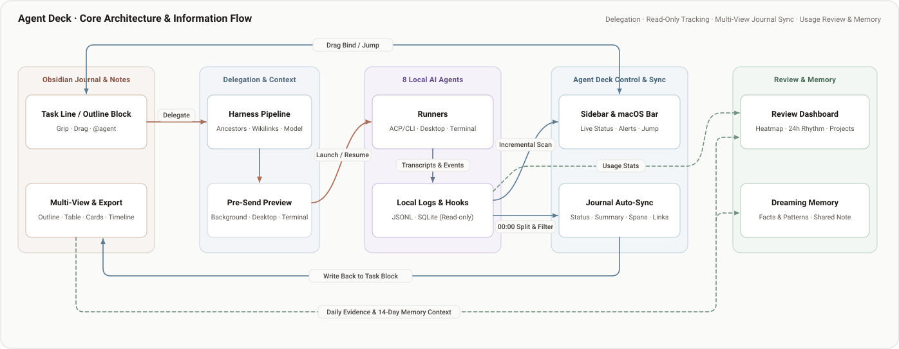
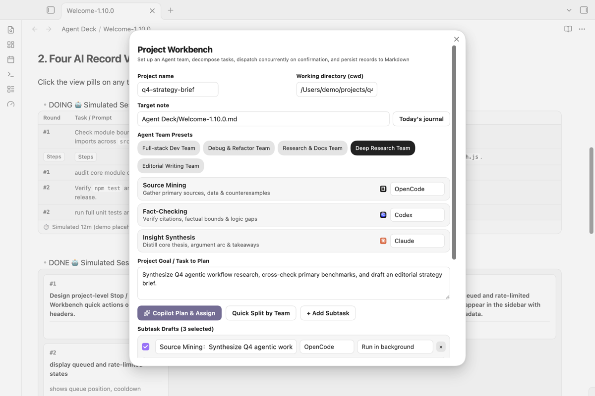
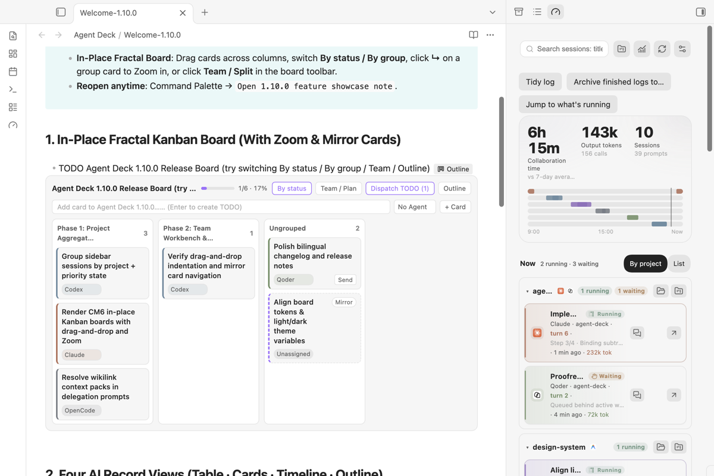
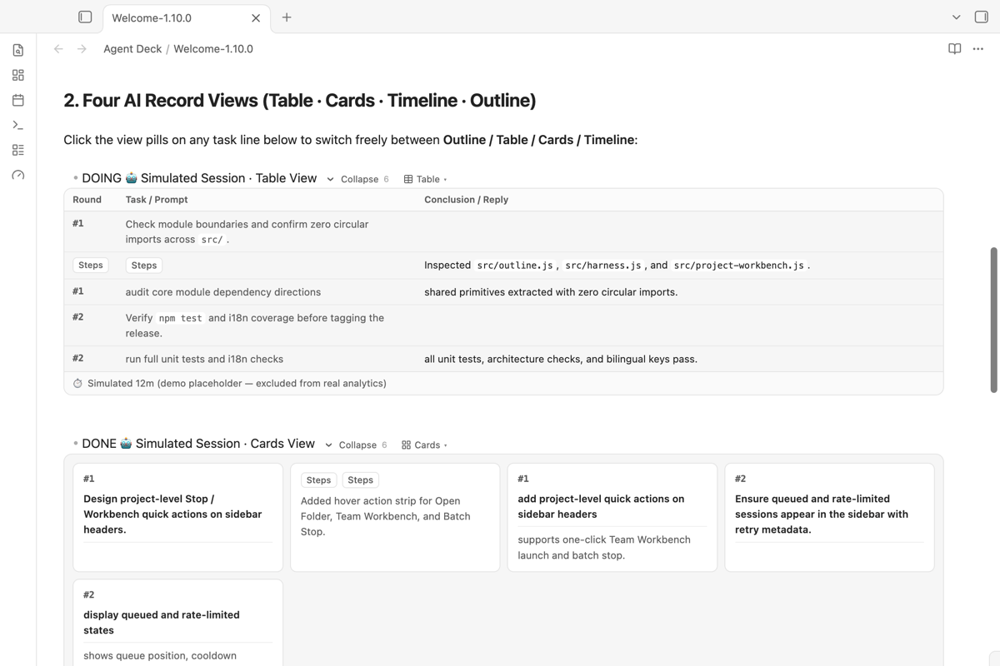
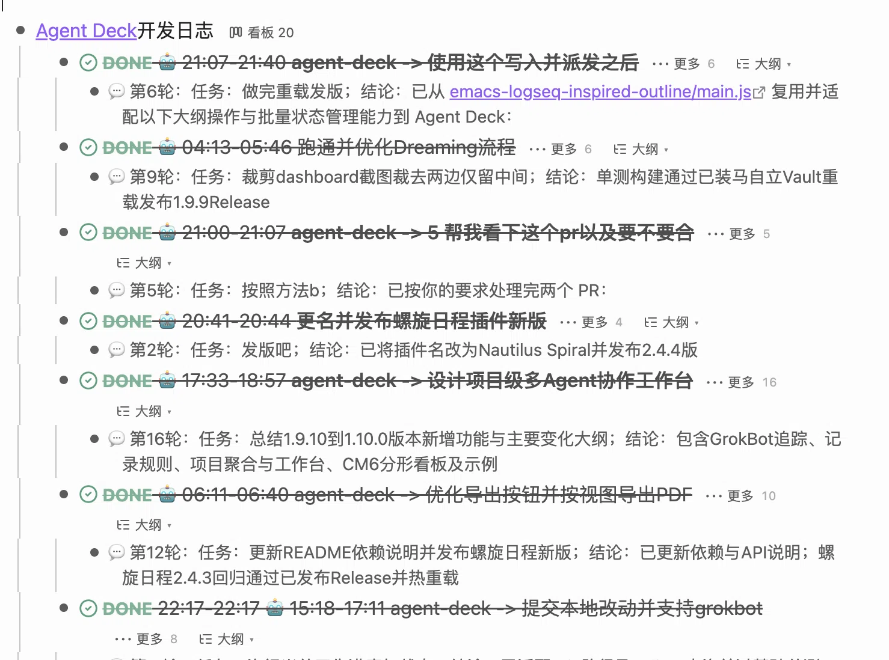
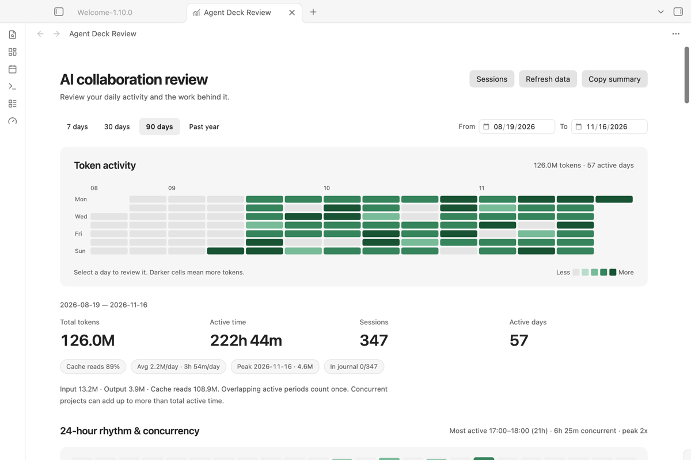
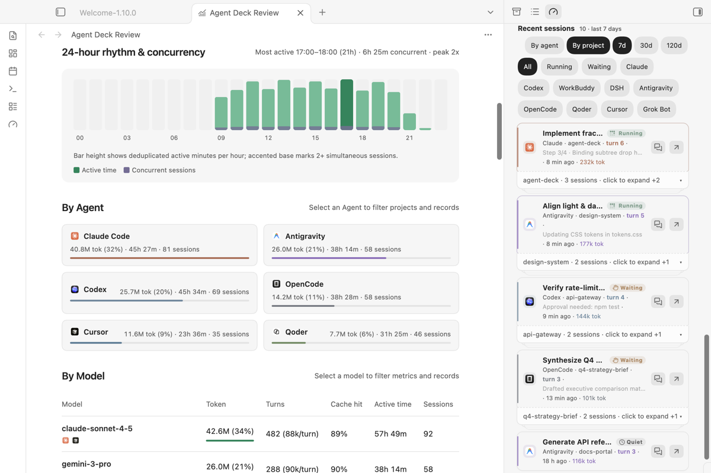

# Agent Deck

> Delegate AI work from your journal. Review daily token usage and project activity in a dashboard.

[中文](README.md) ｜ **English** ｜ [GitHub Releases](https://github.com/MatsuriMW/obsidian-agent-deck/releases) ｜ [Changelog](CHANGELOG.md) ｜ [Discord](https://discord.gg/hVPpAnChv7) ｜ [GitHub Discussions](https://github.com/MatsuriMW/obsidian-agent-deck/discussions)

This project is still early and evolving quickly. Some parts of the experience may be rough, and occasional updates may introduce breaking changes. Check the [Roadmap (Bilingual)](https://matsuri.site/portfolio/journal-workflow/#wishlist) to submit suggestions and vote on upcoming features, join the [Discord Community](https://discord.gg/hVPpAnChv7) or [GitHub Discussions](https://github.com/MatsuriMW/obsidian-agent-deck/discussions) to chat and share workflows, or open a [GitHub Issue](https://github.com/MatsuriMW/obsidian-agent-deck/issues) / email [klauschen2799@gmail.com](mailto:klauschen2799@gmail.com) to report bugs.

<p align="center">
  <a href="https://github.com/MatsuriMW/obsidian-agent-deck/releases/download/1.2.1/agent-deck-demo-4k60.mp4"></a>
</p>

<p align="center">25-second demo (Chinese captions) · click for the <a href="https://github.com/MatsuriMW/obsidian-agent-deck/releases/download/1.2.1/agent-deck-demo-4k60.mp4">4K60 version with sound</a></p>

Agent Deck brings AI agent sessions scattered across separate local clients onto one deck inside Obsidian: see at a glance which agent is running, which one is waiting for you, and how far each has progressed. Delegate work directly from any task line in your notes, and let progress, active time, and answers flow back into the same journal.

---

## Core Architecture & Information Flow

<p align="center">
  
</p>

---

## Core Features

### 0. Notes as context: memory store, dispatch drafts and skill cards

> Shared premise: **everything an agent generates or calls is Markdown**, so it goes back into the vault where you can read it, edit it, and have the edit take effect immediately.

- **Memory store (one file per memory)**: after `Memory: move long-term memory into the memory store`, each memory is its own note (frontmatter: `state / title / sources`), while the original note keeps your prose plus a generated index block. Three views coexist: a **Base table** (filter/sort/count), a **memory board** (three columns by state, drag to change) and **one-by-one review** (dropdown to confirm/reject).
- **Injection with provenance**: dispatch injects up to 5 matching memories (1200 chars) with `source [[journal/#^mem-…]]` so the agent can verify against the original; the extracted journal line gets a `⤴ [[memory/…]]` backlink. `Memory: health check` reports missing sources / unreviewed / duplicates / stale, and `re-anchor sources` fixes drifted line numbers from the quoted text.
- **Dispatch drafts, payload snapshots & complete context**: `Delegate: write a draft first` writes the full payload and links it back (`📝`); delegating then uses that draft. Each real dispatch also stores a snapshot (`📄`) with an `anchor` back to the task block, so nothing is truncated and everything is auditable. Dispatch reads unsaved editor buffers first and automatically packs ancestor context, `❓/✍️` Q&A history, matching memories, and linked notes; notes beyond the 3-snippet cap keep explicit file paths for on-demand reading, truncated long notes append a remaining heading TOC, missing anchors or unreadable targets show explicit warnings instead of silent skips, and `private: true` / excluded folders keep private notes out of outbound prompts and memory queries. Unreferenced payloads older than 30 days can be archived.
- **Goal → task.md → board**: `Plan: turn the current line into a task.md` splits the goal into steps with acceptance criteria and the result **opens as a board**; any note with a list can become a board via `Board: make this note a board file`, and dragging cards edits the Markdown.
- **Skill cards**: `Skills: refresh skill cards` maps local skills (`~/.dsh/skills`, `~/.claude/skills`, skillshare) into `技能/*.md` with the real `SKILL.md` path in frontmatter. Mention `[[技能/xxx]]` (or the short form) in a task and the path is handed to the agent; skill text never enters the prompt. Cards you edited are preserved on refresh.
- **Workbench**: `Workbench: refresh the overview` writes a single index note listing board files, memory stats and recent plans — index only, no copies.

### 1. Unified Multi-Agent Session Panel
- **Tracks 11 local agents**: **Claude Code, Codex, WorkBuddy, DeepSeek Harness, Antigravity, OpenCode, Qoder, Hermes Agent**, plus **QwenWork (千问办公)** (tracking only), **Cursor** (3.30.14+ Hooks, tracking only), and **Grok Bot** (Sand desktop client with per-bot selection, tracking only).
- **Project-first concurrency management**: The **Now** section groups active, waiting, and errored/limit-hit sessions by workspace project by default (switchable to **By status** — waiting / unclaimed / running / issues — or a flat **List**), showing participating agents, status badges, open-folder shortcut, Project Workbench launcher, and project-wide stop controls. **Recent Sessions** switches between `7 / 30 / 120` days and stacks either **By agent** or **By project**.
- **Live status, subagent hierarchy & quick jump**: Distinguishes running, waiting for reply, needs approval, hit limit, paused, errored, and finished sessions; subagent cards indent right below their parent session in **Recent Sessions**; click a session card to switch back to its client or terminal tab (or jump directly to the note line for pending handoff jobs).
- **Primary agents & global search**: Pin up to 2 primary agents for full history and cross-day catch-up (other enabled agents read sessions active today); search across all scanned local sessions by title, project, model, or content, and view a 14-day activity trend.

### 2. Task-Line Delegation & Drag-and-Drop Binding
- **Three ways to delegate**:
  - Click the paper-plane grip at the end of a task line (or double-click / `⌘`-click to pick the agent);
  - Drag a list item from your note onto an agent card in the sidebar;
  - Type `@` in a task line to pick an agent, then `/` for model and reasoning effort (e.g. `@codex/gpt-6.1-sol/high`).
- **Project-folder dispatch**: Register a project name → working folder under Delegation, and a `[[project]]` wikilink, the note's path, or a `Project -> title` prefix sends the task to that folder, outranking each agent's default folder. Switch folders in the delegate dialog or Project Workbench. Codex Desktop reuses or creates a project with the same name and groups the session under it instead of "no project" (experimental API; failures fall back to a plain thread). **Ordinary notes work too**: when a recognized project has no registered folder, the delegate dialog suggests it from recent sessions and one click remembers it; drag delegation just adds a one-time hint. If the task names a different project than the note path, the task wins and the dialog asks you to confirm; drag delegation falls back to the vault root with a hint instead of silently using the wrong project. Such dispatches write their result back to the note and stay out of the daily journal by default (toggle under Delegation → Project folders).
- **Pre-send preview, work modes & permission safety guards**: Preview the block and choose a work destination plus per-run permission or sandbox mode (`plan / auto / acceptEdits / manual` for Claude/Qoder; `read-only / workspace-write / danger-full-access` for Codex) before sending; delegating a sub-item carries its ancestor chain (excluding unrelated sibling branches), its child subtree, and excerpts from explicit `[[wikilinks]]`, and you can edit an AI reply block to delegate again. ACP permission modals support one-click **Allow and enable auto-approve**, while high-risk shell commands, sensitive credential paths, and writes outside the workspace still force interactive confirmation.
- **In-note Q&A loop & Reply Inbox**: When an agent ends a turn with a question, Agent Deck writes `❓ Round N: …` beneath the task and collects it in the non-modal **Reply Inbox** sidebar (without stealing editor focus); reply with quick-pick option chips, or write `✍️ Answer: …` directly in the note and trigger **Answer & Continue** to resume the same session.
- **Drag to bind**: Drop a session card onto an existing list item to bind it, or onto an empty line to create a new bound task. Regular bound sessions show a status pill. Background tasks show one progress row below the parent task with cancel/retry actions; it disappears when the answer is ready.

### 3. Project Workbench & In-Place Fractal Boards
- **Team presets, Steward Watch & Copilot planning**: Open the **Project Workbench** from the sidebar, command palette, or task menu to pick from five built-in team presets (Full-stack Dev, Debug & Refactor, Research & Docs, Deep Research, and Editorial Writing — automatically routing around disabled or hit-limit agents and remembering per-project preferences), decompose goals into editable subtask drafts via the configured organizer model or quick local split, write standard `- TODO ... @agent` Markdown (placed inside the active journal band with pre-assigned block IDs), and dispatch multiple agents concurrently after review. Optional **Steward Watch** alerts once and annotates the child card if a wave worker stalls without output for 15 minutes.
- **In-place Fractal Boards (Editing view)**: Any parent list item with 2 or more direct child tasks (status keywords, standard `[ ]` checkboxes, or `![[note#^blockId]]` mirrors) gets a `Board N` toggle right on its line:
  - **Dual column modes & recursive Zoom**: Switch between **By status** (`TODO / DOING / Wait / DONE`) and **By group** (direct child phases as columns, grandchild tasks as cards); click `↳` on any card with nested subtasks to zoom in with clickable breadcrumbs;
  - **Full in-board workflow**: Track completion progress, quick-add cards inline (`+ Card`), assign `@agent` per card, drag subtrees across columns or reorder cards (atomically rewriting standard Markdown without proprietary syntax). Single-card transcript, stop, and dispatch actions (including sibling board context via Harness) live in the right-click menu, so cards no longer carry a bottom-right button row; one-click Dispatch TODO stays in the board header. Card titles and conclusions render Markdown—bold, inline code, wikilinks and external links are clickable, while clicking plain title text still jumps to the outline.
  - **Compact height, pinning & bulk actions**: Each column shows about three normal cards (four when every card is short) and scrolls internally for the rest. Drop on a card's upper/lower half to insert before/after, or on empty column space to append. Pin a card via `📌` or pin selected cards in bulk; pinning only changes the projection order (stored in `data.json`, Markdown untouched). Card and column checkboxes support bulk status changes, pin/unpin, and deleting whole card subtrees (records and children included, with a second confirmation and editor undo); right-clicking with a multi-selection opens the same bulk actions. Mirror cards only participate in pinning—status changes and deletion go through the source note.
  - **Single-source mirror cards**: Reference tasks across notes via `- ![[note#^blockId]]` or `- [[note#^blockId]]` as dashed **Mirror** cards—status changes write back to the primary source note, while Dashboard analytics and Dreaming explicitly ignore mirror lines to prevent double counting.

Demo order: team draft → Markdown outline → grouped board. See the [release notes](CHANGELOG.md#演示素材与验证范围) for observed behavior and pending acceptance checks.

<p align="center">
  
</p>
<p align="center">
  
</p>

> **Interactive 1.10.0 Welcome Showcase**: On your first launch after installing or upgrading to **1.10.0**, Agent Deck automatically creates and opens `Agent Deck/Welcome-1.10.0.md` (`功能示例-1.10.0.md` in Chinese UI) — a safe simulated sandbox (no real sessions or analytics affected) demonstrating the Fractal Board (with Zoom & mirror jump) and all four AI record views side by side. Reopen anytime via Command Palette → `Open 1.10.0 feature showcase note`.

### 4. Human–AI Journal, Organization & Archiving
- **Auto-journaling & write-back**: Periodically matches or creates daily-note task lines for today's sessions and syncs status, `⏱` active spans, per-turn records (brief / standard / detailed), and nested child session / side-chat / subagent blocks. Newly generated top-level AI record titles default to bold Markdown (`**title**`) with project/bot prefixes, and can be customized under **Settings → Records → Journal & Archive → More settings → Record formatting rules** (title bolding, project/bot prefix, time range, max title length, and Grok Bot idle auto-DONE threshold). Background answers of up to 500 characters are written inline in full; longer answers return a link to a Markdown file under `Agent Deck/Answers/` containing the full question and answer with internal tracking metadata removed (no extra summary model called). Regular session conclusions default to 350 characters, with long addresses shortened to clickable labels. Each session only follows its recent activity: the first time a session or bot is hooked, just its latest 10 turns are backfilled, and afterwards only turns produced that day are tracked, so older history is never re-written (adjustable under **More settings → Rounds recorded on first sight**).
- **Keyword colours and icons**: every task keyword in the journal (`DOING` / `PAUSED` / `TOREVIEW` / `DONE` / `TODOFORAI` …) is coloured and carries its `tsq-ico` icon in both the editor and reading view, matching Logseq Style Tasks (TODOseq) one-to-one, including the icon animation when a keyword changes. AI auto-records stay unstruck even when `DONE`, while hand-written tasks keep their strikethrough. Toggle under **Records → Journal & Archive → Keyword colours and icons**; when TODOseq is installed, turn off both its "Format task keywords" and "Keyword icons" switches; Agent Deck yields to TODOseq per layer, so nothing renders twice.
- **Title protection & record folding**: Preserves manually edited AI task titles verbatim; shows only the latest AI conclusion by default while keeping history expandable; supports manual status locking; keeps internal tracking IDs hidden and removes them automatically on completion or archival.
- **Four persistent record views & view-aware export**: Switch any top-level AI record block in place between **Outline / Table / Cards / Timeline** (persisted per block without rewriting underlying Markdown), and export from the view menu's Export submenu as expanded view-aware PDF or standalone HTML, lossless Markdown (`.md`), structured JSON (`.json`), CSV (`.csv`), or clipboard snippets:

<p align="center">
  
</p>

- **Outline shortcuts & batch task status**: `⌥⌘↑` **Go to ancestor** (press repeatedly to climb; the cursor lands just before the trailing `^blockId`), `⌥⌘⇧↑` **Go to top-level ancestor**, `⌥⌘↓` **Group rows**, plus **Batch update task status…** from the command palette or the editor context menu (`Ctrl+Alt` replaces `⌥⌘` on Windows / Linux):
  - **Group rows is built to batch-merge AI auto-records**: **select any number of AI record blocks (children included) in the journal and one keystroke inserts an empty parent at their shallowest indent and demotes the whole selection beneath it — following Obsidian's `useTab` / `tabSize` and leaving the cursor on the new parent. The new parent immediately gets a `Board N` toggle, so you can flip to the in-place board and review that batch by status or group: the quickest way to audit a day of scattered agent runs.**
  - **Batch status changes**: drag-selected, cross-level and multi-cursor (`Cmd+Click`) selections are deduplicated to their shallowest root list items, so internal `💬` / `🔗` record lines and child items are never mis-edited; keyworded tasks, plain list items and `[ ]` / `[/]` / `[x]` / `[-]` checkboxes update in a single transaction (one undo step), and AI manual status locks / "resume automatic status" keep working.

<p align="center">
  
</p>

- **One-click tidy & archive**: **Tidy log** reorganizes the current daily note by template (in progress, to do, completed, framed by dividers). Only complete bounded sections are organized; outside notes stay unchanged. Notes without a complete frame receive empty sections; **Archive finished logs to…** moves completed AI blocks out of the journal into a target note grouped by date.
- **Nautilus Spiral compatibility**: Works alongside [Nautilus Spiral](https://github.com/MatsuriMW/nautilus-spiral) by letting Agent Deck handle AI note writes while Nautilus keeps scheduling and tracking displays (Agent Deck restores token display whenever Nautilus does not show tokens for the same session).

### 5. Review Dashboard (Experimental, On by Default)
- Displays a GitHub-style **daily token heatmap** and **24-hour rhythm & concurrency** chart (input, output, and cache reads; does not represent monetary cost, with no estimates when missing) with 7/30/90-day, 1-year, and custom date filters.
- Summarizes **By Agent** (with official Agent icons) and **By Model** (tokens, per-turn average, cache hit ratio) for linked filtering, and aggregates **Project activity** (sortable by tokens, active time, sessions, or name in ascending/descending order) from note links, titles, folders, keywords, and aliases; supports manual project overrides, per-day drill-down, and jumping back to the source journal block or session.
- Uses only locally tracked history; makes no extra model calls and never modifies your journal.

<p align="center">
  
</p>
<p align="center">
  
</p>

### 6. macOS Menu Bar Helper, Dreaming & Bilingual UI
- **Solid macOS menu bar panel**: An always-accessible icon (or customizable global shortcut **`⌃⌥⌘D`**) for checking today's metrics and active/waiting sessions from any app and jumping straight to them.
- **Dreaming long-term memory (optional, off by default)**: Distills long-term memories from the past 14 days of journals and delegated notes into editable Markdown with optional export/sync.
- **Automatic UI language**: Follows Obsidian's language setting (Chinese or English) without changing note contents or CLI prompts.
- **Credential protection & redacted diagnostics**: OpenAI-compatible API keys support `env:VAR_NAME` or `secret:KEY_NAME` (stored in a local secrets file outside your synced Vault) so plaintext keys never sync to iCloud/Git; use the **Export redacted diagnostics report** command to bundle CLI health, local status, and sanitized recent failures for troubleshooting.

---

## Supported Agents at a Glance

| Agent | Session Tracking | Background Delegation | Desktop Handoff | Terminal Interactive | Direct Session Jump |
|---|---|---|---|---|---|
| **Claude Code** | Yes | Yes (`claude`) | Yes (auto-opens after turn 1) | Yes | Yes (desktop / terminal tab) |
| **Codex** | Yes | Yes | Yes (via App Server after turn 1) | Yes | Yes (desktop / terminal tab) |
| **DeepSeek Harness** | Yes | Yes (`dsh acp`) | Opens app only | — | Focuses app & copies session ID |
| **Antigravity** | Yes | Yes (`agy acp`) | No | — | Focuses app & copies session ID |
| **OpenCode** | Yes | Yes (`opencode-cli acp`) | Auto-opens app after turn 1 (shared DB) | Yes | Manual selection in app |
| **Qoder** | Yes | Yes (`qodercli`) | Clipboard handoff to desktop | Yes (`qodercli`) | CLI resumes in terminal; desktop copies ID for manual pick |
| **Hermes Agent** | Yes (`$HERMES_HOME/state.db`) | Yes (`hermes-acp`) | No (no desktop GUI) | Yes (`hermes chat`) | Terminal resume (`hermes --resume`) & in-plugin transcript |
| **QwenWork (千问办公)** | Yes (2.x session store + legacy `projects` logs) | No (no non-interactive CLI/ACP endpoint) | No (tracking only) | — | Focuses app & copies session ID (full transcript in plugin) |
| **WorkBuddy** | Yes | No | Clipboard handoff to desktop | Yes (`codebuddy`) | Native WorkBuddy sessions & terminal resume (`codebuddy -r`) |
| **Cursor** | Yes (3.30.14+ Hooks + logs) | No | No (tracking only) | — | Opens app & copies session ID |
| **Grok Bot** | Yes (per-bot multi-select) | No | No (tracking only) | — | Focuses Grok Bot desktop app |

---

## Installation & Requirements

### 1. Installing the Plugin
Install directly from Obsidian Community Plugins, or download manually from GitHub Releases (current version **1.13.1**, requires Obsidian **1.4.0+** desktop):

1. Open **Settings → Community plugins → Browse** in Obsidian, search for **Agent Deck**, then install and enable it.
2. Or download `main.js`, `manifest.json`, and `styles.css` from [GitHub Releases](https://github.com/MatsuriMW/obsidian-agent-deck/releases), place them in `<your-vault>/.obsidian/plugins/agent-deck/`, and enable **Agent Deck** in **Settings → Community plugins**.

<details>
<summary>Building from source (developers only)</summary>

Requires Node.js and npm:

```bash
git clone https://github.com/MatsuriMW/obsidian-agent-deck.git
cd obsidian-agent-deck
npm install
npm run build
```

Copy the generated `main.js`, `manifest.json`, and `styles.css` into `<your-vault>/.obsidian/plugins/agent-deck/` (or run `npm run install:plugin -- <vault-path>`).

</details>

### 2. Runtime Dependencies (Prepare Only What You Use)

- **Tracking, binding & Review Dashboard only**: **No extra dependencies required.** The plugin reads local client logs directly (Cursor requires enabling Hooks in settings) and makes no network requests.
- **Delegation, auto-journaling, AI summaries/polishing & Dreaming**: Require the corresponding local agent CLI or desktop app to be installed and authenticated, or an OpenAI-compatible API for summarization/Dreaming:

| Feature / Agent | Required on Your Machine |
|---|---|
| **Claude Code** | Installed and authenticated `claude` CLI (`/login` or `~/.claude/settings.json` `env` auth; plus Claude desktop app for desktop continuation) |
| **Codex** | Installed and authenticated `codex` CLI and Codex desktop app (bundled CLI is supported) |
| **DeepSeek Harness** | ACP-capable `dsh` installation with valid model/provider credentials |
| **Antigravity** | Standalone **Antigravity CLI (`agy`)** with CLI login (installing the IDE alone is not enough) |
| **OpenCode** | OpenCode desktop app (bundles `opencode-cli`) or standalone `opencode` CLI with configured provider |
| **Qoder** | `qodercli` installed and logged in for background/terminal delegation; Qoder desktop app for desktop handoff |
| **Hermes Agent** | Installed `hermes-acp` / `hermes` CLI (auto-discovered across Homebrew, `uv`, nvm, `~/.local/bin`, etc.) for delegation; read-only `$HERMES_HOME/state.db` for tracking only |
| **QwenWork (千问办公)** | QwenWorkCN desktop app installed (`QwenWorkCN.app`); automatically reads the 2.x session store (`~/.qwenworkcn/.harness/*/qwenwork`) and legacy `~/.qwenworkcn/projects` logs (tracking only) |
| **WorkBuddy** | Chinese-edition WorkBuddy desktop app (`codebuddy` CLI separately if using terminal mode) |
| **Cursor** | Cursor Desktop **3.30.14+** with Cursor Hooks installed via **Settings → Sources & Scan → More settings** (tracking only) |
| **Grok Bot** | Grok Bot desktop app (Sand client) with bots selected in the Grok Bot card under **Settings → Records → Sources & Scan** (none selected by default; tracking only) |
| **Auto-journaling / AI summaries / Dreaming** | Any authenticated local CLI (`agy`, `claude`, `codex`, `qodercli`, `codebuddy`; DeepSeek runs through the `deepseek-ds` wrapper with its own config dir and a Keychain key, leaving the official `gemini` CLI untouched; `~/.claude/settings.json` `env` auth included) OR an **OpenAI-compatible API** (presets for DeepSeek, OpenAI, OpenRouter, Alibaba Cloud Qwen, local Ollama, or custom endpoints under **Records → Journal model**; Dreaming inherits by default and can override separately) |
| **macOS menu bar helper** | `swiftc` from Xcode Command Line Tools (`xcode-select --install`); can be disabled in settings if unused |

> **Notes**:
> - When Obsidian launches from the macOS GUI, its `PATH` may differ from your terminal. If a binary isn't found, set its full absolute path in plugin settings.
> - The **Check** button in Delegation settings only verifies executable paths and versions—it does **not** prove login status or model quota. Use **Test connection** in Records / Dreaming settings (or test in your terminal) to verify live responses.

---

## Current Limitations & Unsupported Features

1. **Platform Support**
   - **Desktop only**: Obsidian mobile is not supported.
   - **Windows unverified**: Developed and tested on macOS; Windows has not been verified yet. The menu bar helper is macOS-only, and terminal tab switching / several binary discovery paths currently rely on macOS tooling.
2. **No Generic Remote API Backend for Task Delegation**
   - Automatic task delegation launches local CLI or desktop processes; there is no generic remote API/SDK runner for delegating coding tasks (while auto-journaling, AI summaries, and Dreaming do support OpenAI-compatible APIs). The plugin does not install CLIs or sign users in automatically.
3. **Transcript Modal Remains Read-Only (Follow-Ups Available via Q&A & Task Menu)**
   - The transcript modal inside Obsidian is read-only (for inspecting, stopping the current turn, and archiving conversations); for in-app follow-up-capable ACP sessions (DeepSeek Harness, OpenCode, Antigravity), you can send follow-ups via the task menu's follow-up prompt or **Answer & Continue** in Q&A / Reply Inbox. Other sessions continue in their own desktop app or terminal.
4. **Per-Agent Boundaries**
   - **Cursor**: Supports **3.30.14+ desktop** Hooks-based read-only tracking only; no task delegation or terminal interaction, and legacy unhooked DB sessions are excluded.
   - **WorkBuddy**: Only the **Chinese edition** is supported; international **WorkBuddy AI** is not supported. Managed background execution is unavailable, and independent `codebuddy` CLI sessions cannot be imported into the WorkBuddy desktop app.
   - **Qoder**: `qodercli` sessions and the Qoder desktop database are separate—background tasks resume in terminal (`qodercli -r <id>`), and desktop mode uses clipboard handoff. Token counts are not estimated when omitted by the desktop format.
   - **Antigravity**: CLI sessions and original IDE sessions do not mix, archive detection is not guaranteed, and exported transcripts exclude tool outputs, internal reasoning, and attachments.
   - **DeepSeek Harness**: The desktop client is still evolving rapidly with limited stability, and deep links do not jump directly to a specific session. Sessions delegated through `dsh acp` carry only a cwd, not a workspace ID, so the client lists them under "Ungrouped"; a client restart/refresh is usually needed before they appear. The sidebar still groups them by cwd, and the transcript can be viewed inside the plugin.
   - **OpenCode**: CLI and desktop share local storage, but launching the desktop app still requires selecting the session manually.
   - **Hermes Agent**: No desktop GUI exists; Agent Deck reads `$HERMES_HOME/state.db` (and `profiles/*/state.db`) read-only (converting Unix seconds to ms and reporting exact `output_tokens`, `input_tokens + cache_write_tokens`, and `cache_read_tokens`), delegates in background via `hermes-acp` (supporting standard ACP `models` / `session/set_model` and serialized permission prompts), and launches/resumes interactive CLI sessions via `hermes chat` / `hermes --resume`.
   - **QwenWork (千问办公)**: Read-only tracking, daily summaries, and conversation viewing/archival come from the 2.x desktop session store (`~/.qwenworkcn/.harness/*/qwenwork`, SQLite) plus legacy `~/.qwenworkcn/projects` JSONL logs. The 2.x store carries per-turn tokens and model names; legacy logs that omit `usage` or report `"model": "unknown"` keep token counts at `0` and leave the model blank without estimation. Neither the desktop app nor `~/.qwenworkcn/bin/qwenwork` exposes a headless prompt or ACP endpoint for delegation or terminal launch.
   - **Grok Bot**: Supports Sand desktop read-only persistence tracking and per-bot multi-select filtering only; no task delegation or terminal interaction. Token/model metrics omitted by the cloud sandbox are shown as "Usage unavailable" without estimation; there is no client archive state, so idle conversations auto-mark `DONE` after the configured inactivity window (`120` min default).
5. **Terminal Delegation Verification**
   - Interactive terminal delegation is currently verified end-to-end only on **Tern** and **Herdr**. **Terminal.app, iTerm2, and Warp** are untested (Warp lacks a scripting interface and can only be brought forward).
6. **Upcoming Feature Direction**
   - Visual pre-dispatch context checklists, anchor drift detection with structural neighbor hints, standalone vault context tools for external agents, per-item shared memory publishing, full Windows verification, and additional agents & terminals (Kimi Code, ZCode, MiniMax Code, Muse, Pi, Ghostty / WezTerm / Kitty / Alacritty, etc.) are actively planned; see [Harness Roadmap](docs/specs/harness-roadmap.zh-CN.md) and the interactive [Roadmap](https://matsuri.site/portfolio/journal-workflow/#wishlist).

---

## Privacy & License

- **Local-first**: Session parsing, panel analytics, the Review Dashboard, and the macOS menu bar helper only read local files and send zero telemetry. Task text or journal excerpts are sent to your locally configured CLI model provider only when you run delegation, AI organization/summarization, or Dreaming.
- **License**: [Apache 2.0](LICENSE) (see also [NOTICE](NOTICE)).
- **More docs**: Full version history in [CHANGELOG.md](CHANGELOG.md); developer specs, architecture, and roadmap notes in [docs/](docs/).
- **Community & Feedback**: Join the [Discord Community](https://discord.gg/hVPpAnChv7) or [GitHub Discussions](https://github.com/MatsuriMW/obsidian-agent-deck/discussions), open a [GitHub Issue](https://github.com/MatsuriMW/obsidian-agent-deck/issues) to report bugs, or visit the [Roadmap](https://matsuri.site/portfolio/journal-workflow/#wishlist) to submit and vote on feature ideas.
- **Updates**: Follow [@Matsurimywaifu](https://x.com/Matsurimywaifu) on X/Twitter.
