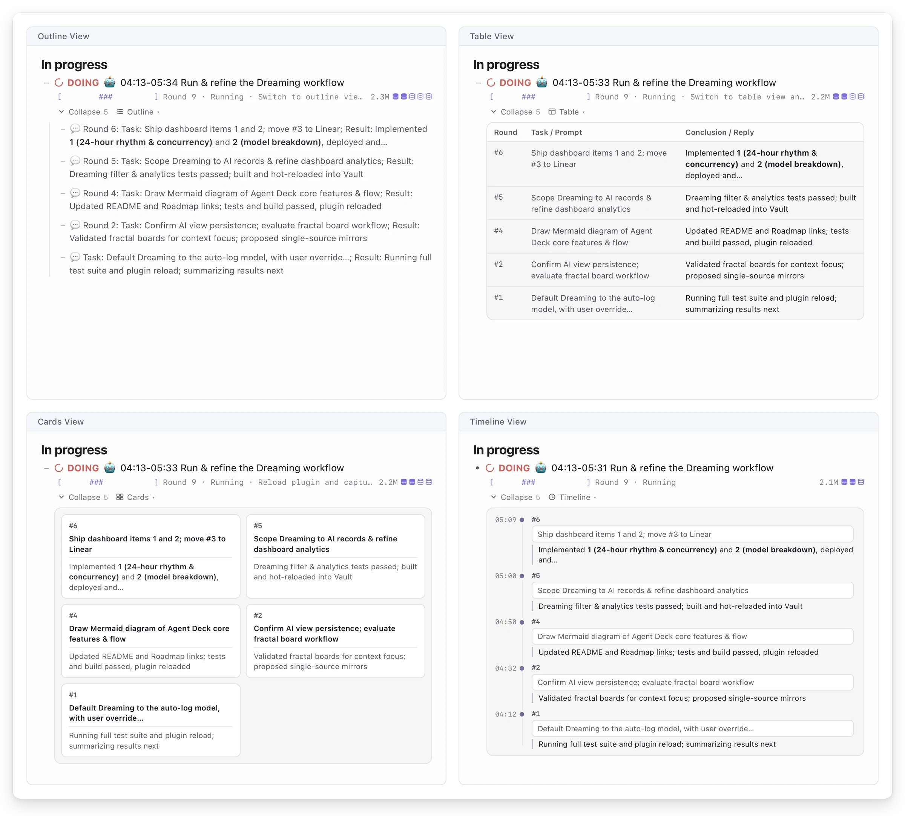
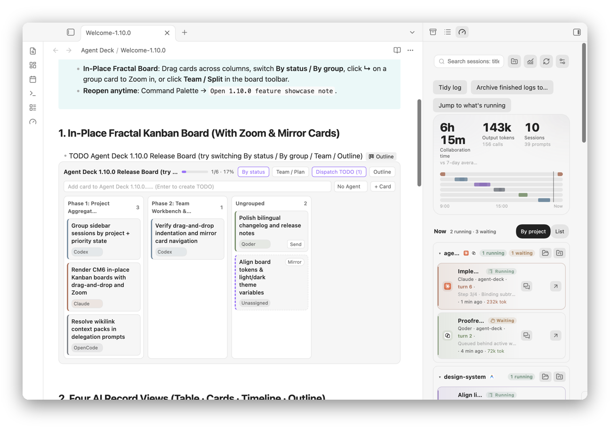
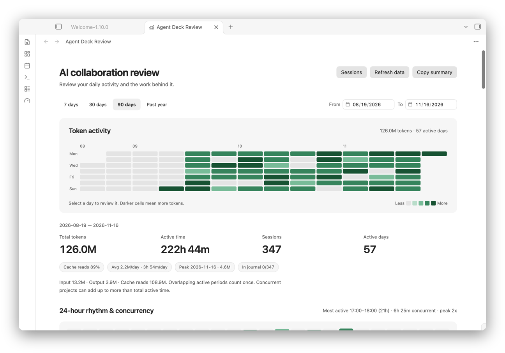

# Agent Deck

> **A multi-client AI control deck with Markdown, outlines and journals as the single source of truth — plus a closed-loop long-term memory system.**

**English** ｜ [中文](README.md) ｜ [Wiki](https://github.com/MatsuriMW/obsidian-agent-deck/wiki) ｜ [GitHub Releases](https://github.com/MatsuriMW/obsidian-agent-deck/releases) ｜ [Changelog](CHANGELOG.md) ｜ [Community](#community) ｜ [GitHub Discussions](https://github.com/MatsuriMW/obsidian-agent-deck/discussions)

Agent Deck is under active development. Browse the [Wiki](https://github.com/MatsuriMW/obsidian-agent-deck/wiki) for guides, see the [roadmap](https://matsuri.site/portfolio/journal-workflow/#wishlist) for what's coming next, or say hello in the [community](#community), on [GitHub Discussions](https://github.com/MatsuriMW/obsidian-agent-deck/discussions) or [GitHub Issues](https://github.com/MatsuriMW/obsidian-agent-deck/issues).

<p align="center">
  <a href="https://github.com/MatsuriMW/obsidian-agent-deck/releases/download/1.2.1/agent-deck-demo-4k60.mp4"></a>
</p>

<p align="center">25-second demo · click for the <a href="https://github.com/MatsuriMW/obsidian-agent-deck/releases/download/1.2.1/agent-deck-demo-4k60.mp4">4K60 version</a></p>

Agent Deck brings AI sessions scattered across local clients into Obsidian, keeping **Markdown, outlines, and daily journals as the single source of truth**:
- **Multi-client control deck**: see who is running, who is waiting and how far each task has gone; delegate straight from a task line in your journal or notes, write progress, duration, tokens and conclusions back in place, and flip between outline, table, cards, timeline and in-place fractal boards.
- **Broad mainstream model support**: works across **Claude, GPT / Codex, Gemini, DeepSeek, Qwen, MiniMax, Kimi, Doubao, Grok** and local Ollama via native clients, custom ACP CLIs, and OpenAI-compatible APIs — with unified cross-client usage and project effort analytics.
- **First-class Chinese Agent ecosystem tracking**: alongside global tools, Agent Deck ships dedicated local session tracking (and delegation where supported) for Chinese agent clients including **DeepSeek Harness, MiniMax Code (`mcode`), QwenWork (千问办公), Qoder, WorkBuddy (China edition), Kimi Code, and Doubao Work (豆包工作)**, with more on the way.
- **Closed-loop long-term memory**: session logs, dispatch snapshots, skill cards and **Dreaming long-term memories** all live as plain Markdown in your vault — editable, reviewable, traceable back to source lines, and automatically injected into future delegations.

## Contents

- [0. At a glance](#0-at-a-glance)
- [1. Multi-agent session tracking](#1-multi-agent-session-tracking)
- [2. Delegate from your notes](#2-delegate-from-your-notes)
- [3. Project workbench and in-place board](#3-project-workbench-and-in-place-board)
- [4. Journal, tidy and archive](#4-journal-tidy-and-archive)
- [5. Collaboration Dashboard & security replay](#5-collaboration-dashboard--security-replay)
- [6. Notes as context](#6-notes-as-context)
- [7. Menu bar, Dreaming & languages](#7-menu-bar-dreaming--languages)
- [Agent support, requirements & limits](#agent-support-requirements--limits)
- [Install](#install)
- [Community](#community)
- [Privacy and license](#privacy-and-license)

## Features

### 0. At a glance

Watch every agent in the sidebar, delegate from your notes, and flip one AI record between four views; the board and the dashboard then show the output.

<p align="center">
  
</p>
<p align="center"><b>Four record views</b>: switch per block without rewriting the underlying Markdown.</p>

<p align="center">
  
</p>
<p align="center"><b>In-place board</b>: the same Markdown toggles between outline and board; drag a card to change its status.</p>

<p align="center">
  
</p>
<p align="center"><b>Collaboration review</b>: how much you used each day, on which project, and which agent was busiest.</p>

### 1. Multi-agent session tracking

- **17 built-in local agents + Custom ACP Agents**: Claude Code, Codex, WorkBuddy, DeepSeek Harness, Antigravity, OpenCode, Qoder, Hermes Agent, MiniMax Code, QwenWork (千问办公), Cursor, Grok Bot, T3 Code, Muse, Kimi Code, Doubao Work (豆包工作), Gemini CLI, plus any ACP-compatible CLI you configure in Settings (such as Kiro, Mistral Vibe, etc.).
- **See Now by project**: the sidebar groups active sessions by workspace project; switch to a status view (waiting / unclaimed / running / error) or a flat list. Recent sessions can be filtered to 7 / 30 / 120 days and stacked by agent or project.
- **States at a glance**: running, waiting for a reply, needs confirmation, limit reached, paused, error and done; subagent sessions are indented under their parent, and clicking a card switches back to that client or terminal tab.
- **Primaries and search**: mark up to two agents as primary (full history; the rest only read today), and search every scanned session by title, project, model or body text.

### 2. Delegate from your notes

- **Three ways to delegate**: click the paper-plane at the end of the paragraph under the cursor (task line, `💬` write-back log or plain paragraph), drag a note item onto an agent card in the sidebar, or type `@` in the task line to pick an agent and `/` to pick a model and reasoning effort.
- **Preview before sending**: preview the body and child blocks, switch the project folder, and choose the work mode and permissions for this run; delegating from a subtask carries the parent chain and related note excerpts automatically.
- **Follow up in the note**: when an agent asks a question, a `❓` line appears under the task and lands in the sidebar Reply inbox; writing `✍️ Answer: …` by hand sends it back without leaving the note.
- **Bind by dragging**: drop a session card on a task line to bind it, or on an empty line to create a task; background jobs show one progress line under the parent block with cancel and retry.

### 3. Project workbench and in-place board

- **Squad presets**: five built-in squads (full-stack, debugging and refactoring, research and docs, deep report, long-form writing) that skip disabled or rate-limited agents; enter a goal and get an editable subtask draft, then run it across agents.
- **Steward check-in**: if a collaboration wave produces nothing new for 15 minutes, you get one reminder and the child card is updated.
- **In-place board**: any block with several direct children gets a "Board N" toggle on its line; open it to view that block as a board in the current note, split by status or by group, with card zoom, cross-column drag, bulk status changes and pinning. Interactive in Live Preview and rendered as a clean read-only preview in Reading View.
- **Mirror cards**: reference a task from another note with `![[Note#^block-id]]`; the board shows it as a mirror and status changes write back to the source note.

### 4. Journal, tidy and archive

- **Automatic journaling**: sessions are scanned through the day, matched to (or created as) journal task lines, and their status, active time and per-round records are kept in sync; pick brief, standard or detailed records, and long answers are saved as separate notes with a link.
- **Keyword colours**: task keywords such as `DOING` / `PAUSED` / `TOREVIEW` / `DONE` are coloured and iconified in both editing and reading views, matching Logseq Style Tasks.
- **Titles and folding**: AI titles you edited by hand are never overwritten, and older rounds stay folded so the latest conclusion stays visible.
- **Four views & combined task metrics**: switch one record between outline, table, cards and timeline (interactive in Live Preview, visible as a read-only preview in Reading View), then export the current view to PDF, HTML, Markdown, JSON or CSV. When multiple agents work on the same task, the line-end badge combines deduplicated duration, tokens and session count (hover for per-agent breakdown). Right-click any round in table, cards, timeline or reading view to pin it as a key record, or to hand that round out again to the default agent or a chosen model; right-clicking the paragraph under the cursor in the editor offers the same two delegation entries.
- **Tidy and archive**: reorganise the day into "doing / to do / done" in one command, or archive finished AI tasks by date into a note you choose.
- **Works with Nautilus Spiral**: pair it with [Nautilus Spiral](https://github.com/MatsuriMW/nautilus-spiral) so Agent Deck owns the AI writes while Spiral keeps its schedule and progress display.

### 5. Collaboration Dashboard & security replay

- **Daily token heatmap** plus **24-hour rhythm and concurrency**: 7 / 30 / 90 days, a year or a custom range; nothing is estimated when data is missing.
- **Agent and model distribution**: who used the most, cache hit rate, average per round.
- **Project & multi-session task effort**: sessions are attributed to projects from journal links and titles, correctable by hand, and can be drilled into by date back to the source journal or session; tasks spanning multiple sessions show combined tokens and deduplicated active time. No extra model calls.
- **Offline security replay & allowlist guardrails**: replay the last 7 or 30 days of historical tool calls into a redacted High / Medium / Low Markdown report (`Agent Deck/安全审计.md`); allowlist entries in the report frontmatter sync directly with live ACP permission guardrails.

### 6. Notes as context

> Everything here rests on one rule: whatever the AI produces or consumes is Markdown, so it lives back in your vault where you can read it, edit it, and see the change immediately.

- **Memory library (one note per memory)**: each memory is a Markdown file; browse it as a **Base table**, drag it across three states in the **memory board**, or review it one by one (confirm / reject).

<p align="center">
  
</p>

- **Memory that is used and traceable**: up to five relevant memories are injected when delegating, each with a link back to the journal, so the agent can check the source; the line a memory came from gets a backlink. The `Memory: health check` command lists entries with no source, pending confirmation or duplicates.
- **Dispatch drafts and full context**: `Delegate: write a draft (do not send)` writes the complete payload and attaches it to the task line so you can edit before sending; sending saves a snapshot for later review. The editor's unsaved content is read first, and the parent outline, Q&A, memories and linked notes are included automatically. Too many links keep a path instead of full text, failures are reported instead of skipped, and notes marked `private` are never sent out.
- **Goal → task.md → board**: `Plan: turn this line into task.md` splits one line into steps with acceptance criteria, and the resulting file becomes a board automatically; any note with a checklist can also become a board.
- **Skill cards**: `Skills: refresh skill cards` turns local skills into notes; write `[[Skills/xxx]]` in a task to hand that skill to the agent. Hand-edited cards keep their text when refreshed.
- **Workbench**: `Workbench: refresh overview` writes an index page with boards, memory stats and recent plans.

### 7. Menu bar, Dreaming & languages

- **macOS menu bar**: a menu bar icon and the global shortcut `⌃⌥⌘D` show today's numbers, running and waiting sessions, and jump straight to them; click the top-right **Pin** icon to float the panel on screen.
- **Dreaming long-term memory** (optional, off by default): distils editable long-term memories from the last 14 days of journals and delegations, with an exportable copy.
- **Multi-language UI & update reminders**: built-in Simplified Chinese, Traditional Chinese and English (plus custom locale packs), following Obsidian's language setting; gentle daily GitHub Releases update check with per-version skip.
- **Keys stay out of the vault**: API keys and custom ACP environment variables support `env:VAR` / `secret:KEY`, and `Export redacted diagnostics` produces a shareable report.

## Agent support, requirements & limits

Agent Deck supports **17 built-in local agents + any Custom ACP CLI**, covering mainstream model families (**Claude, GPT / Codex, Gemini, DeepSeek, Qwen, MiniMax, Kimi, Doubao, Grok**, plus local Ollama) with dedicated tracking for Chinese agent clients (**DeepSeek Harness, MiniMax Code, QwenWork, Qoder, WorkBuddy, Kimi Code, Doubao Work**).

For the full compatibility matrix, per-client requirements, and known limits, see the Wiki: 👉 [**Supported Agents & Models (Wiki)**](https://github.com/MatsuriMW/obsidian-agent-deck/wiki/Supported-Agents-and-Models)

## Install

1. In Obsidian, open Settings → Community plugins → Browse, search for **Agent Deck**, then install and enable it;
2. Or download the latest [GitHub Release](https://github.com/MatsuriMW/obsidian-agent-deck/releases), copy `main.js`, `manifest.json` and `styles.css` into `<your vault>/.obsidian/plugins/agent-deck/`, then enable it in the plugin settings.

Current version: **1.13.15**, requires Obsidian **1.4.0+** on desktop (mobile is not supported). Session tracking, task binding and the Dashboard need no extra dependencies; see the [Wiki](https://github.com/MatsuriMW/obsidian-agent-deck/wiki/Supported-Agents-and-Models) for full client and platform details.

## Community

Two groups — join whichever you like:

- **Discord** (permanent invite; never expires, unlimited uses): https://discord.gg/hVPpAnChv7
- **Xiaohongshu (小红书) group "agent deck 螺旋日程用户群"**: copy the whole block below and open the Xiaohongshu app (valid until December 17; the group is in Chinese):

  ```
  0【全部复制—打开🍠APP】 12月17日截止，"agent deck螺旋日程用户群"欢迎有缘人 CZ3798 :/#s🐂🥭😊😘😏🥒🥭🍟🍟😗🐱🍌
  ```

You can also ask in [GitHub Discussions](https://github.com/MatsuriMW/obsidian-agent-deck/discussions) and [GitHub Issues](https://github.com/MatsuriMW/obsidian-agent-deck/issues).

## Privacy and license

- **Local first**: session reading, panel statistics, the Dashboard and the menu bar only read local files and upload nothing. Only when you delegate, tidy, summarise or run Dreaming is the relevant text sent to a model service your local client is signed in to.
- **License**: [Apache 2.0](LICENSE), see [NOTICE](NOTICE).
- **More**: full changes in [CHANGELOG.md](CHANGELOG.md); developer docs in [docs/](docs/); updates on Twitter [@Matsurimywaifu](https://x.com/Matsurimywaifu).
