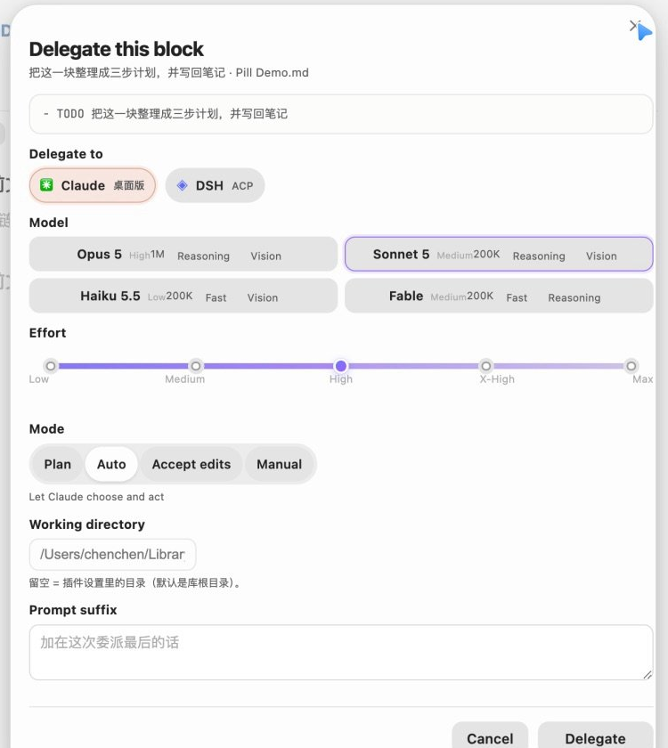

# Agent Deck（智能体甲板）

> Track every agent. Delegate from the line you are already looking at.

Agent Deck is an Obsidian plugin that reads the local session logs of **Claude Code, Codex, WorkBuddy and DeepSeek Harness**, shows what each agent is doing now, and lets you delegate a task block from the editor. The trigger button on the task line turns into the progress surface: the fill moves with the session, the label changes from **Delegate** to **Delegating**, and a cancel control appears next to it.

It is the AI/agent tracking half of [Nautilus Spiral](https://github.com/MatsuriMW/nautilus-spiral), extracted into a standalone plugin and extended with a second primary agent, DeepSeek Harness, model/effort/mode selection, and a layered model picker.


## What it does

- **A dashboard for the agents on this Mac.** Running, waiting and quiet sessions for Claude Code, Codex, WorkBuddy and DeepSeek Harness, with project, last step, elapsed time and tokens. Click a row to open that session in its client.
- **Two primary agents, full history.** Pick up to two agents as primaries. They are read in full (all history, cross-day catch-up); every other enabled agent is only read for sessions that moved today.
- **Delegation from the task line.** Put the cursor on a list item; a small **Delegate** pill appears at the end of the line. Click it to delegate with the current defaults, or click the chevron for model, effort, permission mode and working directory.
- **Progress lives inside the button.** While the job runs the pill fills and shows the elapsed clock; the `×` cancels it. When the agent answers, the pill becomes **Done** and the result is written under the task as one `💬` line.
- **Note-native records.** Delegation writes a `🔗` line under the task and changes the status to `DELEGATED`; the line is the source of truth. Delete the `🔗` line to unbind.
- **Layered model settings.** A global default model, a default effort slider, capability tags, search/filter, enable switches, pinned order, per-row menu, and task models. Changes sit in an **Unsaved changes** bar until you save them.
- **Local only.** Everything is read from `~/.claude`, `~/.codex`, `~/.workbuddy` and `~/.dsh`. Nothing is uploaded. The plugin stores its own aggregate in `usage.json` next to the plugin, so history survives log rotation.
- **The agent summary lives in the macOS menu bar.** Obsidian's bottom-right status bar no longer carries the agent session summary. A small status item shows an icon plus something like `2 跑 · 1 等`; click it for a detailed popover with session rows you can jump from.


## macOS menu bar

The menu bar item is a tiny SwiftUI helper app compiled on first use. It is not a second copy of the dashboard: it is the quick "what is running / what needs me" surface.

- **Primary agents** (up to two) contribute more rows: all live sessions plus recent sessions from the last six hours, up to six per primary by default.
- **Other agents** contribute only sessions that are currently running, up to three per agent by default.
- The header shows all enabled agents as chips, with running and waiting counts, including agents that have no row at the moment.
- Clicking a row opens the same deeplink as the dashboard. DeepSeek Harness focuses the client and copies the session id; Codex copies `codex resume <id>`.
- **打开面板** opens the Obsidian dashboard via `obsidian://agent-deck`; **重新扫描** triggers a scan; **隐藏** disables the menu bar from inside the popover.

The first start needs `swiftc` (Xcode Command Line Tools). The plugin compiles `~/.agent-deck/AgentDeckMenuBar.app`, then launches it. It exits when Obsidian exits. The source is included in the plugin bundle, so no separate download is needed. If the menu bar does not appear, open **追踪 → 重启菜单栏** or install the command line tools with `xcode-select --install`.


## Delegate targets

### Claude Code

Agent Deck starts a headless Claude Code session with:

- `--model` (Opus 5, Sonnet 5, Haiku 5.5, Fable, or a custom alias)
- `--effort` (low, medium, high, xhigh, max)
- `--permission-mode` (`plan`, `auto`, `acceptEdits`, `manual`)
- `-n` for the session name, `--add-dir` for the vault

The first turn runs in the background. The session can then be reopened in the Claude desktop app with `claude://resume?session=<id>`.

If Claude Code has never trusted the vault, the plugin reads `~/.claude.json` and starts in a directory that Claude already trusts, adding the vault with `--add-dir`. This behaviour can be turned off in **委派 → 库没被信任时自动换个目录**.

### DeepSeek Harness

Agent Deck speaks ACP (Agent Client Protocol) to `dsh acp`. It creates a real Harness session, selects the model and `reasoning_effort`, sends the prompt, and follows the `session/update` stream. The session is persisted in `~/.dsh/sessions`, so it also appears in the dashboard afterwards.

ACP does not expose Claude-style plan/auto permission modes. Instead the plugin can auto-approve one-shot tool permissions, or reject them and notify you.

### Codex and WorkBuddy

Codex and WorkBuddy are tracked read-only. Codex has no session URL, so the dashboard copies `codex resume <id>`. WorkBuddy opens with `workbuddy://chat/<id>`.

## Deep links

| Agent | Link | State |
|---|---|---|
| Claude Code | `claude://resume?session=<id>` | Works |
| WorkBuddy | `workbuddy://chat/<id>` | Works |
| DeepSeek Harness | `dsh://open` | Opens the client; the desktop build does not expose a per-session URL yet. Agent Deck copies the session id to the clipboard so you can find it in the sidebar. |
| Codex | none | Copies `codex resume <id>` |

## The progress button


The pill is a CodeMirror widget. It only lives in the editor, not in the note, and it has five states:

1. **Delegate** (dashed border), with the current model name.
2. **Starting**, while the session is being created.
3. **Delegating**, with a liquid fill, elapsed time and `×`.
4. **Waiting / needs approval**, with a slow glow.
5. **Done** or **Error**, with an open/retry control.

Clicking the chevron opens the options sheet:



## Installation

This plugin is not in the community store yet. Install it manually:

1. Download or clone this repository.
2. Copy `main.js`, `manifest.json` and `styles.css` into `<vault>/.obsidian/plugins/agent-deck/`.
3. Enable **Agent Deck** in **Settings → Community plugins**.

To build from source:

```bash
git clone https://github.com/MatsuriMW/obsidian-agent-deck.git
cd obsidian-agent-deck
npm install
npm run build
```

`npm run build` writes `main.js` with esbuild. The only runtime dependency is `fzstd`, used to read DeepSeek Harness's zstd-compressed session logs.

## Settings

- **Agents**: enable each agent, pick up to two primaries, scan now, import Nautilus Spiral history.
- **委派**: default target, models, effort, permission mode, working directory, prompt prefix/suffix, write-back rules, trust fallback.
- **Models**: the layered picker shown above.
- **追踪**: day cutoff, polling interval, idle threshold, history depth, macOS menu bar toggle and row limits, UI switches, rebuild, import, and a one-click **pause Nautilus Spiral's AI tracking** action.
- **关于**: version, license and debug info.

## Compatibility with Nautilus Spiral

Agent Deck understands the same `🔗` line as Nautilus Spiral. If both plugins are on, Nautilus will also see the Claude sessions and may rewrite `DELEGATED` to `TOREVIEW`.

Agent Deck hides Nautilus's 🤖 agent status item automatically (the planner's own status bar and timer stay). Use **追踪 → 停用螺旋日程里的 AI 追踪** to also turn off its AI panel, automatic journal logging, status writing and `💬` writing while keeping the planner. The Nautilus settings are backed up first. The 🤖 toggle can be reversed from the same page.

## Privacy

- Session logs are read locally with Node's `fs`.
- No network requests are made by the tracking code.
- Delegation starts local CLI processes (`claude`, `dsh`) owned by the user.
- `usage.json` stores only aggregate per-day numbers and session summaries, not full conversations.
- The menu bar helper reads `~/.agent-deck/menubar.json` and makes no network requests.

## Credits

- Extracted from [Nautilus Spiral](https://github.com/MatsuriMW/nautilus-spiral), which remains the planner.
- The progress-in-trigger-button interaction is inspired by [@ZZ.X's note “AI 任务进度，长在触发按钮里”](https://xhslink.cn/o/3gmyiCARRj2).
- The layered model settings page is inspired by [@ZZ.X's note “AI 产品模型设置”](https://xhslink.cn/o/AwW7VhnzX6m).

## License

MIT. See [LICENSE](LICENSE).
