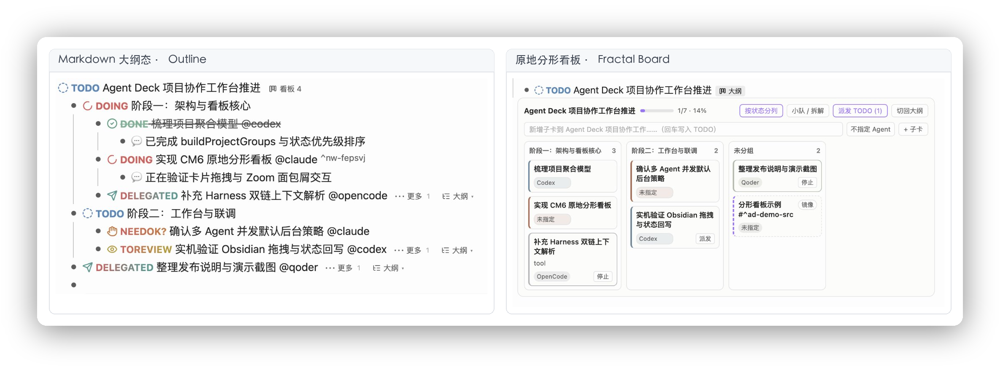
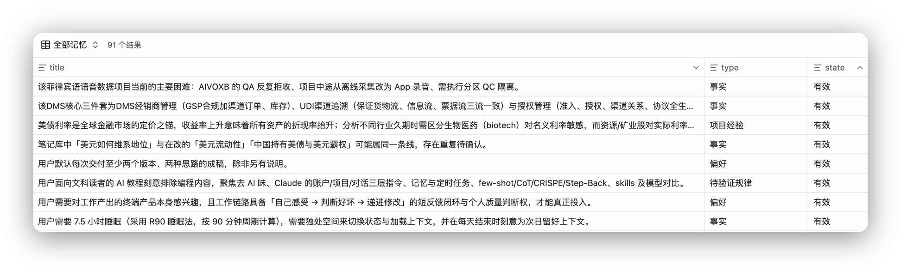

# Agent Deck（智能体甲板）

> **以 Markdown / 大纲 / 日记为正本的多客户端 AI 总控台 + 长期记忆闭环。**

**中文** ｜ [English](README.en.md) ｜ [Wiki 文档](https://github.com/MatsuriMW/obsidian-agent-deck/wiki) ｜ [GitHub Releases](https://github.com/MatsuriMW/obsidian-agent-deck/releases) ｜ [更新日志](CHANGELOG.md) ｜ [用户群](#用户群) ｜ [GitHub Discussions](https://github.com/MatsuriMW/obsidian-agent-deck/discussions)

项目仍在快速迭代，欢迎在 [Roadmap](https://matsuri.site/portfolio/journal-workflow/#wishlist) 看后续规划并投票，或到 [Wiki 文档](https://github.com/MatsuriMW/obsidian-agent-deck/wiki) 查阅详细指南，也可以在 [用户群](#用户群)、[GitHub Discussions](https://github.com/MatsuriMW/obsidian-agent-deck/discussions)、[GitHub Issues](https://github.com/MatsuriMW/obsidian-agent-deck/issues) 反馈问题。

<p align="center">
  <a href="https://github.com/MatsuriMW/obsidian-agent-deck/releases/download/1.2.1/agent-deck-demo-4k60.mp4"></a>
</p>

<p align="center">25 秒演示 · 点图看 <a href="https://github.com/MatsuriMW/obsidian-agent-deck/releases/download/1.2.1/agent-deck-demo-4k60.mp4">4K60 有声版</a> ｜ 国内可看：<a href="https://matsuri.site/demo/agent-deck/">matsuri.site/demo/agent-deck</a></p>

Agent Deck 把散落在各个客户端的 AI 会话收拢到 Obsidian，让 **Markdown、大纲和日记成为唯一正本**：
- **多客户端总控台**：集中看住本机正在跑、等你回复或已完成的 AI 会话；直接从日记或笔记的任务行派活，进度、用时、Token 与结论自动写回原处，并原地切换大纲 / 表格 / 卡片 / 时间线 / 分形看板。
- **主流模型全覆盖**：通过本地客户端、自定义 ACP CLI 及 OpenAI 兼容接口，全面支持 **Claude、GPT / Codex、Gemini、DeepSeek、Qwen（千问）、MiniMax、Kimi、豆包、Grok** 等主流模型及本地 Ollama，汇总跨客户端用量与项目投入。
- **深度适配中文 Agent 客户端**：除国际主流工具外，特别为中文开发者和办公场景常见的一系列 Agent 客户端实现了本地追踪（及部分委派/续聊），涵盖 **DeepSeek Harness、MiniMax Code（`mcode`）、千问办公（QwenWork）、Qoder、WorkBuddy（中国版）、Kimi Code、豆包工作**，并持续扩展中。
- **长期记忆闭环**：AI 产出的记录、派发快照、技能卡与 **Dreaming 长期记忆**全部以普通 Markdown 落回笔记库，可编辑、可审阅、可溯源，下次派活自动按相关度注入，形成「干活 → 记日记 → 提炼记忆 → 反哺下次派发」的闭环。

## 目录

- [0. 一眼看懂](#0-一眼看懂)
- [1. 多 Agent 会话追踪面板](#1-多-agent-会话追踪面板)
- [2. 从笔记委派任务](#2-从笔记委派任务)
- [3. 项目协作工作台与分形看板](#3-项目协作工作台与分形看板)
- [4. 人机共写日记、整理与归档](#4-人机共写日记整理与归档)
- [5. 协作回顾 Dashboard 与安全回放](#5-协作回顾-dashboard-与安全回放)
- [6. 笔记即上下文](#6-笔记即上下文)
- [7. 菜单栏、Dreaming 与多语言界面](#7-菜单栏dreaming-与多语言界面)
- [支持的 Agent、依赖与边界](#支持的-agent依赖与边界)
- [安装](#安装)
- [用户群](#用户群)
- [隐私与开源协议](#隐私与开源协议)

## 核心功能

### 0. 一眼看懂

侧栏看住所有 Agent，笔记里派活；同一条 AI 记录还能切四种视图看，最后用看板和仪表盘回顾产出。

<p align="center">
  
</p>
<p align="center"><b>四种记录视图</b>：同一条记录随块切换，不用改写底层 Markdown。</p>

<p align="center">
  
</p>
<p align="center"><b>原地分形看板</b>：同一份 Markdown，大纲和看板随时切换，拖动卡片就改状态。</p>

<p align="center">
  
</p>
<p align="center"><b>协作回顾 Dashboard</b>：每天用了多少、花在哪个项目、哪个 Agent 最忙。</p>

### 1. 多 Agent 会话追踪面板

- **统一收拢 17 类内置 Agent + 自定义 ACP Agent**：Claude Code、Codex、WorkBuddy、DeepSeek Harness、Antigravity、OpenCode、Qoder、Hermes Agent、MiniMax Code、千问办公（QwenWork）、Cursor、Grok Bot、T3 Code、Muse、Kimi Code、豆包工作、Gemini CLI，以及在设置里自行添加的任意兼容 ACP 协议的 CLI（如 Kiro、Mistral Vibe 等）。
- **按项目看现在**：侧栏「现在」默认按工作区项目收拢活跃会话，也可以按状态（等你 / 待认领 / 在跑 / 异常）或直接平铺成列表；「最近的会话」支持 7 / 30 / 120 天切换，并按 Agent 或项目叠放。
- **状态一眼可见**：区分运行中、等待回复、需要确认、到达限额、暂停、出错与已完成；子代理会话缩进跟在母会话下面，点卡片即可切回对应客户端或终端标签。
- **主力与搜索**：最多设两个主力 Agent（读全部历史，其余只读当天），也可以按标题、项目、模型或正文搜索所有本地会话。

### 2. 从笔记委派任务

- **三种派活方式**：点光标所在那一段末尾的纸飞机（任务行、`💬` 回传日志、普通段落都算），把笔记列表项拖到侧栏的 Agent 卡片上，或直接在任务行里输入 `@` 选 Agent、再输入 `/` 选模型和推理强度。
- **发送前看得见**：可预览正文与子块、切换项目目录、选择这一次的工作模式和权限；从子任务派发时会自动带上母项链与相关笔记摘录。
- **任务里能对话**：Agent 在结尾提问时，任务下方会多出一行 `❓`，并收进侧栏「回复信箱」；在笔记里手写 `✍️ 答：…` 也能直接发回去，不必回客户端翻记录。
- **拖拽绑定**：会话卡片拖到任务行即绑定，拖到空白行即新建任务；后台任务在母块下显示一条进度，可随时取消或重试。

### 3. 项目协作工作台与分形看板

- **小队预设**：内置全栈开发、排错重构、调研与文档、深度研报、深度写作五套小队，自动避开已禁用或撞限额的 Agent；输入目标即可拆成可编辑的子任务草案，确认后多 Agent 并发。
- **管家中途看护**：协作波次超过 15 分钟没有新输出时提醒一次，并把情况写回子卡。
- **原地看板**：任意有多个直接子任务的块，行尾会出现「看板 N」，点一下就在当前笔记里变成看板，支持按状态分列或按子组分列、卡片下钻、跨列拖拽、批量改状态与置顶；实时预览下可完整交互，阅读视图下可只读预览。
- **镜像卡**：用 `![[笔记#^块号]]` 引用别的笔记里的任务，看板里显示为镜像，改状态直接回写原笔记。

### 4. 人机共写日记、整理与归档

- **自动记日记**：定时扫描当天会话，自动匹配或新建日记任务行，同步状态、活动时段和每轮记录；简略、标准、详细三档可选，长篇回答会保存成独立文件并留下链接。
- **关键词配色**：`DOING` / `PAUSED` / `TOREVIEW` / `DONE` 等任务关键词在编辑器和阅读视图里按 Logseq 风格上色带图标，与 Logseq Style Tasks 一致。
- **标题与折叠**：你手改过的 AI 标题不会被覆盖；历史轮次默认收起，只留最新结论。
- **四种视图与多会话指标**：同一条记录可在大纲、表格、卡片、时间线之间切换（实时预览下交互、阅读视图下可只读预览），并能按当前视图导出 PDF、HTML、Markdown、JSON 或 CSV。多个 AI 协作同一任务时，行尾自动汇总合计时长、总 Token 与会话数（悬停看各家占比）。表格／卡片／时间线／阅读视图里右键某一轮，可以把它 Pin 成关键记录，也可以原地把这一轮再派给默认 Agent 或指定模型；编辑器里光标所在那一段右键同样有委派与选模型两项。
- **整理与归档**：一键把当天日记整理成「正在做 / 还要做 / 已完成」，或把已完成的 AI 任务按日期归档到指定笔记。
- **与螺旋日程共存**：可搭配 [螺旋日程 Nautilus Spiral](https://github.com/MatsuriMW/nautilus-spiral) 使用，由 Agent Deck 接管 AI 写入，螺旋保留排程与进度展示。

### 5. 协作回顾 Dashboard 与安全回放

- **每日 Token 热力图**与 **24 小时作息、并发分布**：按 7 / 30 / 90 天、一年或自定义范围查看，无数据时不估算。
- **Agent 与模型分布**：看谁用得最多、缓存命中多少、平均每轮多少。
- **项目与跨会话任务投入**：结合日记链接与标题自动归到项目，可手动修正，按日期下钻回来源日记或原会话；跨多个会话推进的同一任务单独汇总去重活跃耗时与总 Token。全程不调用额外模型。
- **离线安全回放与护栏白名单**：一键回放近 7 / 30 天历史工具调用，按「高危 / 中危 / 低危」分组输出脱敏 Markdown 报告（`Agent Deck/安全审计.md`），在报告 frontmatter 里维护白名单并自动同步到实时 ACP 权限护栏。

### 6. 笔记即上下文

> 这一组能力的共同前提：AI 生成或调用的一切都是 Markdown，所以都放回库里，你能直接读、直接改，改完立刻生效。

- **记忆库（一文一条）**：每条记忆是一个 Markdown 文件，可以用 **Base 表格**筛选排序、用**记忆看板**三列拖拽，或**逐条审阅**（确认 / 拒绝）。

<p align="center">
  
</p>

- **记忆会用、也能溯源**：派发时按相关度注入最多 5 条记忆，每条附回原日记的链接，Agent 可以回原文核对；被提炼的那一行会得到反向回链；命令 `记忆：体检` 会汇总无来源、待确认与重复条目。
- **派发草稿与完整上下文**：命令 `委派：先生成草稿（不发送）` 会把这一趟要发的内容完整写出来并挂回任务行，你改完再发；真正派发时另存一份快照，事后可核对。派发时优先读编辑器里未保存的最新内容，并自动拼入上层大纲、问答、记忆与关联笔记；关联笔记太多时只保留路径供按需阅读，读取失败会明确提示。标了 `private` 的笔记不会随派发外发。
- **目标 → task.md → 看板**：命令 `规划：把当前这一条拆成 task.md` 把一行目标拆成带验收标准的步骤，产出文件自动成为看板文件；任何有清单的笔记也都能一键设为看板。
- **技能卡**：命令 `技能：刷新技能卡` 把本机 Skill 映射成笔记，派发时在任务里写 `[[技能/xxx]]` 即可把该技能交给 Agent；你手改过的卡片刷新时保留正文。
- **工作台**：命令 `工作台：刷新总览` 生成一页索引，列出看板、记忆统计和最近规划。

### 7. 菜单栏、Dreaming 与多语言界面

- **macOS 菜单栏助手**：常驻菜单栏，点一下或按全局快捷键 `⌃⌥⌘D` 随时看今日指标、运行中与待确认会话并直接跳转；右上角支持**一键置顶 Pin**，让面板常驻屏幕浮窗。
- **Dreaming 长期记忆**（可选，默认关闭）：基于最近 14 天的日记与委派记录提炼可编辑的长期记忆，可以导出副本或按需同步。
- **多语言与版本提醒**：内置简体中文、繁体中文与英文界面（支持自定义语言包），跟随 Obsidian 语言自动切换；提供温和的 GitHub Releases 更新检查与单版本跳过。
- **密钥不进笔记库**：填 API Key 或自定义 ACP 环境变量时支持 `env:VAR` / `secret:KEY`；命令面板提供「导出脱敏诊断报告」，方便排查问题。

## 支持的 Agent、依赖与边界

Agent Deck 内置支持 **17 家本地 Agent + 任意自定义 ACP CLI**，覆盖 **Claude、GPT / Codex、Gemini、DeepSeek、Qwen（千问）、MiniMax、Kimi、豆包、Grok** 及本地 Ollama 等主流模型，并特别针对中文 Agent 客户端生态（DeepSeek Harness、MiniMax Code、千问办公 QwenWork、Qoder、WorkBuddy、Kimi Code、豆包工作）做了追踪与适配。

想深入了解各 Agent 的支持矩阵、按需安装依赖及已知边界，请直接查阅 Wiki：👉 [**支持的 Agent 与主流模型（Wiki）**](https://github.com/MatsuriMW/obsidian-agent-deck/wiki/Supported-Agents-and-Models)

## 安装

1. 打开 Obsidian「设置 → 第三方插件 → 社区插件市场 → 浏览」，搜索 **Agent Deck**，安装并启用；
2. 或在 [GitHub Releases](https://github.com/MatsuriMW/obsidian-agent-deck/releases) 下载最新版，把 `main.js`、`manifest.json`、`styles.css` 放进 `<你的库>/.obsidian/plugins/agent-deck/`，再到插件设置里启用。

当前版本 **1.13.15**，需要 Obsidian **1.4.0+** 桌面端（不支持移动端）；仅使用会话追踪、任务绑定与 Dashboard 时无需额外依赖，更多平台与客户端细节见 [Wiki](https://github.com/MatsuriMW/obsidian-agent-deck/wiki/Supported-Agents-and-Models)。

## 用户群

两个群，喜欢哪个加哪个：

- **Discord**（永久邀请，不过期、不限次数）：https://discord.gg/hVPpAnChv7
- **小红书「agent deck 螺旋日程用户群」**：复制下面整段，打开小红书 App 就能加入（12 月 17 日截止）：

  ```
  0【全部复制—打开🍠APP】 12月17日截止，"agent deck螺旋日程用户群"欢迎有缘人 CZ3798 :/#s🐂🥭😊😘😏🥒🥭🍟🍟😗🐱🍌
  ```

也可以继续在 [GitHub Discussions](https://github.com/MatsuriMW/obsidian-agent-deck/discussions) 和 [GitHub Issues](https://github.com/MatsuriMW/obsidian-agent-deck/issues) 提问。

## 隐私与开源协议

- **本地优先**：会话读取、面板统计、Dashboard 与菜单栏都只读本机文件，不上传数据；只有你主动委派、自动整理、AI 总结或 Dreaming 时，对应文本才会发给本机已登录的模型服务。
- **开源协议**：[Apache 2.0](LICENSE)，见 [NOTICE](NOTICE)。
- **更多**：完整改动见 [CHANGELOG.md](CHANGELOG.md)；开发者文档见 [docs/](docs/)；动态见 Twitter [@Matsurimywaifu](https://x.com/Matsurimywaifu)。
