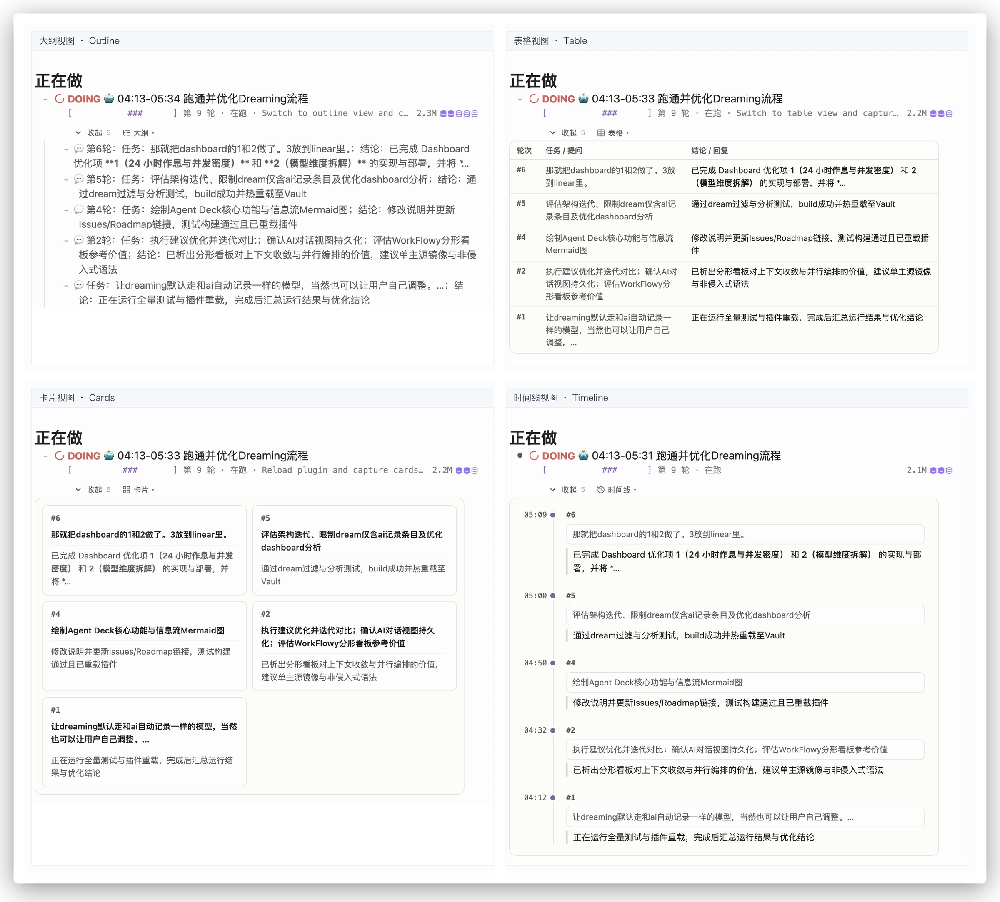
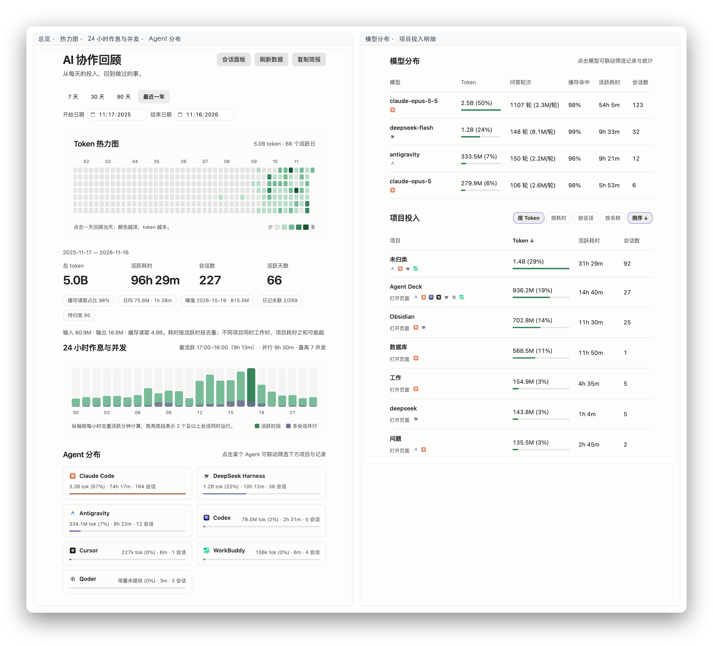

# Agent Deck（智能体甲板）

> 在 Obsidian 里看住、指挥并回顾本机的 AI Agent。

**中文** ｜ [English](README.en.md) ｜ [GitHub Releases](https://github.com/MatsuriMW/obsidian-agent-deck/releases) ｜ [更新日志](CHANGELOG.md) ｜ [用户群](#用户群) ｜ [GitHub Discussions](https://github.com/MatsuriMW/obsidian-agent-deck/discussions)

项目仍在快速迭代，欢迎在 [Roadmap](https://matsuri.site/portfolio/journal-workflow/#wishlist) 看后续规划并投票，或到 [用户群](#用户群)、[GitHub Discussions](https://github.com/MatsuriMW/obsidian-agent-deck/discussions)、[GitHub Issues](https://github.com/MatsuriMW/obsidian-agent-deck/issues) 反馈问题。

<p align="center">
  <a href="https://github.com/MatsuriMW/obsidian-agent-deck/releases/download/1.2.1/agent-deck-demo-4k60.mp4"></a>
</p>

<p align="center">25 秒演示 · 点图看 <a href="https://github.com/MatsuriMW/obsidian-agent-deck/releases/download/1.2.1/agent-deck-demo-4k60.mp4">4K60 有声版</a> ｜ 国内可看：<a href="https://matsuri.site/demo/agent-deck/">matsuri.site/demo/agent-deck</a></p>

Agent Deck 把散落在各个客户端的 AI 会话集中到 Obsidian：哪个 Agent 在跑、哪个在等你、做到哪一步，一眼看清；要派活时直接从日记或笔记的任务行发出去，进度、用时和结论再自动写回这一行。

## 目录

- [0. 一眼看懂](#0-一眼看懂)
- [1. 多 Agent 会话追踪面板](#1-多-agent-会话追踪面板)
- [2. 从笔记委派任务](#2-从笔记委派任务)
- [3. 项目协作工作台与分形看板](#3-项目协作工作台与分形看板)
- [4. 人机共写日记、整理与归档](#4-人机共写日记整理与归档)
- [5. 协作回顾 Dashboard](#5-协作回顾-dashboard)
- [6. 笔记即上下文](#6-笔记即上下文)
- [7. 菜单栏、Dreaming 与双语界面](#7-菜单栏dreaming-与双语界面)
- [各 Agent 支持情况](#各-agent-支持情况)
- [安装与依赖](#安装与依赖)
- [当前受限](#当前受限)
- [用户群](#用户群)
- [隐私与开源协议](#隐私与开源协议)

## 核心功能

### 0. 一眼看懂

侧栏看住所有 Agent，笔记里派活；同一条 AI 记录还能切四种视图看，最后用看板和仪表盘回顾产出。

<p align="center">
  
</p>
<p align="center"><b>四种记录视图</b>：同一条记录随块切换，不用改写底层 Markdown。</p>

<p align="center">
  
</p>
<p align="center"><b>原地分形看板</b>：同一份 Markdown，大纲和看板随时切换，拖动卡片就改状态。</p>

<p align="center">
  
</p>
<p align="center"><b>协作回顾 Dashboard</b>：每天用了多少、花在哪个项目、哪个 Agent 最忙。</p>

### 1. 多 Agent 会话追踪面板

- **统一收拢 11 类本地 Agent**：Claude Code、Codex、WorkBuddy、DeepSeek Harness、Antigravity、OpenCode、Qoder、Hermes Agent、千问办公（QwenWork）、Cursor 与 Grok Bot。
- **按项目看现在**：侧栏「现在」默认按工作区项目收拢活跃会话，也可以按状态（等你 / 待认领 / 在跑 / 异常）或直接平铺成列表；「最近的会话」支持 7 / 30 / 120 天切换，并按 Agent 或项目叠放。
- **状态一眼可见**：区分运行中、等待回复、需要确认、到达限额、暂停、出错与已完成；子代理会话缩进跟在母会话下面，点卡片即可切回对应客户端或终端标签。
- **主力与搜索**：最多设两个主力 Agent（读全部历史，其余只读当天），也可以按标题、项目、模型或正文搜索所有本地会话。

### 2. 从笔记委派任务

- **三种派活方式**：点任务行末尾的纸飞机，把笔记列表项拖到侧栏的 Agent 卡片上，或直接在任务行里输入 `@` 选 Agent、再输入 `/` 选模型和推理强度。
- **发送前看得见**：可预览正文与子块、切换项目目录、选择这一次的工作模式和权限；从子任务派发时会自动带上母项链与相关笔记摘录。
- **任务里能对话**：Agent 在结尾提问时，任务下方会多出一行 `❓`，并收进侧栏「回复信箱」；在笔记里手写 `✍️ 答：…` 也能直接发回去，不必回客户端翻记录。
- **拖拽绑定**：会话卡片拖到任务行即绑定，拖到空白行即新建任务；后台任务在母块下显示一条进度，可随时取消或重试。

### 3. 项目协作工作台与分形看板

- **小队预设**：内置全栈开发、排错重构、调研与文档、深度研报、深度写作五套小队，自动避开已禁用或撞限额的 Agent；输入目标即可拆成可编辑的子任务草案，确认后多 Agent 并发。
- **管家中途看护**：协作波次超过 15 分钟没有新输出时提醒一次，并把情况写回子卡。
- **原地看板**：任意有多个直接子任务的块，行尾会出现「看板 N」，点一下就在当前笔记里变成看板，支持按状态分列或按子组分列、卡片下钻、跨列拖拽、批量改状态与置顶。
- **镜像卡**：用 `![[笔记#^块号]]` 引用别的笔记里的任务，看板里显示为镜像，改状态直接回写原笔记。

### 4. 人机共写日记、整理与归档

- **自动记日记**：定时扫描当天会话，自动匹配或新建日记任务行，同步状态、活动时段和每轮记录；简略、标准、详细三档可选，长篇回答会保存成独立文件并留下链接。
- **关键词配色**：`DOING` / `PAUSED` / `TOREVIEW` / `DONE` 等任务关键词在编辑器和阅读视图里按 Logseq 风格上色带图标，与 Logseq Style Tasks 一致。
- **标题与折叠**：你手改过的 AI 标题不会被覆盖；历史轮次默认收起，只留最新结论。
- **四种视图**：同一条记录可在大纲、表格、卡片、时间线之间切换，并能按当前视图导出 PDF、HTML、Markdown、JSON 或 CSV。
- **整理与归档**：一键把当天日记整理成「正在做 / 还要做 / 已完成」，或把已完成的 AI 任务按日期归档到指定笔记。
- **与螺旋日程共存**：可搭配 [螺旋日程 Nautilus Spiral](https://github.com/MatsuriMW/nautilus-spiral) 使用，由 Agent Deck 接管 AI 写入，螺旋保留排程与进度展示。

### 5. 协作回顾 Dashboard

- **每日 Token 热力图**与 **24 小时作息、并发分布**：按 7 / 30 / 90 天、一年或自定义范围查看，无数据时不估算。
- **Agent 与模型分布**：看谁用得最多、缓存命中多少、平均每轮多少。
- **项目投入**：结合日记链接与标题自动归到项目，可手动修正，按日期下钻回来源日记或原会话。全程不调用额外模型。

### 6. 笔记即上下文

> 这一组能力的共同前提：AI 生成或调用的一切都是 Markdown，所以都放回库里，你能直接读、直接改，改完立刻生效。

- **记忆库（一文一条）**：每条记忆是一个 Markdown 文件，可以用 **Base 表格**筛选排序、用**记忆看板**三列拖拽，或**逐条审阅**（确认 / 拒绝）。

<p align="center">
  
</p>

- **记忆会用、也能溯源**：派发时按相关度注入最多 5 条记忆，每条附回原日记的链接，Agent 可以回原文核对；被提炼的那一行会得到反向回链；命令 `记忆：体检` 会汇总无来源、待确认与重复条目。
- **派发草稿与完整上下文**：命令 `委派：先生成草稿（不发送）` 会把这一趟要发的内容完整写出来并挂回任务行，你改完再发；真正派发时另存一份快照，事后可核对。派发时优先读编辑器里未保存的最新内容，并自动拼入上层大纲、问答、记忆与关联笔记；关联笔记太多时只保留路径供按需阅读，读取失败会明确提示。标了 `private` 的笔记不会随派发外发。
- **目标 → task.md → 看板**：命令 `规划：把当前这一条拆成 task.md` 把一行目标拆成带验收标准的步骤，产出文件自动成为看板文件；任何有清单的笔记也都能一键设为看板。
- **技能卡**：命令 `技能：刷新技能卡` 把本机 Skill 映射成笔记，派发时在任务里写 `[[技能/xxx]]` 即可把该技能交给 Agent；你手改过的卡片刷新时保留正文。
- **工作台**：命令 `工作台：刷新总览` 生成一页索引，列出看板、记忆统计和最近规划。

### 7. 菜单栏、Dreaming 与双语界面

- **macOS 菜单栏助手**：常驻菜单栏，点一下或按全局快捷键 `⌃⌥⌘D` 随时看今日指标、运行中与待确认会话，并直接跳转。
- **Dreaming 长期记忆**（可选，默认关闭）：基于最近 14 天的日记与委派记录提炼可编辑的长期记忆，可以导出副本或按需同步。
- **中英双语**：界面跟随 Obsidian 的语言设置自动切换，笔记正文与发给 Agent 的提示词保持不变。
- **密钥不进笔记库**：填 API Key 时可以用环境变量或本机独立的密钥文件；命令面板提供「导出脱敏诊断报告」，方便排查问题。

## 各 Agent 支持情况

| Agent | 会话追踪 | 后台委派 | 桌面端交接 | 终端交互 |
|---|---|---|---|---|
| **Claude Code** | 支持 | 支持 | 支持（首轮后自动打开） | 支持 |
| **Codex** | 支持 | 支持 | 支持（首轮后自动打开） | 支持 |
| **DeepSeek Harness** | 支持 | 支持 | 仅唤起客户端 | — |
| **Antigravity** | 支持 | 支持 | 不支持 | — |
| **OpenCode** | 支持 | 支持 | 首轮后自动打开 | 支持 |
| **Qoder** | 支持 | 支持 | 仅复制任务并唤起 | 支持 |
| **Hermes Agent** | 支持 | 支持 | 不支持（无桌面界面） | 支持 |
| **千问办公（QwenWork）** | 支持 | 不支持 | 不支持（仅追踪） | — |
| **WorkBuddy** | 支持 | 不支持 | 仅复制任务并唤起 | 支持 |
| **Cursor** | 支持（需开启 Hooks） | 不支持 | 不支持（仅追踪） | — |
| **Grok Bot** | 支持（按 Bot 多选） | 不支持 | 不支持（仅追踪） | — |

## 安装与依赖

### 安装

1. 打开 Obsidian「设置 → 第三方插件 → 社区插件市场 → 浏览」，搜索 **Agent Deck**，安装并启用；
2. 或在 [GitHub Releases](https://github.com/MatsuriMW/obsidian-agent-deck/releases) 下载最新版，把 `main.js`、`manifest.json`、`styles.css` 放进 `<你的库>/.obsidian/plugins/agent-deck/`，再到插件设置里启用。

当前版本 **1.13.5**，需要 Obsidian **1.4.0+** 桌面端。

### 需要准备什么

只用面板追踪、任务绑定和 Dashboard 时**不需要任何额外依赖**，插件只读本机已有的会话记录，也不联网。要用委派、自动记日记或 Dreaming 时，再准备你实际要用的客户端：

| 你要用的功能 | 需要先装好 |
|---|---|
| **Claude Code** | Claude Code 命令行或桌面端，并登录 |
| **Codex** | Codex 命令行与桌面端，并登录 |
| **DeepSeek Harness** | DeepSeek Harness 客户端，并配置好模型与账号 |
| **Antigravity** | 独立的 Antigravity 命令行（只装 IDE 不够） |
| **OpenCode** | OpenCode 桌面端或命令行 |
| **Qoder** | Qoder 命令行；只用桌面交接则装 Qoder 桌面端 |
| **Hermes Agent** | Hermes 命令行；不用委派时无需额外安装 |
| **千问办公（QwenWork）** | 千问办公桌面端（仅追踪） |
| **WorkBuddy** | 中国版 WorkBuddy 桌面端；终端交互另需 `codebuddy` |
| **Cursor** | Cursor 桌面端 3.30.14+，并在设置里开启 Cursor Hooks |
| **Grok Bot** | Grok Bot 桌面端，并在设置里勾选要追踪的 Bot |
| **自动记日记 / 总结 / Dreaming** | 任一已登录的本地 CLI，或一个 OpenAI 兼容 API（支持 DeepSeek、OpenAI、OpenRouter、百炼 Qwen、本地 Ollama 等） |
| **macOS 菜单栏助手** | Xcode Command Line Tools（未装时运行 `xcode-select --install`） |

> 从 macOS 图形界面启动 Obsidian 时可能找不到命令行工具，在插件设置里填写完整路径即可；设置页的「检查」只验证路径和版本，登录状态请在客户端确认。

## 当前受限

1. **仅桌面端**：不支持 Obsidian 移动端。目前只在 Mac 上做过大量测试；Windows 缺少测试环境，很多功能还没有实机验证过（菜单栏助手仅限 macOS）。
2. **委派依赖本机客户端**：自动委派要本机 CLI 或桌面应用来执行，暂不支持用远程 API 直接跑任务，插件也不会替你安装或登录客户端。
3. **对话窗口只读**：Obsidian 内的对话查看用于看正文、停止当前轮和保存归档，不设自由输入框；支持的会话可从任务菜单轻量追问或「回答并继续」，其余需回客户端继续。
4. **各客户端的边界**：
   - **Cursor**：只追踪装了 Hooks 的新会话，不支持委派与终端交互。
   - **WorkBuddy**：仅中国版，独立 CodeBuddy 命令行与桌面端不互通。
   - **Qoder**：命令行与桌面端不互通，桌面端没给 token 时显示「未提供」。
   - **Antigravity**：命令行与 IDE 会话不互通；导出正文不含工具结果与内部推理。
   - **DeepSeek Harness**：客户端仍在迭代，委派会话在客户端里可能落到「未分组」，通常需刷新客户端才出现。
   - **OpenCode**：后台与桌面共用会话，但打开桌面端后仍需手动选一次。
   - **Hermes Agent**：没有桌面界面，只能在插件里看，或在终端恢复。
   - **千问办公（QwenWork）**：只追踪、不能委派；新版客户端的对话已能完整读取，旧日志缺 token 时如实显示为 0。
   - **Grok Bot**：只追踪桌面端，云端沙箱不给逐条 token 时显示「用量未提供」，没有归档概念。
5. **终端交互的实测范围**：自动开终端跑交互式会话目前只在 **Tern** 和 **Herdr** 上实测通过；系统终端、iTerm2、Warp 尚未实测。
6. **正在做的方向**：派发前可视化上下文、防引用漂移、Dream 记忆按条共享、Windows 实机验证，以及更多 Agent 与终端支持，详见 [Roadmap](https://matsuri.site/portfolio/journal-workflow/#wishlist)。

## 用户群

两个群，喜欢哪个加哪个：

- **Discord**（永久邀请，不过期、不限次数）：https://discord.gg/hVPpAnChv7
- **小红书「agent deck 螺旋日程用户群」**：复制下面整段，打开小红书 App 就能加入（12 月 17 日截止）：

  ```
  0【全部复制—打开🍠APP】 12月17日截止，"agent deck螺旋日程用户群"欢迎有缘人 CZ3798 :/#s🐂🥭😊😘😏🥒🥭🍟🍟😗🐱🍌
  ```

也可以继续在 [GitHub Discussions](https://github.com/MatsuriMW/obsidian-agent-deck/discussions) 和 [GitHub Issues](https://github.com/MatsuriMW/obsidian-agent-deck/issues) 提问。

## 隐私与开源协议

- **本地优先**：会话读取、面板统计、Dashboard 与菜单栏都只读本机文件，不上传数据；只有你主动委派、自动整理、AI 总结或 Dreaming 时，对应文本才会发给本机已登录的模型服务。
- **开源协议**：[Apache 2.0](LICENSE)，见 [NOTICE](NOTICE)。
- **更多**：完整改动见 [CHANGELOG.md](CHANGELOG.md)；开发者文档见 [docs/](docs/)；动态见 Twitter [@Matsurimywaifu](https://x.com/Matsurimywaifu)。
