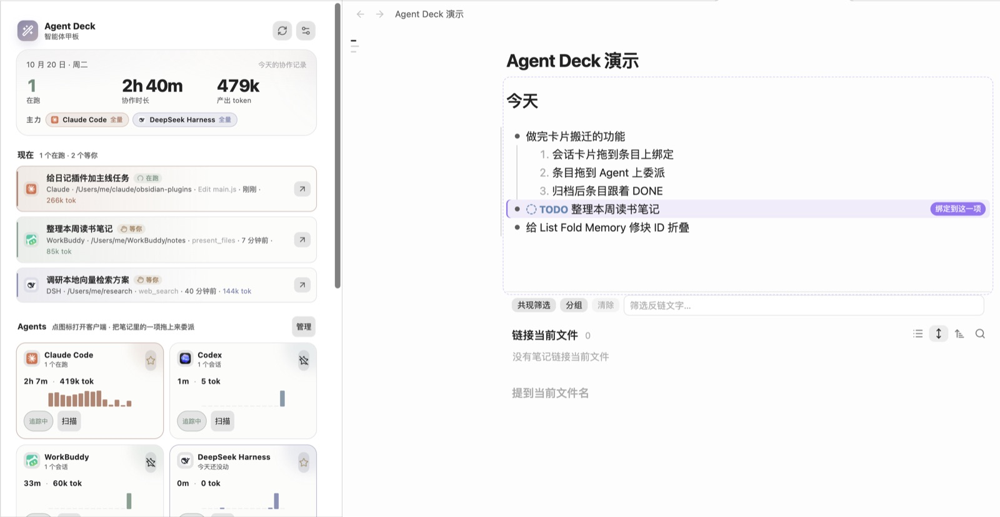
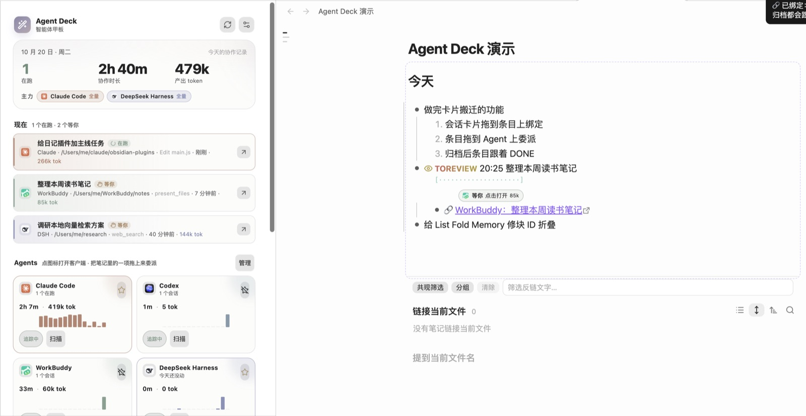
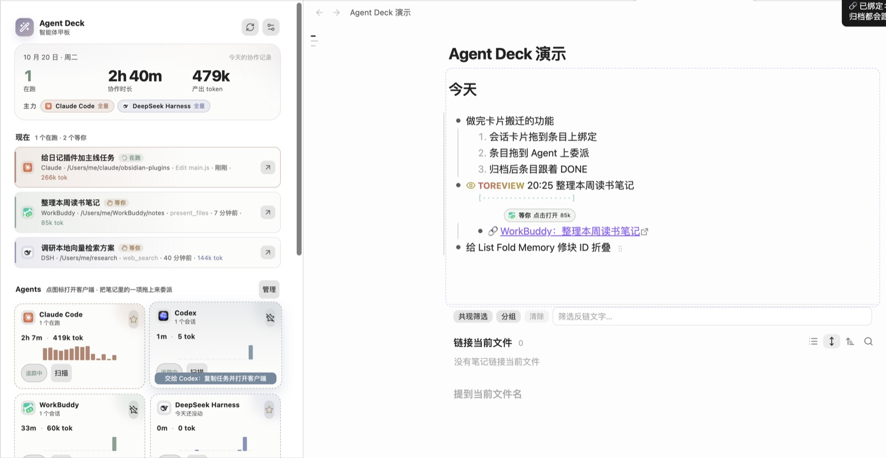
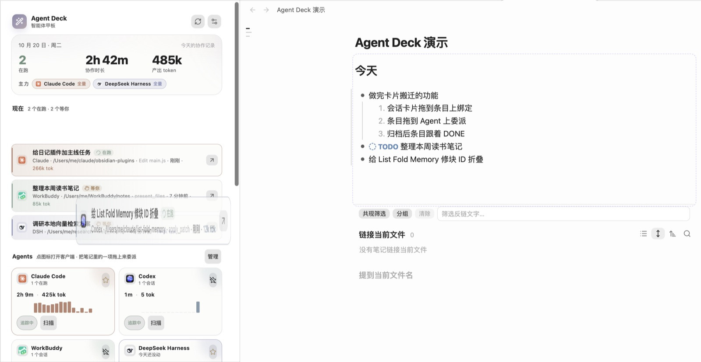
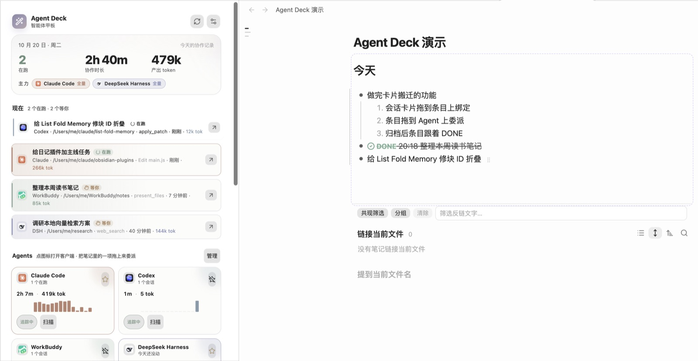
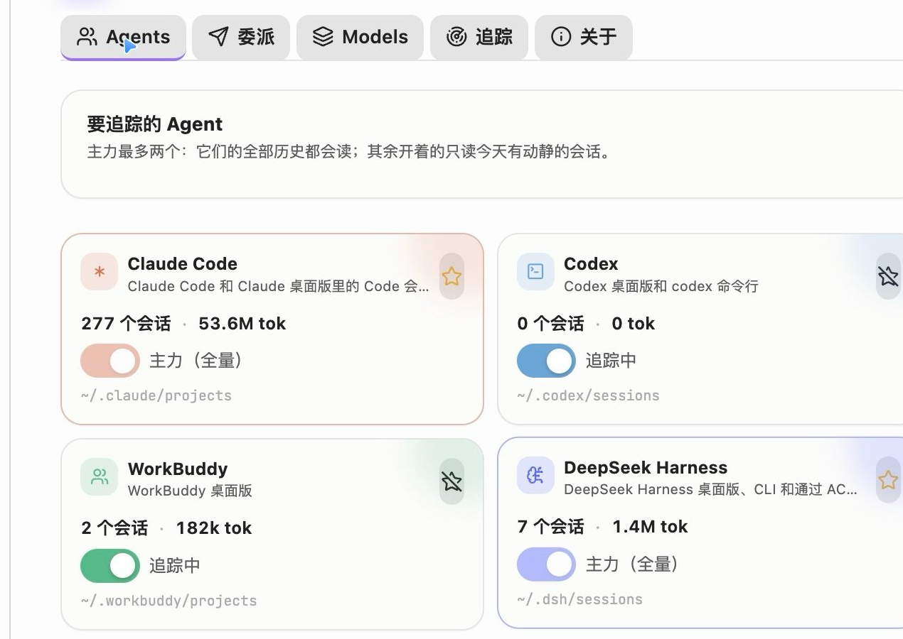
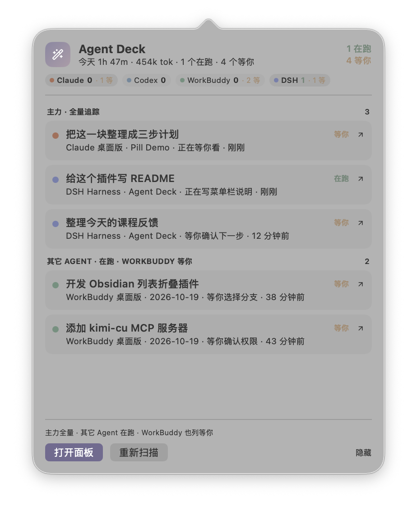
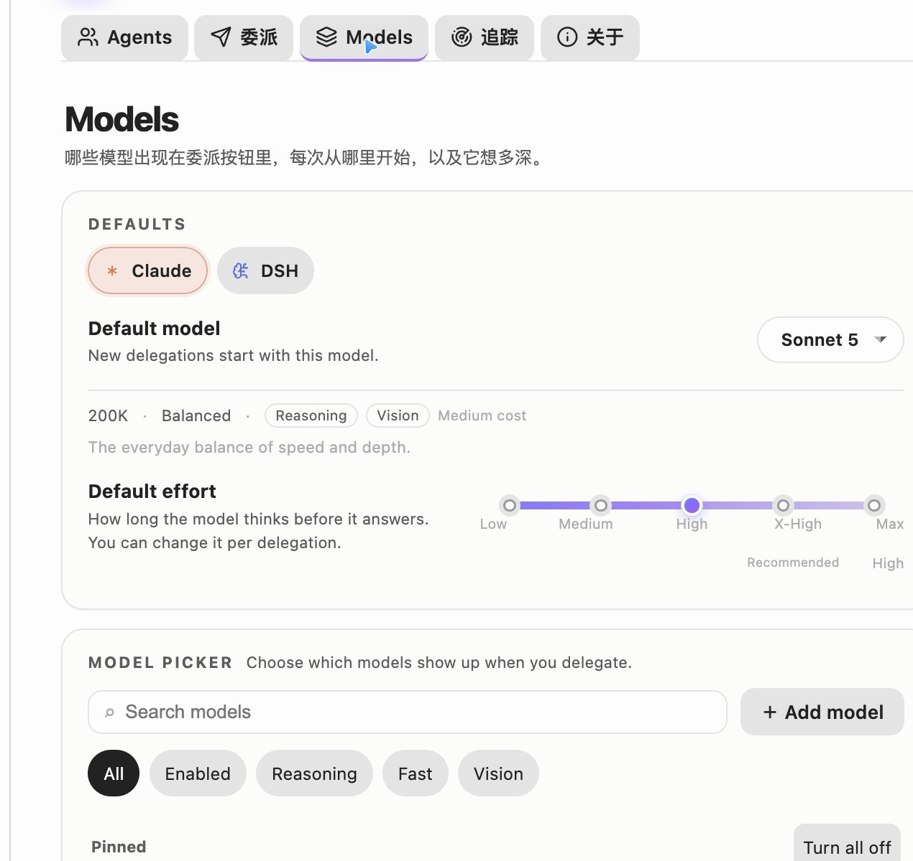

# Agent Deck（智能体甲板）

> Track every agent. Delegate from the line you are already looking at.

[中文](README.zh-CN.md) ｜ [GitHub Releases](https://github.com/MatsuriMW/obsidian-agent-deck/releases)

Agent Deck gathers the AI agent sessions scattered across separate clients onto one deck inside Obsidian: which agent is working, which one is waiting for you, and how far each has got, at a glance. To hand off work, delegate from the line you are writing; progress and the result come back to that same line. What you planned and what the agents did end up in the same journal.

<p align="center">
  <a href="https://github.com/MatsuriMW/obsidian-agent-deck/releases/download/1.2.1/agent-deck-demo-4k60.mp4"></a>
</p>

<p align="center">25-second demo (Chinese captions) · click for the <a href="https://github.com/MatsuriMW/obsidian-agent-deck/releases/download/1.2.1/agent-deck-demo-4k60.mp4">4K60 version with sound</a></p>

Agent Deck is an Obsidian plugin that reads the local session logs of **Claude Code, Codex, WorkBuddy and DeepSeek Harness**, shows what each agent is doing now, and tracks delegated tasks from the editor. Notes and the panel talk by drag and drop: drop a session card on a list item to bind it, drop a list item on an agent to delegate it. Agent Deck does not put a trigger on every list item. Once a line is bound to a session, the line-end pill becomes the progress surface: the fill moves with the session, the label changes to **Delegating**, and a cancel control appears next to it.

It is the AI/agent tracking half of [Nautilus Spiral](https://github.com/MatsuriMW/nautilus-spiral), extracted into a standalone plugin and extended with a second primary agent, DeepSeek Harness, model/effort/mode selection, and a layered model picker.

## How to use it

The plugin keeps explanatory text out of its UI; this section is the manual, and the switches live in the settings.

### The panel

| Area | What it shows / what you can do |
|---|---|
| Top numbers | Sessions running today, collaboration time, output tokens. After **主力** are your 1–2 primary agents: their full history is read; other agents only for sessions that moved today |
| 现在 (Now) | Running and waiting sessions, up to six. Click a card to open the session; drag it into a note to bind it (see below) |
| Agents | One card per agent: click the icon to bring the client forward, ⭐ to make it primary, toggle tracking, **扫描** to rescan. Drop a note item on a card to delegate |
| 最近 14 天 | Daily collaboration minutes stacked by agent; hover for numbers |
| 最近的会话 | Sessions from the last 7 days, filterable by state and agent, searchable by title, project and last step |

**Where a click opens a session.** Claude Code desktop sessions use `claude://resume`, Codex desktop `codex://threads/<id>`, WorkBuddy `workbuddy://chat/<id>`; DeepSeek Harness can only be focused, so the session id goes to the clipboard. **Claude Code / Codex sessions running in a terminal** switch to the terminal tab that runs them (Terminal, iTerm2 and Tern select the tab; Warp has no scripting interface, so it is only brought forward); only when the process has exited is a new tab opened to resume. Settings → Tracking → Claude desktop lets you send them to the desktop app instead and pick your terminal.

### Drag: bind and delegate


Pin Agent Deck to a sidebar and drag between the note and the panel:

| Drag | Result |
|---|---|
| A session card from **现在** → a list item with text (ordered or unordered) | The text stays; the line gets the session's keyword (`DOING` / `TOREVIEW` / `NEEDOK` …) and a `🔗` child. From then on `💬`, status and `⏱` follow the session |
| A session card → an empty line, an empty item (`- `), or a paragraph | A new item `DOING 20:05 🤖 session title` is created there and bound, following the list's indent and numbering |
| A list item → an agent card | Delegation. Claude Code and DeepSeek Harness start a session in the background. Codex and WorkBuddy have no CLI that can start a session, so the task goes to the clipboard and the client comes to the front; you paste and send, and Agent Deck binds the new session back to the item once it appears |
| ⌘-drag a session card onto an item | Leaves the item alone and creates a new bound item below it (and its children) |
| ⌘-drag an item onto Claude Code / Codex | Opens a new tab in your terminal running interactive `claude` / `codex` with the task as the first message; the session is bound back once it appears. With **open in terminal by default** on in the settings, it is the other way round. With Tern as your terminal the task runs in a separate background Tern session named "Agent Deck", so the session you are looking at stays put and Tern does not come forward; Claude Code starts in a trusted directory (the vault added with `--add-dir`) so it never stops at the trust prompt |
| An item → a session card in the panel | Binds that session to the item, no delegation |
| A delegated session gets its id | Its card flies from the agent card into **现在** |
| You archive the session in its client | The item becomes `DONE` + `⏱` and the `🔗` line is retired |

- **One-to-one.** A session is bound in one place. Dropping it elsewhere moves the binding; an auto-logged `🤖 …` line written for that session earlier is removed, so a task you already wrote and the agent's run of it merge into one line.
- **Where to drag from.** While the panel is open, the list item under the cursor shows a small grip ⠿ at its end; drag that, or drag a text selection. Agent cards turn dashed while you drag, and the hovered one says what dropping will do.
- **Dropping into a note** highlights the target line and labels it (bind / new item); headings, code blocks and tables don't accept drops.
- **Items that are not delegated**: agent-written ones (🤖), items already bound to a session, and items with a ⏱ record. Dropping them only says why.
- **With Nautilus Spiral**: when Nautilus draws its session progress line under a task, Agent Deck draws no pill there and the `🔗` link is dimmed and not clickable; click Nautilus's progress line to open the session. This can be turned off in the settings.

| | |
|---|---|
|  |  |
|  |  |
|  |  |

## Recommended: use it with Nautilus Spiral

The two plugins are two halves of one setup:

| Plugin | Owns |
|---|---|
| [Nautilus Spiral](https://github.com/MatsuriMW/nautilus-spiral) | The daily note and the plan: spiral scheduling, timing, capacity, reviews — and the agent tracking display (inner rings, status bar, progress rows, `🔗` bindings) |
| Agent Deck | The AI write half: automatic journal logging, status write-back, `💬`, desktop child / side chat / subagent blocks, archive → `DONE`, and delegation from a task line |

To hand over: open **Settings → 追踪 → 停用螺旋日程里的 AI 写入** in Agent Deck, then reload Nautilus Spiral. Nautilus stops writing but keeps its schedule and tracking display; Agent Deck owns the note writes. Agent Deck also works on its own — you just lose Nautilus's planner and display.



## What it does

- **A dashboard for the agents on this Mac.** Running, waiting and quiet sessions for Claude Code, Codex, WorkBuddy and DeepSeek Harness, with project, last step, elapsed time and tokens. Click a row to open that session in its client.
- **Claude desktop side chats.** In the Claude desktop app a session can spawn another session that looks like a sibling in the sidebar. Agent Deck reads `spawnedFrom` from `claude-code-sessions/**/local_*.json`, indents the child under its parent, and labels the relationship; a session with an open side chat gets a badge, and the menu bar adds `side chat ×N`. Archived sessions drop out of **现在** and the recent list for every client: Claude desktop (`isArchived`), Codex (`threads.archived` in `state_*.sqlite`, plus the older `archived_sessions/`), WorkBuddy (`sessions.status` in `workbuddy.db`) and DeepSeek Harness (`archivedSessionIds` in `storages/workspace.json`).
- **Human–AI journal, moved in.** The AI half of Nautilus Spiral's journal flow now lives here: sessions are recorded into today's note (a local `claude -p` names them and matches existing task lines), status and elapsed time are written back, `💬` carries the last reply, child sessions / side chats / Claude Code subagents become nested blocks, and archiving a session marks its line `DONE`. Nautilus keeps the tracking display.
- **Write-back on bound lines.** A bound `🔗` session gets `💬`, its keyword follows the session (`DOING` / `TOREVIEW` / `NEEDOK` / `ERRORED` / `HITLIMIT`), and archiving writes `DONE` + `⏱` and retires the `🔗` line. While Nautilus's own AI tracking is still enabled Agent Deck stays out of the note, so the two never fight over the same lines.
- **Two primary agents, full history.** Pick up to two agents as primaries. They are read in full (all history, cross-day catch-up); every other enabled agent is only read for sessions that moved today.
- **Two ways to delegate, no more.** Drop a list item you wrote onto an agent card in the panel, or use **块去向 → 委派给 Claude** (⌥⌘D). Anything between existing note items, agent-written items (🤖) and session cards is a binding, never a new session. There is no Delegate button on list items and no delegate command in the palette. Model, effort, permission mode and working directory come from the settings; when a delegation fails, **Retry** on its status pill opens the options sheet.
- **Progress only on bound lines.** A line with a `🔗` session or a running delegation gets a line-end pill. While the job runs the pill fills and shows the elapsed clock; the `×` cancels it. When the agent answers, the pill becomes **Done** and the result is written under the task as one `💬` line. Lines with no session stay clean.
- **Note-native records.** Delegation writes a `🔗` line under the task and changes the status to `DELEGATED`; the line is the source of truth. Delete the `🔗` line to unbind.
- **Layered model settings.** A global default model, a default effort slider, capability tags, search/filter, enable switches, pinned order, per-row menu, and task models. Changes sit in an **Unsaved changes** bar until you save them.
- **Local only.** Everything is read from `~/.claude`, `~/.codex`, `~/.workbuddy`, `~/.dsh` and the Claude desktop session list under `~/Library/Application Support/Claude/claude-code-sessions`. Nothing is uploaded. The plugin stores its own aggregate in `usage.json` next to the plugin, so history survives log rotation.
- **Official app icons.** Claude, Codex, WorkBuddy and DeepSeek Harness use the icons of their own apps in the dashboard, session rows, pills, settings and menu bar; status, tool and window icons stay Lucide, and running states use a CSS spinner.
- **The agent summary lives in the macOS menu bar.** Obsidian's bottom-right status bar no longer carries the agent session summary. A small status item shows an icon plus something like `2 跑 · 1 等`; click it for a solid, opaque panel of task cards you can jump from.



## macOS menu bar

The menu bar item is a tiny SwiftUI helper app compiled on first use. It is not a second copy of the dashboard: it is the quick "what is running / what needs me" surface.

- **Solid, not glassy.** The panel is a borderless window with opaque surfaces. There is no `NSPopover`, no vibrancy and no frosted material, so text keeps its contrast on macOS 26. The light background is a near-white tint of the current Obsidian theme, and dark mode has its own solid palette.
- **Rows speak TODOseq.** Each card is tagged with a TODOseq keyword — `DOING`, `WAITING`, `NEEDOK?`, `HITLIMIT!`, `PAUSED`, `ERRORED`, `DONE`, `LATER`, `TODO` — with the same SVG icon and task-state colour TODOseq uses. `DOING` keeps its loader-circle spinning while the panel is open. The header counts `DOING` / `WAITING`, and any `NEEDOK?` session gets an orange reminder.
- **Cards are card-like.** White surface, 1px border, a soft shadow, a state-coloured rail, the agent's glyph badge, the project and the current step. Hovering lifts the card.
- **Five at a time.** The first five sessions are visible; the rest are a scroll away. The footer tells you how many sessions are in the list.
- **Right side, plus a shortcut.** The status item stays in the right side of the menu bar. If macOS hides it because the bar is full, press **⌃⌥⌘D** (Control + Option + Command + D) to open or focus the panel from any app. Pressing the shortcut again leaves it open; Escape or a click outside closes it. The shortcut can be changed in **Settings → 追踪 → 菜单栏快捷键**; no Accessibility permission is needed.
- **Primary agents** (up to two) contribute more rows: all live sessions plus recent sessions from the last six hours, up to six per primary by default.
- **Other agents** contribute only sessions that are currently running, up to three per agent by default. **WorkBuddy is the exception**: its waiting sessions are listed too, because they are part of the daily loop.
- The header shows all enabled agents as chips, with running and waiting counts, including agents that have no row at the moment.
- Clicking a row opens the same deeplink as the dashboard. DeepSeek Harness focuses the client and copies the session id; Codex opens `codex://threads/<id>` and copies `codex resume <id>`.
- **打开面板** opens the Obsidian dashboard via `obsidian://agent-deck`; **重新扫描** triggers a scan; **隐藏** disables the menu bar from inside the panel.

The dashboard itself keeps the calmer 1.0.2 palette; only the menu bar uses the vivid task-state colours.

The first start needs `swiftc` (Xcode Command Line Tools). The plugin compiles `~/.agent-deck/AgentDeckMenuBar.app`, then launches it. It exits when Obsidian exits. The source is included in the plugin bundle, so no separate download is needed. If the menu bar does not appear, open **追踪 → 重启菜单栏** or install the command line tools with `xcode-select --install`.

If the menu bar is full (or a menu-bar manager such as Ice has the item in its hidden section), press **⌃⌥⌘D** to open or focus the panel (a second press leaves it open; Escape or a click outside closes it). You can also run **Agent Deck: 打开 macOS 菜单栏面板** from the command palette.



## Human–AI journal

Your task lines are the plan; the agent session logs are the record of what actually happened. With **Auto-log into today's note** enabled, Agent Deck periodically reads today's sessions and writes the record back:

- **Active** → the matching line becomes `DOING`; if there is no line it writes `- DOING 00:45 🤖 …`. A local `claude -p` names the session and picks an existing task line when one fits.
- **Idle for a while** (40 minutes by default) → `PAUSED`, with `- ⏱ 00:45–01:20 · 共 52m · Claude` underneath.
- **Archived in the desktop app / Codex** → `DONE 19:20 …`, including lines still open from previous days.
- **It never guesses DONE.** The machine only moves between `DOING` and `PAUSED`; finishing is you marking it done or archiving the session.
- **Bound lines** get `💬` when the session answers, their keyword follows the session, and archiving writes `DONE` + `⏱`.
- **Nested blocks**: desktop child sessions (from `spawnedFrom`), open side chats, and Claude Code subagents (`<session>/subagents/agent-*.jsonl`) become indented blocks with their own status.

Writes are line-level, stay out of undo history, skip while an IME composition is active, and abort if the note changed in the meantime. These writes used to live in Nautilus Spiral; now Agent Deck owns them, and Nautilus keeps the tracking display. While Nautilus's write flags are still on, Agent Deck stays out of the note — use **停用螺旋日程里的 AI 写入** and reload Nautilus to complete the handoff.

## Delegate targets

### Claude Code

Agent Deck starts a headless Claude Code session with:

- `--model` (Opus 5, Sonnet 5, Haiku 5.5, Fable, or a custom alias)
- `--effort` (low, medium, high, xhigh, max)
- `--permission-mode` (`plan`, `auto`, `acceptEdits`, `manual`)
- `-n` for the session name, `--add-dir` for the vault

The first turn runs in the background. The session can then be reopened in the Claude desktop app with `claude://resume?session=<id>`.

If Claude Code has never trusted the vault, the plugin reads `~/.claude.json` and starts in a directory that Claude already trusts, adding the vault with `--add-dir`. This behaviour can be turned off in **委派 → 库没被信任时自动换个目录**.

### DeepSeek Harness

Agent Deck speaks ACP (Agent Client Protocol) to `dsh acp`. It creates a real Harness session, selects the model and `reasoning_effort`, sends the prompt, and follows the `session/update` stream. The session is persisted in `~/.dsh/sessions`, so it also appears in the dashboard afterwards.

ACP does not expose Claude-style plan/auto permission modes. Instead the plugin can auto-approve one-shot tool permissions, or reject them and notify you.

### Codex and WorkBuddy

Codex and WorkBuddy have no CLI that can start a session, so they use a client hand-off: drop an item on their card, the task text (with your delegation prefix/suffix) goes to the clipboard and the client comes to the front; start a chat, paste, send. On each scan Agent Deck looks for a new session of that agent whose opening matches, writes `🔗` under the item, marks it `DELEGATED`, and flies the card into **现在**. While it waits, the agent card shows a "waiting for you to send" row with an `×`; it gives up after 30 minutes.

Codex sessions open in the desktop app with `codex://threads/<id>` (and `codex resume <id>` is copied too). WorkBuddy opens with `workbuddy://chat/<id>`.

## Deep links

| Agent | Link | State |
|---|---|---|
| Claude Code | `claude://resume?session=<id>` | Works |
| WorkBuddy | `workbuddy://chat/<id>` | Works |
| DeepSeek Harness | `dsh://open` | Opens the client; the desktop build does not expose a per-session URL yet. Agent Deck copies the session id to the clipboard so you can find it in the sidebar. |
| Codex | `codex://threads/<id>` | Works; also copies `codex resume <id>` |

## The status pill

The pill is a CodeMirror widget. It only lives on lines that already have a session or delegation, not on every list item, and it has four states:

1. **Starting**, while the session is being created.
2. **Delegating**, with a liquid fill, elapsed time and `×`.
3. **Waiting / needs approval**, with a slow glow.
4. **Done** or **Error**, with an open/retry control.

When a delegation fails, **Retry** on its status pill opens the options sheet:

## Installation

This plugin is not in the community store yet. Install it manually:

1. Download or clone this repository.
2. Copy `main.js`, `manifest.json` and `styles.css` into `<vault>/.obsidian/plugins/agent-deck/`.
3. Enable **Agent Deck** in **Settings → Community plugins**.

To build from source:

```bash
git clone https://github.com/MatsuriMW/obsidian-agent-deck.git
cd obsidian-agent-deck
npm install
npm run build
```

`npm run build` writes `main.js` with esbuild. The only runtime dependency is `fzstd`, used to read DeepSeek Harness's zstd-compressed session logs.

## Settings

- **Agents**: enable each agent, pick up to two primaries, scan now, import Nautilus Spiral history.
- **委派**: default target, models, effort, permission mode, working directory, prompt prefix/suffix, write-back rules, trust fallback.
- **Models**: the layered picker shown above.
- **追踪**: day cutoff, polling interval, idle threshold, history depth, Claude desktop side chats, automatic journal logging and write-back toggles, macOS menu bar toggle and row limits, UI switches, rebuild, import, and a one-click **pause Nautilus Spiral's AI writes** action.
- **关于**: version, license and debug info.

## Compatibility with Nautilus Spiral

Agent Deck understands the same `🔗` line as Nautilus Spiral. If both plugins are on, Nautilus will also see the Claude sessions and may rewrite `DELEGATED` to `TOREVIEW`.

Agent Deck hides Nautilus's 🤖 agent status item automatically (the planner's own status bar and timer stay). The AI **writes** of the journal flow (automatic logging, status keywords, `💬`, child blocks) now live in Agent Deck; while Nautilus's write flags are still on, Agent Deck keeps its hands off the note. Use **追踪 → 停用螺旋日程里的 AI 写入** to turn off only those writes — Nautilus keeps its tracking display. Its settings are backed up first. After using it, reload Nautilus Spiral from Obsidian's plugin settings (or restart Obsidian); Agent Deck never disables or enables another plugin.

If you use **done-to-top** and **journal-tidy**, update to **done-to-top 1.17.3+** and **journal-tidy 1.9.1+**. Those versions keep a `DELEGATED` block that mentions 明天 / 后天 / 大后天 in today's DOING area instead of moving it to the next day, and do not fold DOING/TODO blocks before the first separator.

## Privacy

- Session logs are read locally with Node's `fs`.
- No network requests are made by the tracking code.
- Delegation starts local CLI processes (`claude`, `dsh`) owned by the user.
- `usage.json` stores only aggregate per-day numbers and session summaries, not full conversations.
- The menu bar helper reads `~/.agent-deck/menubar.json` and makes no network requests.

## Release provenance

Releases are built by GitHub Actions from the tagged commit. `main.js`, `manifest.json` and `styles.css` carry build provenance attestations:

```bash
gh attestation verify main.js --repo MatsuriMW/obsidian-agent-deck
```

## Credits

- Extracted from [Nautilus Spiral](https://github.com/MatsuriMW/nautilus-spiral), which remains the planner.
- The progress-in-trigger-button interaction is inspired by [@ZZ.X's note “AI 任务进度，长在触发按钮里”](https://xhslink.cn/o/3gmyiCARRj2).
- The layered model settings page is inspired by [@ZZ.X's note “AI 产品模型设置”](https://xhslink.cn/o/AwW7VhnzX6m).

## License

MIT. See [LICENSE](LICENSE).
