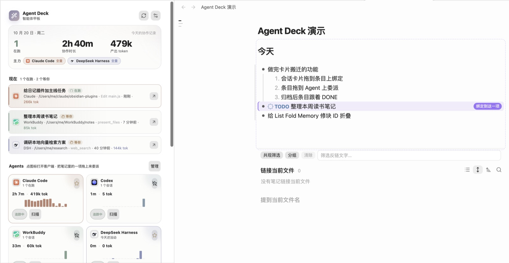
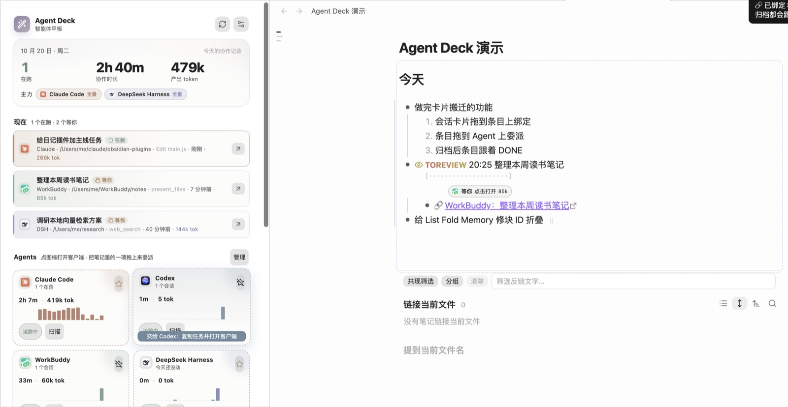
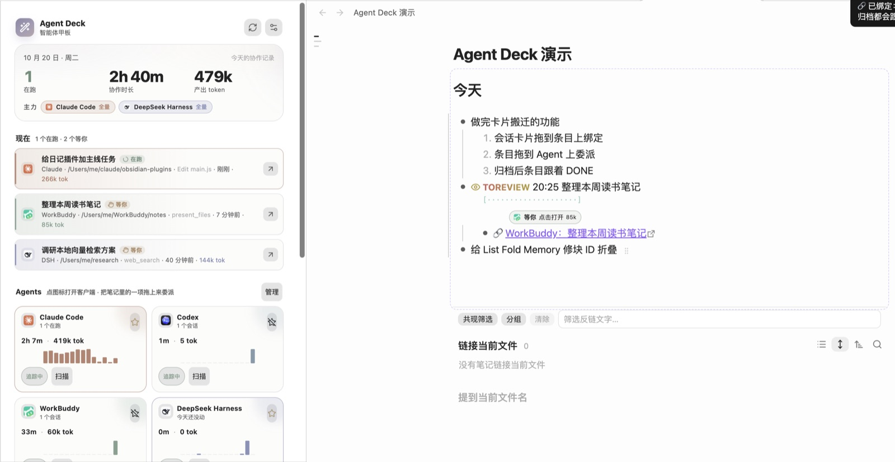
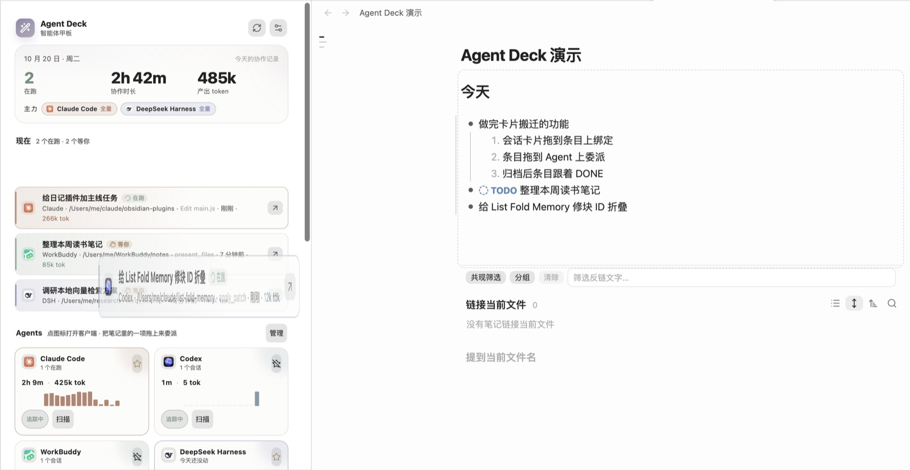
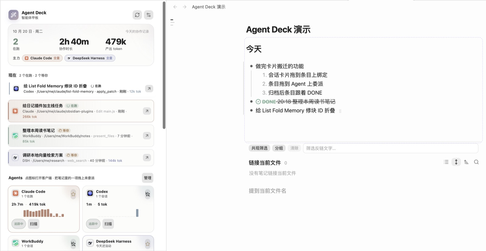
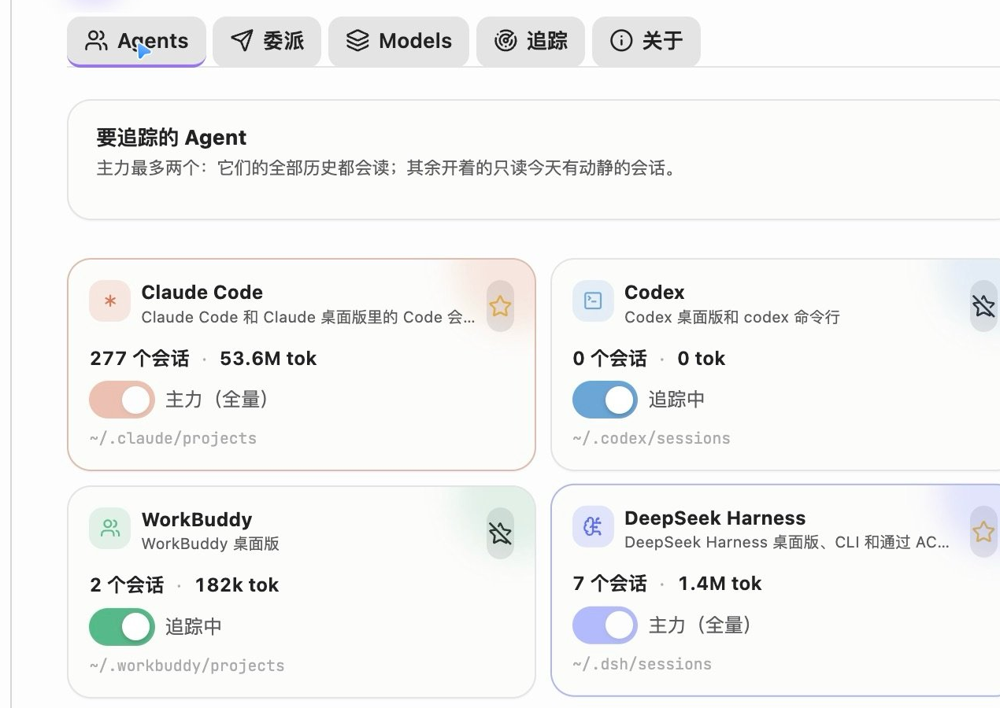
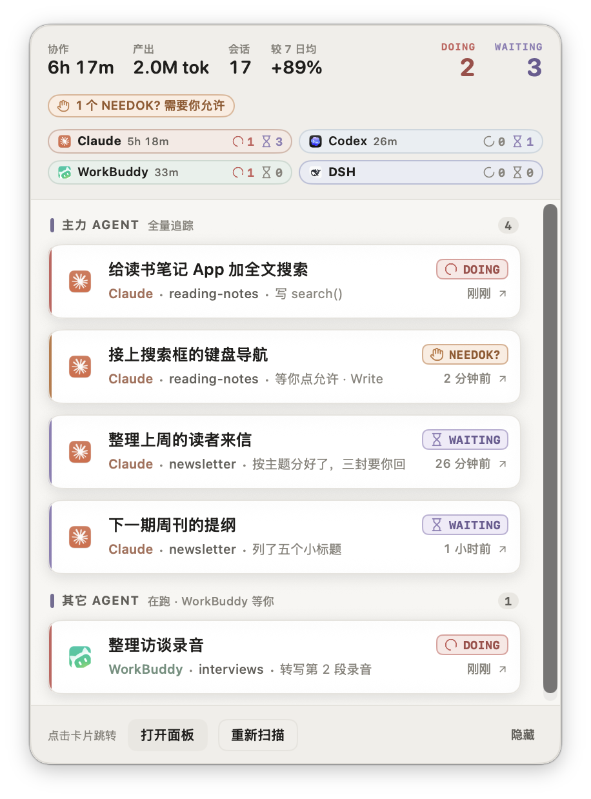
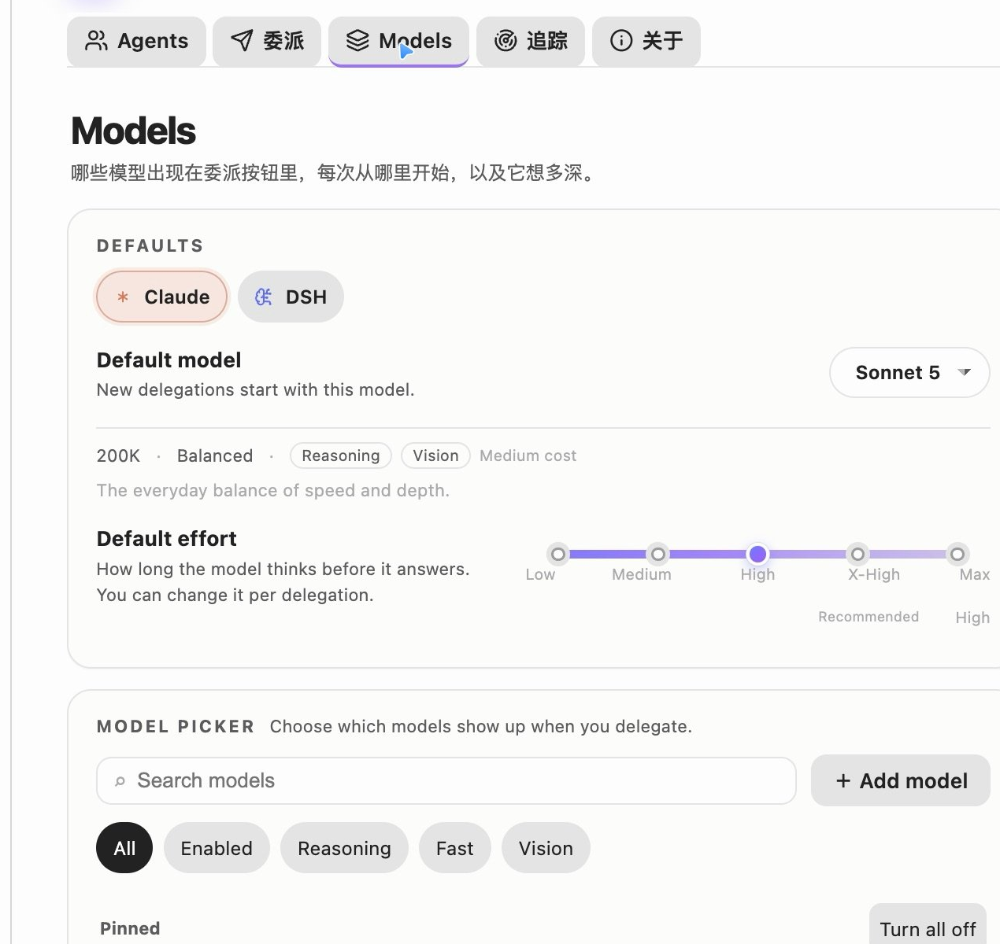

# Agent Deck（智能体甲板）

> 一个面板看清本机所有 AI Agent：谁在跑、谁在等你、刚才那步到哪了；需要时从正在写的任务行直接委派。

[English](README.md) ｜ [GitHub Releases](https://github.com/MatsuriMW/obsidian-agent-deck/releases)

Agent Deck 把散在各个客户端里的 AI Agent 会话收到 Obsidian 里的一张甲板上：哪个 Agent 在干活、哪个在等你、做到了哪一步，抬眼就能看到；要派活，就从笔记里正在写的那一行派出去，进度和结果再回到这一行。人写的计划和 Agent 跑的活，最后落在同一份日记里。

<p align="center">
  <a href="https://github.com/MatsuriMW/obsidian-agent-deck/releases/download/1.2.1/agent-deck-demo-4k60.mp4"></a>
</p>

<p align="center">25 秒演示 · 点图看 <a href="https://github.com/MatsuriMW/obsidian-agent-deck/releases/download/1.2.1/agent-deck-demo-4k60.mp4">4K60 有声版</a> ｜ 国内可看：<a href="https://matsuri.site/demo/agent-deck/">matsuri.site/demo/agent-deck</a></p>

Agent Deck 是 Obsidian 插件，把本机 **Claude Code、Codex、WorkBuddy、DeepSeek Harness、Antigravity** 五类 Agent 会话收进同一张「甲板」：主力 Agent 全量追踪，其它 Agent 只看正在跑的；在跑、等你、安静、需要你确认、额度用完、出错停下这些状态用 TODOseq 的任务关键词和颜色标出来，点一行就回到对应客户端。

笔记和面板之间可以直接拖：会话卡片拖到笔记里的一项上，就把会话绑给它；笔记里的一项拖到某个 Agent 上，就是委派。只有光标所在的那一项尾巴上有个纸飞机把手：单击确认后连同子块发给主力，双击或 ⌘ 单击选发给哪个 Agent。任务行绑定了会话后，行尾的 pill 才变成进度条，完成后把结果写回笔记。macOS 菜单栏还有一块常驻的纯色面板，菜单栏被系统藏起来时可以用自定义全局快捷键唤起。

它从[螺旋日程 Nautilus Spiral](https://github.com/MatsuriMW/nautilus-spiral) 里「人机协作 / AI 追踪」那一半拆出来，补上了第二个主力 Agent、DeepSeek Harness 的 ACP 委派、模型 / 强度 / 权限模式选择、分层的模型设置页，以及一块可读性更高的 SwiftUI 菜单栏面板。

**目录**

- [操作指南](#操作指南)
- [推荐：和螺旋日程一起用](#推荐和螺旋日程一起用)
- [功能](#功能)
- [macOS 菜单栏](#macos-菜单栏)
- [人机共写：会话写回日记](#人机共写会话写回日记)
- [委派到哪儿](#委派到哪儿)
- [Deeplink](#deeplink)
- [状态 pill](#状态-pill)
- [安装](#安装)
- [设置](#设置)
- [和螺旋日程并存](#和螺旋日程并存)
- [隐私](#隐私)
- [发布与校验](#发布与校验)
- [反馈与后续](#反馈与后续)
- [致谢](#致谢)
- [许可证](#许可证)

## 操作指南

插件界面上几乎不放说明文字，怎么用都写在这里；各项开关在设置里。

### 面板

| 区域 | 看什么 / 能做什么 |
|---|---|
| 顶栏 | 搜会话（标题、项目、最近一步，筛的是「最近的会话」）、重新扫描、设置 |
| 今天 | 协作时长（较前 7 天日均）、产出 token（调用次数）、会话数（提问次数）；今天各 Agent 在哪几段干活的时间轴；花时间最多的三个项目 |
| 现在 | 在跑和等你的会话，最多 6 张。点卡片打开会话；拖到笔记里绑定（见下面的拖拽）；在列表里上下拖调整顺序，新来的排最上面；卡片上的 ×（或右键）把它从「现在」移除 |
| Agents | 每个 Agent 一张卡：点图标把客户端叫到前台，⭐ 设主力（1–2 个，主力的全部历史都读，其余只读今天有动静的会话），「追踪中」开关、「扫描」立刻重读。笔记里的一项拖上来就是委派 |
| 最近 14 天 | 按 Agent 堆叠的每天协作分钟，悬停看具体数字 |
| 最近的会话 | 最近 7 天的会话，可以按状态、Agent 筛选，用顶栏的搜索框缩小范围 |

**点会话打开到哪儿**：Claude Code 桌面版会话走 `claude://resume`，Codex 桌面版走 `codex://threads/<id>`，WorkBuddy 走 `workbuddy://chat/<id>`；DeepSeek Harness 只能聚焦客户端，会话号复制到剪贴板。**终端里的 Claude Code / Codex 会话**还开着时，切到跑它的那个终端标签（系统终端、iTerm2、Tern、Herdr 能选中标签；Warp 没有脚本接口，只能叫到前台），进程退出了才在主力终端里新开标签 resume。主力终端默认「自动」，按这台电脑挑：眼下的 `claude` / `codex` 命令行会话多半开在哪个终端就用哪个（认出来记在 `~/.agent-deck/terminal.json`），没有就用上次认出的，再没有就看开着的、装了的，先后是 Herdr → Tern → iTerm2 → Warp → 系统终端。设置 → 追踪 → Claude 桌面版里可以固定成某一个，或者都走桌面版。

### 拖拽：绑定和委派


把 Agent Deck 固定在侧栏，笔记里的列表项和面板里的会话卡片可以互相拖：

| 怎么拖 | 结果 |
|---|---|
| 「现在」里的会话卡片 → 笔记里有字的一项（有序 / 无序列表都行） | 原文不动，前面换上会话的状态关键词（`DOING` / `TOREVIEW` / `NEEDOK` …），下面多一行 `🔗` 子块。之后 `💬`、状态、`⏱` 都跟着会话走 |
| 会话卡片 → 空行、空的列表项「- 」、或一段文字上 | 在那儿新建一项 `DOING 20:05 🤖 会话标题` 并绑上；接着上面列表的缩进和编号 |
| 笔记里的一项 → Agents 里的某个 Agent | 委派。Claude Code、DeepSeek Harness 直接在后台开会话（默认模型 Opus 5.5，设置里可改）；Claude Code 答完一轮自动在桌面版打开，接着在桌面版里聊；Codex 默认走桌面版交接，WorkBuddy 也使用桌面版交接：任务文字放进剪贴板、客户端叫到前台，你粘贴发出去，Agent Deck 认出新会话后自动绑回这一项 |
| 按住 ⌘ 把会话卡片拖到一项上 | 不绑这一项，在它（连同子项）下面新建一条并绑上 |
| 按住 ⌘ 把一项拖到 Claude Code / Codex 上 | 在主力终端里新开标签跑交互式的 `claude` / `codex`，任务直接当第一句发出去；会话一出现自动绑回这一项。设置里开了「默认在终端里开」就反过来：不按 ⌘ 是终端，按 ⌘ 是后台 / 桌面版。主力终端是 Tern 或 Herdr 时，任务放进单独的「Agent Deck」会话（Herdr 里是「Agent Deck」空间）在后台跑，不把终端叫到前台；Claude Code 在信任过的目录里起（库用 `--add-dir` 加进去），不会卡在信任提示上 |
| 笔记里的一项 → 面板里的某张会话卡片 | 把这个会话绑给它，不委派 |
| 委派出去的会话有了会话号 | 卡片从它的 Agent 卡片飞进「现在」 |
| 在客户端里归档这个会话 | 笔记里那一项自动记 `DONE` + `⏱`，收掉 `🔗` |

- **一对一**：一个会话只绑一处。拖到别的项上等于换绑；自动记日记先替它写过的「🤖 …」那一项会一起收掉，时间和状态并到你拖到的那一项上。日记里本来写着的任务和 Agent 跑的那件事其实是同一件时，拖一下就合到一起。
- **小把手 ⠿**：光标所在的列表项尾巴上有一个小把手。**单击**：先弹确认框，确认后这一项连同子块作为一条消息发给委派的默认 Agent（主力），条目随后变成 `DELEGATED`；**双击**或 **⌘ 单击**：弹出 Agent 列表（Claude Code、Codex、WorkBuddy、DeepSeek Harness），选哪个发给哪个，效果和拖到那张卡片上一样；**按住拖**：拖到侧栏的 Agent 卡片上委派，选中一段文字直接拖也行。拖的时候 Agent 卡片变成虚线框，悬停的那张写着松手会发生什么。
- **拖进笔记时**目标行高亮，右边标着「绑定到这一项 / 在这里新建一项」；标题、代码块、表格上不接。
- **⚠️ 终端委派只在 Tern 和 Herdr 上实测过。** 在终端里开 `claude` / `codex`，Claude Code 和 Codex 命令行在 Tern、Herdr 上都已跑通、能绑回这一项，点会话也能切回那个标签；系统终端、iTerm2、Warp 还没实测。Codex 和 Claude Code 一样：库没被信任时换到一个信任过的目录起，库用 `--add-dir` 加进去，不会停在信任提示上。后台委派（不按 ⌘ 拖到 Claude Code / DeepSeek Harness 上）不受影响。
- **动手前先确认**：每条委派消息末尾会追加一句（笔记里看不到）：有疑问先问，都清楚了先说打算，等你确认再动手。设置 → 提示词前后缀里可以关掉。
- **不会再委派的条目**：Agent 记的（🤖 开头）、已经绑着会话的、下面有 ⏱ 用时记录的。拖上去只提示原因。
- **和螺旋日程一起用**：螺旋日程在任务行下面画了会话进度行时，行尾不再画 pill，🔗 链接放淡、不可点，点螺旋的进度行打开会话。设置里可以关掉这个让位。

| | |
|---|---|
|  |  |
|  |  |
|  |  |

## 推荐：和螺旋日程一起用

两个插件是配套的两半，建议一起装：

| 插件 | 负责 |
|---|---|
| [螺旋日程 Nautilus Spiral](https://github.com/MatsuriMW/nautilus-spiral) | 日记和日程本身：螺旋排程、计时、容量、回顾，以及 Agent 的追踪展示（内圈细线、状态栏、进度条、`🔗` 绑定） |
| Agent Deck | AI 写入那一半：自动记日记、状态写回、`💬`、桌面版子会话 / side chat / subagent 子块、归档 → `DONE`；以及从任务行委派 |

交接只要一步：在 Agent Deck 的 **设置 → 追踪 → 停用螺旋日程里的 AI 写入**，然后重新加载螺旋日程。螺旋只停 AI 写入，日程、螺旋和追踪展示照常；写日记交给 Agent Deck。只装 Agent Deck 也能用，只是少了螺旋的排程和展示。



## 功能

- **本机 Agent 面板**：Claude Code、Codex、WorkBuddy、DeepSeek Harness 的在跑、等你、安静会话，带项目、最近一步、时长和 token。点一行用 deeplink 回到那个会话。
- **Claude 桌面版的 side chat**：桌面版里从一个会话开出来的会话，侧栏里看着和它同级。Agent Deck 读 `claude-code-sessions/**/local_*.json` 里的 `spawnedFrom` 认出母子关系，把子会话缩进一层、标出从哪个会话开出；正开着 side chat 的会话带一个标签，菜单栏里也会写 `side chat ×N`。已归档的会话不列在「现在」和「最近的会话」里：Claude 桌面版读 `isArchived`，Codex 读 `state_*.sqlite` 的 `threads.archived`（老版本的 `archived_sessions/` 也认），WorkBuddy 读 `workbuddy.db` 的 `sessions.status`，DeepSeek Harness 读 `storages/workspace.json` 的 `archivedSessionIds`。
- **人机共写：自动记日记**：读今天 Claude / Codex / WorkBuddy / DeepSeek Harness 的会话，用所选本机 Claude / Codex CLI 起名、对上日记里已有的任务行，接不上就新写一行 `DOING HH:MM 🤖 …`；停了一阵改 `PAUSED` 并写 `⏱` 时段；桌面版 / Codex 里归档记 `DONE`；前几天还挂着的行补记。设置 → 追踪里打开，或跑命令「整理 Agent 会话进今天的日记」。
- **回写日记**：`🔗` 绑着的会话答完一轮或归档写 `💬`；状态关键词跟着会话切；桌面版子会话、开着的 side chat、Claude Code 的 subagent 写成缩进子块。
- **和螺旋日程分工**：这些 AI 写入原来在螺旋里，现在归 Agent Deck；螺旋只保留追踪展示。螺旋的 AI 追踪还开着时 Agent Deck 不写日记，点「停用螺旋日程里的 AI 写入」并重载螺旋后完全接管。
- **最多两个主力 Agent**：主力全量读（全部历史、跨天补记）；其它开着的只读今天有动静的会话。
- **委派只有两个入口**：把笔记里人写的一项拖到面板的某个 Agent 卡片上；或者用 **块去向 → 委派给 Claude**（⌥⌘D）。日记里已有的条目、Agent 记的条目（🤖）、面板里的会话卡片之间怎么拖都只是绑定，不开新会话。Agent Deck 不在列表项上放「委派」按钮，命令面板里也没有委派命令。模型、强度、权限模式、工作目录用设置里的默认值；委派失败时点状态 pill 上的「重试」可以临时改。
- **进度只长在绑定了会话的行上**：有 `🔗` 或正在委派的行，行尾才出现状态 pill。委派中 pill 自己填充、显示已用时间，旁边有 `×` 取消。答完变成「完成」，结果写成任务下面一行 `💬`。没有会话的行保持干净。
- **记录留在笔记里**：委派会写一行 `🔗`，状态改成 `DELEGATED`；拖拽绑定也是一行 `🔗`。删掉 `🔗` 就是解绑。
- **分层模型设置**：默认模型、默认强度滑杆、能力标签、搜索筛选、启用开关、置顶排序、每行菜单、任务模型。改动先放在「Unsaved changes」条里，点保存才落盘。
- **只读本机**：只读 `~/.claude`、`~/.codex`、`~/.workbuddy`、`~/.dsh`，以及 Claude 桌面版的会话清单 `~/Library/Application Support/Claude/claude-code-sessions`，不上传。插件目录里的 `usage.json` 存按天的汇总，日志被轮转掉历史还在。
- **官方 App 图标**：Claude、Codex、WorkBuddy、DeepSeek Harness 四个 Agent 用各自 App 的 icon（面板、会话行、状态 pill、设置页和菜单栏一致）；状态、工具和窗口图标仍是 Lucide，正在跑的图标用 CSS 旋转。
- **Agent 汇总搬到 macOS 菜单栏**：Obsidian 右下角不再显示 Agent 会话汇总。系统最上方只留一个小图标；点开是一块纯色面板，任务卡片可以直接跳会话。



## macOS 菜单栏

菜单栏是一个很小的 SwiftUI 助手，第一次运行时编译；菜单栏上只显示一个图标。它不是面板的复制，而是「现在谁在跑、谁在等我」的快速入口。

- **纯色，不毛玻璃。** 面板是一个无边框窗口，所有表面都是不透明颜色：没有 `NSPopover`、没有 vibrancy、没有磨砂材质，在 macOS 26 上文字对比度不会被玻璃效果吃掉。浅色背景是接近 Obsidian 主题色的浅底，深色模式也有独立的纯色配色。
- **任务关键词来自 TODOseq。** 每张卡片右上角标 `DOING`、`WAITING`、`NEEDOK?`、`HITLIMIT!`、`PAUSED`、`ERRORED`、`DONE`、`LATER`、`TODO`，前面配 TODOseq 里同一个 SVG 图标和任务状态色；`DOING` 的 loader-circle 在面板打开时一直转。顶部右边统计 `DOING` / `WAITING`，有 `NEEDOK?` 会话时会出现橙色提醒条。
- **页头是今天的数字。** 左边四项：协作时长、产出 token、会话数、和前 7 天日均比多还是少（前 7 天里有用量的日子不到 3 天时不显示）。没有图标和产品名：面板本来就挂在菜单栏的图标下面。
- **卡片就是卡片。** 白底、1px 描边、柔和阴影、左侧状态色轨、Agent 图标徽章、项目名和当前步骤；鼠标悬停时卡片会轻微浮起。
- **默认五条。** 一眼先看前五个会话，其余向下滑动；底部会写清楚一共多少个。
- **在右侧，也有快捷键。** 状态项常驻菜单栏右侧；如果 macOS 因为菜单栏排满把它藏起来，按 **⌃⌥⌘D**（Control + Option + Command + D）就能在任意 App 里打开面板，再按一次收起；Esc 或点面板外面也会关掉。快捷键可以在 **设置 → 追踪 → 菜单栏快捷键** 里改，不需要辅助功能权限。
- **主力 Agent**（最多两个）给更多行：正在跑的、等你的，加上最近六小时内的会话，默认每个主力最多 6 条。
- **其它 Agent** 只给正在运行的会话，默认每个最多 3 条。**WorkBuddy 例外**：它的等待会话也会列出来，因为那是每天要接着处理的事。
- 顶部有一排所有已启用 Agent 的小标签，带今天的时长和在跑 / 等你数量；即使某个 Agent 当前没有可列出的会话，它的标签也在。
- 点一行和面板里的跳转一样：Claude Code / WorkBuddy 直接打开会话；DeepSeek Harness 聚焦客户端并复制会话号；Codex 用 `codex://threads/<id>` 打开，并复制 `codex resume <id>`。
- **打开面板** 走 `obsidian://agent-deck`；**重新扫描** 立刻扫一遍；**隐藏** 从菜单栏里直接关掉。

菜单栏面板和主面板是同一套低饱和配色：暖中性的底、灰紫的强调色（`--ad-accent`）、和主面板一致的 Agent 颜色；底部按钮也是中性色。任务状态色照 TODOseq。

第一次启动需要 `swiftc`（Xcode Command Line Tools）。插件会编译 `~/.agent-deck/AgentDeckMenuBar.app` 并启动它；Obsidian 退出时它也会退出。源码已经打包在插件里，不需要另外下载。菜单栏没出现时，到 **追踪 → 重启菜单栏**，或者先运行 `xcode-select --install`。

如果菜单栏已经排满（或者 Ice 把它收进了隐藏区），按 **⌃⌥⌘D** 打开或聚焦面板（再按一次不会关闭，用 Esc 或点面板外面关闭）。也可以在命令面板里运行 **Agent Deck: 打开 macOS 菜单栏面板**。



## 人机共写：会话写回日记

你在日记里写任务，是预计；Agent 的会话日志是自己会写的实际记录。打开「自动记日记」以后，Agent Deck 每隔一阵看一眼今天开着的会话，替你把状态和用时补上：

- **在动** → 那一行改成 `DOING`；日记里没有对应的行，就新写一行 `- DOING 00:45 🤖 优化配色`。名字和“接在哪一行”由所选 Claude / Codex CLI 整理；对不上就新写。
- **停了一阵**（默认 40 分钟）→ 改成 `PAUSED`，实际时段写在下面：`- ⏱ 00:45–01:20、04:02–04:24 · 共 52m · Claude`。
- **归档** → 改成 `DONE 19:20 …`，前几天记下、还挂着的行也在当天日记里补上。四家客户端的归档都认；今天的日记没开着也照样改。
- **不猜 DONE**：机器只在 `DOING` / `PAUSED` 和等你的几种状态（`TOREVIEW` / `NEEDOK` / `ERRORED`）之间切；你觉得做完了自己改，或者去桌面版里归档。模型说「看着做完了」只在提醒里提一句。
- **绑定会话的回写**：`🔗` 行绑着的会话答完一轮写 `💬`；停在权限提示上写 `NEEDOK`，等你回复写 `TOREVIEW`，报错 `ERRORED`，限额 `HITLIMIT`；归档记 `DONE` + `⏱`。自动记的 `🤖` 那一行也一样跟着会话切 `DOING` ↔ `TOREVIEW` / `NEEDOK` / `ERRORED`，不用等停满 40 分钟才看出它在等你。
- **都能调**（设置 → 追踪 → 自动记日记）：每隔几分钟整理、启动后第几分钟先跑一次（默认 1 分钟，不用再等满一个间隔）、新会话活跃满几分钟才记（3）、停几分钟算暂停（40）、记哪几个 Agent、一轮最多问几个会话（8）、整理用的模型和等多久（`haiku`、120 秒）、模型问不到时自动整理也先用会话标题记上（默认开）、整理 CLI（Claude / Codex）及其路径、Codex 推理强度、每轮 `💬` 要不要让模型润色及润色用的模型和超时。
- **子块**：桌面版里从绑定会话开出来的会话按 `spawnedFrom` 缩进挂成子块；开着的 side chat 一个子块；Claude Code 的 subagent 读 `<会话号>/subagents/agent-*.jsonl`，在跑画 `🤖 子代理`，跑完换 `DONE` / `FAILED` + `⏱` + `💬`。
- **分工**：这些写入原来在螺旋日程里，现在归 Agent Deck；螺旋只保留追踪展示。螺旋的 AI 追踪还开着时 Agent Deck 不写日记，点「停用螺旋日程里的 AI 写入」并重载螺旋后完全接管。

默认使用简略日志，只保留最新一句结论，不逐轮记录用户输入。任务下面的 AI 记录默认折叠，点“AI 记录”按钮展开。可分别切换日志详细程度和显示方式；“最新 5 条”只隐藏更早记录，原文仍保留。切换日志详细程度后，下次写回会整理本任务已有的直属自动记录。

写入按行做、不进撤销记录；正在用输入法打字的那一下不写，等下一轮；这期间日记被别处改过就放弃这一轮。

自动记日记的各项配置如下，均可在设置页修改：

| 配置字段 | 默认值 | 用途 |
|---|---|---|
| `autoLog` | `false` | 是否自动整理；关闭后仍可手动整理 |
| `autoLogDetail` | `brief` | 日志详细程度：简略只留最新一句结论（约 45 字）；标准保留各轮结论与步骤；详细再记录各轮提问 |
| `aiRecordDisplay` | `collapsed` | AI 记录显示方式：默认折叠、默认展开（`expanded`）、只展示最新 5 条（`latest5`）；只改变显示，不删除正文 |
| `autoLogEvery` | `20` 分钟 | 后续整理间隔，可设 5～240 分钟 |
| `autoLogStartDelay` | `1` 分钟 | 插件启动后首次整理的等待时间，可设 1～240 分钟 |
| `autoLogMinMinutes` | `3` 分钟 | 新会话累计活跃时长门槛；0 表示有活动就记，已归档会话不受此限制 |
| `autoLogIdle` | `40` 分钟 | 停歇多久后记为 PAUSED，可设 5～480 分钟 |
| `autoLogAgents` | 5 个 Agent 全开 | 分别选择 Claude、Codex、WorkBuddy、DSH、Antigravity |
| `autoLogBatch` | `8` | 每次交给模型的会话数，可设 1～20 |
| `autoLogProvider` | `claude` | 整理和润色使用的 CLI，可选 `claude` / `codex` |
| `autoLogModel` | `haiku` | 传给所选 CLI 的模型名；切换到 Codex 时预填 `gpt-6-luna`，可修改 |
| `autoLogEffort` | `low` | Codex 整理和润色的推理强度 |
| `autoLogTimeout` | `120` 秒 | 整理超时，可设 10～600 秒 |
| `autoLogFallback` | `true` | 后台调用失败或返回无效 JSON 时，用标题或首句先建项 |
| `autoLogPath` | 空 | 整理 CLI 路径；空值沿用对应委派路径，再从 PATH 查找 |
| `roundPolish` | `true` | 是否让模型润色每轮结论 |
| `roundPolishModel` | 空 | 润色模型；空值沿用整理模型 |
| `roundPolishTimeout` | `30` 秒 | 润色超时，可设 5～300 秒 |
| `autoLogKw` | `true` | 无 🔗 的自动条目也同步会话状态，受 `journalSync` / `agentKw` 总开关控制 |
| `autoLogArchiveDone` | `true` | 识别到客户端归档后记为 DONE |
| `autoLogNotify` | `true` | 整理后通知 |

每轮结论和状态的扫描间隔由“追踪 → 每隔几秒扫描”（`pollSeconds`，默认 20 秒）控制。今天的日记必须已存在。首次整理仍受活跃时长门槛约束，未达门槛的会话在后续整理时再处理。

## 委派到哪儿

### Claude Code

Agent Deck 用无头方式起一个 Claude Code 会话，把下面这些参数传过去：

- `--model`（默认 Opus 5.5；也可以选 Opus 5、Sonnet 5、Haiku 5.5、Fable，或自定义别名）
- `--effort`（low、medium、high、xhigh、max）
- `--permission-mode`（`plan`、`auto`、`acceptEdits`、`manual`）
- `-n` 会话名，`--add-dir` 把库加进可读目录

任务直接开跑，不会停在输入框里等你按回车。第一轮答完，会话自动用 `claude://resume?session=<id>` 在 Claude 桌面版里打开（桌面版把命令行会话导入进来），接着在桌面版里聊。「委派 → 完成后自动在桌面版打开」可以关掉，关掉后点任务行的 pill 也能打开。

发给任何 Agent 的委派消息，末尾都会追加一句（笔记里看不到）：有不清楚的先问；都清楚了先复述打算，等你确认再改文件、跑命令。「提示词前后缀 → 动手前先确认」可以关掉。

如果 Claude Code 没信任过这个库，插件会读 `~/.claude.json`，找一个已经信任的目录当工作目录，再用 `--add-dir` 把库加进去。可以在「委派 → 库没被信任时自动换个目录」关掉。

### DeepSeek Harness

通过 `dsh acp` 走 ACP（Agent Client Protocol）：建真正的 Harness 会话，选模型和 `reasoning_effort`，发 prompt，跟 `session/update` 流。任务直接开跑，答完把结论写回 `💬`。会话落在 `~/.dsh/sessions`，所以面板里也能追踪到。但 Harness 客户端侧栏只列默认工作区，从库里起的会话在客户端里看不到；`dsh://open` 也只能把客户端叫到前台。

ACP 没有 Claude 那套 plan/auto 权限模式；插件可以选择自动允许一次工具调用，或者拒绝并在通知里提醒你。

### Codex / WorkBuddy

Codex 可在“委派”或“Agents”页设为默认委派目标，使用终端 CLI 并传入所选模型、推理强度和沙箱模式。普通拖放默认仍走桌面版交接；按住 ⌘ 拖放（或开启默认终端委派）走 CLI。WorkBuddy 使用桌面版交接：把一项拖到它们的卡片上，任务文字（加上委派设置里的前后缀）放进剪贴板，客户端叫到前台；你新建对话、粘贴发出去。Agent Deck 每轮扫描找这个 Agent 新出现、开头对得上的会话，找到就在那一项下面写 `🔗`、改成 `DELEGATED`，面板里的卡片飞进「现在」。等待中 Agent 卡片上会挂一行「等你在 Codex 里发出：…」，点 `×` 不等了；半小时没等到自动作罢。

Codex 会话用 `codex://threads/<id>` 在桌面版打开（同时把 `codex resume <id>` 放进剪贴板）；WorkBuddy 用 `workbuddy://chat/<id>`。

## Deeplink

| Agent | 链接 | 状态 |
|---|---|---|
| Claude Code | `claude://resume?session=<id>` | 可用 |
| WorkBuddy | `workbuddy://chat/<id>` | 可用 |
| DeepSeek Harness | `dsh://open` | 只能聚焦客户端；当前桌面版没有按会话跳转的 URL。插件会把会话号复制到剪贴板，方便你去侧栏找。 |
| Codex | `codex://threads/<id>` | 可用；同时复制 `codex resume <id>` |

## 状态 pill

这个 pill 是 CodeMirror 的 widget，只出现在已经绑定了会话或正在委派的行上，不是每个列表项都有。四个状态：

1. **准备中**，会话正在创建。
2. **委派中**，液体填充 + 已用时间 + `×`。
3. **等你 / 等你允许**，缓慢呼吸。
4. **完成 / 出错**，带打开或重试。

委派失败时，点状态 pill 上的「重试」打开参数面板：

## 安装

还没上社区插件市场。手动装：

1. 下载或 clone 这个仓库。
2. 把 `main.js`、`manifest.json`、`styles.css` 放进 `<库>/.obsidian/plugins/agent-deck/`。
3. 在「设置 → 第三方插件」里启用 **Agent Deck**。

从源码构建：

```bash
git clone https://github.com/MatsuriMW/obsidian-agent-deck.git
cd obsidian-agent-deck
npm install
npm run build
```

`npm run build` 用 esbuild 生成 `main.js`。运行时唯一的依赖是 `fzstd`，用来解 DeepSeek Harness 的 zstd 会话日志。

## 设置

- **Agents**：开关每个 Agent、选最多两个主力、选择 Claude / Codex / DSH 的默认模型和默认委派目标、立即扫描、导入历史。主力星标控制追踪范围，与默认委派目标分别设置。
- **委派**：默认目标、模型、强度、权限模式、工作目录、提示词前后缀、写回规则、信任回退。
- **Models**：管理 Claude / Codex / DSH 的模型，可添加和编辑显示名、CLI 模型名、DSH provider route、上下文和能力标签，启用、置顶、排序，并分别设置默认模型与推理强度。可选模型取决于客户端账号；WorkBuddy / Antigravity 内的模型请在对应客户端选择。
- **追踪**：日记分界、轮询间隔、历史天数、macOS 菜单栏开关和条数、界面开关、重算、导入，以及一键「停用螺旋日程里的 AI 写入」。
- **关于**：版本、许可证、调试信息。

## 和螺旋日程并存

Agent Deck 认同一套 `🔗` 行。两个插件都开着时，螺旋日程也会看到 Claude 会话，可能把 `DELEGATED` 改成 `TOREVIEW`。

人机共写的 AI 写入（自动记日记、状态写回、`💬`、子会话 / side chat / subagent 子块、归档 → `DONE`）现在只在 Agent Deck 里做。只要螺旋的 AI 追踪还开着（`showAi` / `resultBack` / `agentKw` / `autoLog`），Agent Deck 就不碰日记，避免两套写法互相覆盖。

要完成交接：用 **追踪 → 停用螺旋日程里的 AI 写入**，然后到 Obsidian 设置里重新加载螺旋日程（或重启 Obsidian）。它只关自动记日记、状态写回、`💬` 和子块写入；螺旋的 AI 面板、螺旋、计时这些追踪展示照常。改之前会在旁边备份一份螺旋日程的 `data.json`。Agent Deck 不会自动启停别的插件。🤖 那一项也可以在同一个设置页恢复。

Agent Deck 会自动隐藏螺旋日程右下角的 🤖 Agent 汇总。

如果你在用 **块去向（done-to-top）** 和 **日记整理（journal-tidy）**，请更新到 **done-to-top 1.17.3+** 和 **journal-tidy 1.9.1+**。这两个版本会让带「明天 / 后天 / 大后天」的 `DELEGATED` 块留在今天的 DOING 区，不会搬到明天的日记；也不会再折叠第一条分割线之前的 DOING / TODO 块。

## 隐私

- 会话日志用 Node 的 `fs` 在本地读。
- 追踪部分不发任何网络请求。
- 委派和 AI 整理会启动本机 `claude` / `codex` / `dsh`。整理会将选定会话的标题、首尾片段和今日未完成任务交给对应 CLI，CLI 按其账号服务处理；纯追踪不调用模型。
- `usage.json` 只存按天的汇总和会话摘要，不存完整对话。
- 菜单栏助手只读 `~/.agent-deck/menubar.json`，不发网络请求。

## 发布与校验

Release 由 GitHub Actions 从对应 tag 构建；`main.js`、`manifest.json`、`styles.css` 带 build provenance attestation，可以用 GitHub CLI 校验：

```bash
gh attestation verify main.js --repo MatsuriMW/obsidian-agent-deck
```

## 反馈与后续

想追踪后续功能、反馈问题、关注后续进展，欢迎关注我的 Twitter：[@Matsurimywaifu](https://x.com/Matsurimywaifu)。

## 致谢

- 从[螺旋日程 Nautilus Spiral](https://github.com/MatsuriMW/nautilus-spiral) 拆出，日程仍然是它。
- 「进度长在触发按钮里」的交互参考小红书 [@ZZ.X 的《AI 任务进度，长在触发按钮里》](https://xhslink.cn/o/3gmyiCARRj2)。
- 分层模型设置页参考 [@ZZ.X 的《AI 产品模型设置》](https://xhslink.cn/o/AwW7VhnzX6m)。

## 许可证

MIT，见 [LICENSE](LICENSE)。
