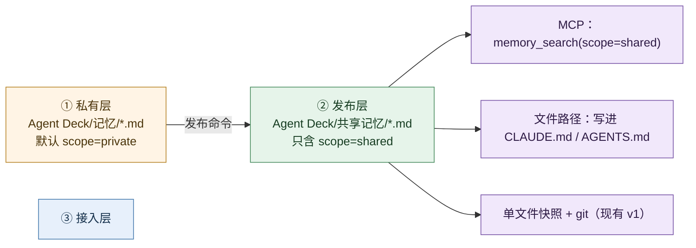

# Dream 记忆共享（方向草案）

> **这不是契约，是方向。** 现在的契约是 [`shared-memory.md`](shared-memory.md)：整份快照单向导出 + 可选 git push + Telegram Companion 联动。
> 本文讨论的是"接下来可能要做"的一步：**把 Dream 出来的记忆按条目共享给别的 Agent**，以及为什么先做发布层、再做 MCP。
> 状态：草案，未排期；实现前需要先把「未决问题」拍板。

## 1. 现在卡在哪

| 现状 | 缺口 |
|---|---|
| `记忆/*.md` 一文一条，frontmatter 带 `id/kind/state/date/sources` | 没有"这条能不能给外人看"的字段 |
| 共享 = 整份 `长期记忆.md` 快照写到一个外部路径 | 粒度是文件，没法只共享某几条 |
| 消费端只能读文本 | 没有按需检索（Notion 那边是 MCP 检索） |
| 撤销 = 重写整个快照 | 没有版本/id 线索；外部副本被谁缓存过不可知 |

一句话：**现在能"整体复制出去"，但没法"按条授权、按需查询、可证明撤销"。**

## 2. 参照：Notion 怎么做

四条事实（来自官方文档）：

1. **内容在 workspace 里，权限跟着内容走**：Notion AI 只使用"你有权限看"的页面。— [Notion AI FAQ](https://www.notion.com/help/notion-ai-faqs)
2. **入口是 MCP + Connectors**：Claude / ChatGPT / Gemini 接同一个 workspace，可搜可建可改；Slack、Drive 走 connectors。— [Notion MCP 概览](https://developers.notion.com/guides/mcp/overview)
3. **记忆挂在账号/workspace 上，不挂在会话上**：把偏好存进 *personal memories* 之后，**另一个会话、或另一个接了同一账号/workspace 的客户端**都能召回；且"接 MCP 不会自动导入另一个客户端的聊天历史"。
4. **Skills 也是可分享对象**：建一次，队友和任何接了 MCP 的客户端都能用（Skills via MCP）。

映射到我们这边：

| Notion | 我们 |
|---|---|
| workspace 页面 | `记忆/*.md` |
| 页面级权限 | 每条记忆的 `scope` / `audience` |
| MCP 入口 | 本地 stdio MCP（`memory_search/read/recent` + `scope`） |
| personal memories | `Agent Deck/记忆/`（本地 iCloud） |
| 分享 Skills | `技能/*.md`（已有 frontmatter 真实路径，可复用同一套发布规则） |

## 3. 目标与非目标

**目标**

- 能**按条**决定哪条记忆可以出库，给谁看。
- 别的 Agent 能**按需查**共享层（不是只能吃一份快照）。
- 撤销是**可证明干净**的：共享目录按差集同步删，外部快照全量覆盖。
- 每条共享记忆保留**来源锚点**，消费端回答能溯源。

**非目标**

- 不做多人实时协作 / 冲突合并（我们不是 Notion）。
- 不做服务端权限与审计（本地没有这个基础设施）。
- 不把私有记忆默认共享（默认必须 `private`）。
- 不引入软链或把密码/凭据写进共享层。

## 4. 三层模型



**① 私有层**：现状不动。唯一新增是 frontmatter 两个字段。

**② 发布层**：一条命令把 `scope=shared` 的条目复制进库内的 `Agent Deck/共享记忆/`（**复制，不软链**——库在 iCloud + git，软链会断，见 `shared-memory.md` 的既定边界）。撤销就是把 `scope` 改回 `private` 再发布一次。

**③ 接入层**：同一份共享目录，三种壳，按消费端能力选。

## 5. 数据契约（草案）

### 5.1 私有记忆新增字段

```yaml
scope: private            # private（默认）| shared
audience: []              # 空 = 所有共享消费者；否则列 agent id：claude / codex / dsh / …
```

规则：

- 缺字段按 `private` 处理（**旧文件不需要迁移**）。
- `state≠有效` 的条目不参与发布，即使 `scope: shared`。
- `audience` 只做"发布时筛选"，不是访问控制（见 §8 红线）。

### 5.2 发布产物

```
Agent Deck/共享记忆/
  2026-11-17-在RAG系统中设置拒答门槛.md   # 原样复制记忆文件 + 三个发布字段
  索引.md                                  # 一行一条：日期 · 类型 · 标题 · [[双链]] · audience
  _published.md                            # 本次发布的 id / content_hash / published_at
```

复制时在 frontmatter 追加：

```yaml
published_at: 2026-11-18T07:00:00.000Z
published_from: m-3f789702002552e3e9f6da00
content_hash: ab12cd34
```

`_published.md` 是撤销与幂等的依据：下次发布按 id 差集删除不再共享的文件；内容 hash 没变就不重写（避免无意义改动与 git 噪音）。

## 6. 命令与流程

| 命令 | 作用 |
|---|---|
| `记忆：发布共享记忆（预览）` | 只列出"会新增/更新/删除"哪些条目，不写盘 |
| `记忆：发布共享记忆` | 同步共享目录 + 索引 + `_published.md`；可选触发一次 v1 快照导出 |
| `记忆：撤销这条的共享` | 把当前光标所在记忆的 `scope` 改回 `private`，并提示需要重新发布 |

**幂等**：同一份输入连续发布两次，第二次不产生任何文件修改。
**失败语义**：任何一步失败就停在那里、保留已写文件，不自动回滚（与现有写入策略一致），错误写进 `settings.dream.share.lastError`。

## 7. 接入方式对比

| 方式 | 适合谁 | 成本 | 风险 |
|---|---|---|---|
| **MCP 只读**（`memory_search/read/recent` 加 `scope`） | 接了 MCP 的客户端 | 与现有的"MCP 化"任务合并，约 1 天 | 本地 stdio，跨机要自己解决同步 |
| **文件路径**：把共享目录绝对路径写进各客户端指令文件 | 只能读文件的 CLI Agent | 半天 | 依赖"它真的会去读"；没有检索，只有全量读 |
| **单文件快照 + git**（v1，保留） | 不在同机、没有 MCP 的（Telegram Companion 等） | 已有 | 粒度粗、无检索 |

推荐顺序：**发布层 → `--scope shared` 的 CLI → MCP → 现有快照改成从共享目录生成**。

## 8. 红线

1. **默认私有**：没有 `scope: shared` 一律不出去；发布命令要先有"预览"。
2. **来源锚点不可丢**：共享条目必须保留 `sources`（`[[日记/…#^mem-…]]`）。外部客户端打不开双链时，至少保留可读的"日记日期 + 行号"文本。
3. **撤销要能证明**：发布幂等 + 按 id 差集删文件 + 外部快照全量覆盖。**禁止**做增量合并（最容易被已撤销内容残留在别处）。
4. **不做软链、不搬文件**：共享目录是副本，真相仍在 `记忆/`。
5. **`audience` 不是访问控制**：它只是"发布时筛给谁"，一旦文件出库（外部路径 / git / MCP），实际可见性由那个通道决定。文档里必须这么写，不许含糊。
6. **不共享凭据、邮箱、私聊原文**：共享只到"记忆条目 + 来源锚点"这一级。

## 9. 与 Notion 的差距（别自我美化）

| 维度 | Notion | 我们 |
|---|---|---|
| 权限执行 | 服务端强制，按页面/块 | 白名单筛选 + 导出文件权限，**不强制** |
| 检索 | 托管 MCP + 向量/关系检索 | 本地词面 + CLI/MCP，只有一条通道 |
| 审计 | 管理后台、成员级统计 | 只有 `_published.md` 的本地记录 |
| 跨机 | 天然 | 靠 git / 云盘，冲突要人工处理 |

## 10. 最小切片

1. `scope/audience` 字段 + 发布/撤销/预览三个命令 + `共享记忆/` 与 `索引.md`（约 1 天）
2. `memory-query --scope shared`，让 CLI 先能查共享层（半天）
3. MCP 暴露 `scope` 参数（并入"记忆查询接 MCP"，1 天）
4. v1 快照改成"从共享目录生成"，Telegram 通道不动（半天）

## 11. 未决问题（实现前要拍板）

1. **`audience` 语义**：是"发布时筛选"还是"运行时按调用方过滤"？目前草案是前者（简单、可验证）。
2. **一条记忆的 shared 是否可撤回**：已导出到外部路径的副本，我们无法收回——要不要在发布前强制"预览 + 确认"？
3. **跨机共享**：共享目录进 git 还是走云盘？进 git 会暴露来源锚点到仓库，需要单独的私有仓库吗？
4. **冲突**：多个 Agent 都改了共享记忆怎么办？（草案：不允许写共享层，写回只走私有层 + 重新发布）
5. **技能卡是否共用同一套发布规则**：`技能/*.md` 已有真实路径 frontmatter，复用 `scope` 可能让两者语义打架。

## 12. 验收

- 发布预览列出的条目 = 实际写入的条目（可 diff 验证）。
- 连续发布两次，第二次零改动（幂等）。
- 把一条改成 `private` 再发布：共享目录对应文件被删，`_published.md` 记录里消失。
- `state≠有效` 的条目即使 `scope: shared` 也不出现。
- 共享条目的 `sources` 锚点与私有层一致（可逐条 diff）。
- MCP 侧：`memory_search` 带 `scope=shared` 只返回共享层，`private` 条目不可见。
