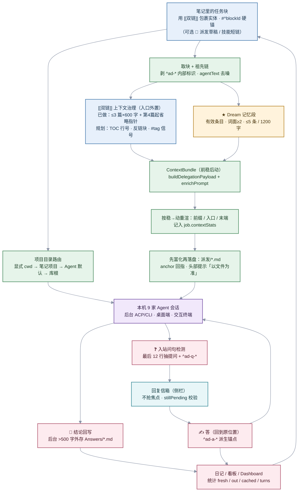
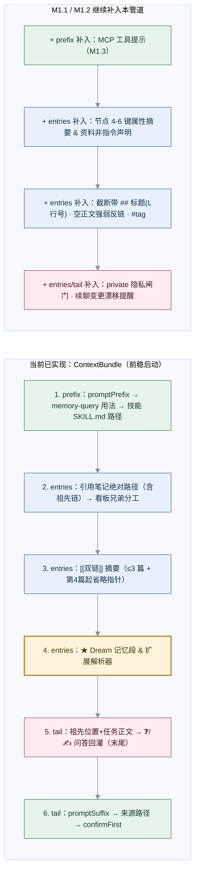
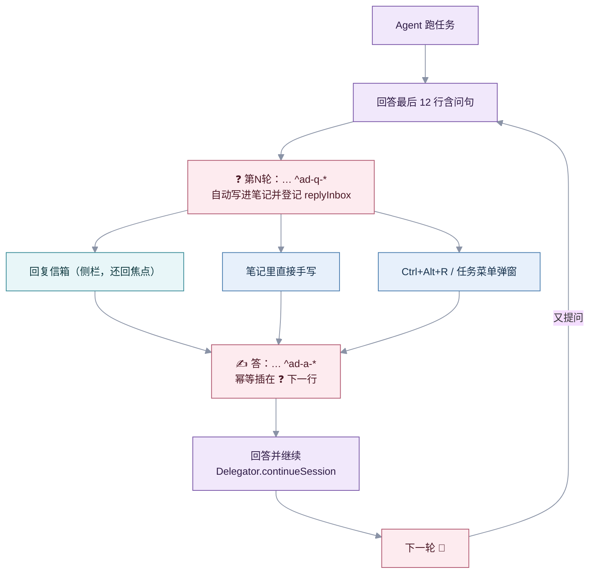
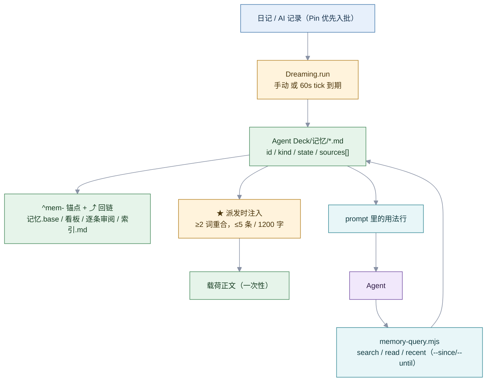
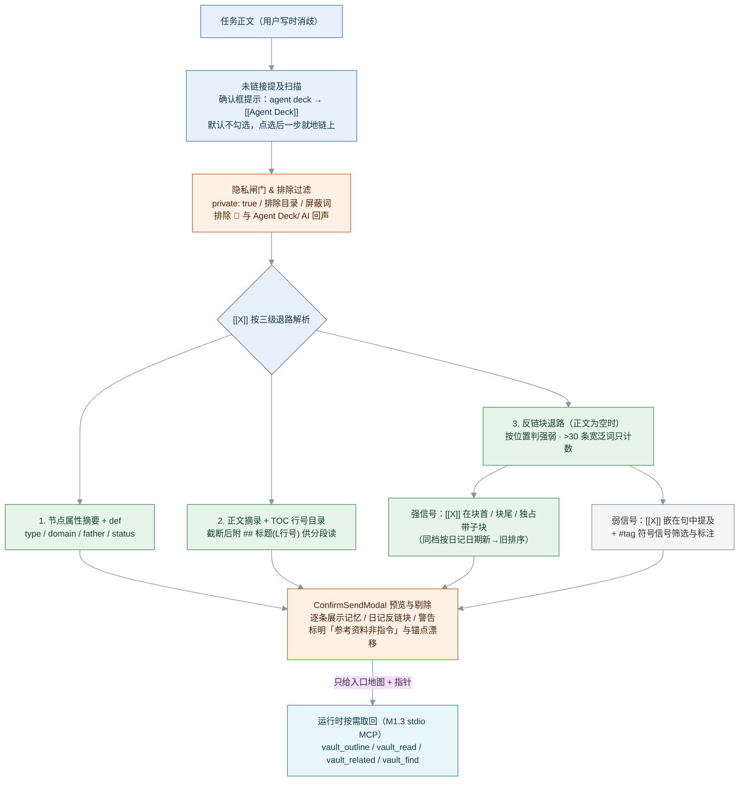

# 信息与功能流转（Harness 全链路与上下文治理）

> 状态：**2026-11-19 对齐源码与 M1 规划**（基线：`1.12.2` + 未发版增量；对应模块见 `docs/specs/architecture-and-boundaries.md`）。
> 相关：[`vision-markdown-harness.zh-CN.md`](vision-markdown-harness.zh-CN.md) · [`context-protocol.zh-CN.md`](context-protocol.zh-CN.md) · [`harness-roadmap.zh-CN.md`](harness-roadmap.zh-CN.md) · [`data-and-markdown-contracts.md`](data-and-markdown-contracts.md)
> 五张图：① 一次派发的全链路 ② Prompt 组装顺序（现状 vs 前稳后动）③ 问答闭环（含回复信箱）④ Dream 三条路径 ⑤ 双链包裹上下文与强弱信号治理（M1.2 规划）。

---

## 图 1｜一次派发的全链路

> 核心思路：用户在写任务时用 `[[双链]]` 包裹实体并借位置（块首/块尾 vs 句中）或 `#tag` 标定范围与强弱；委派时由 Harness 把笔记库当作外部存储，只内联高信噪比入口与引用指针，其余按需回查。

---

## 图 2｜Prompt 组装顺序（已改为「前稳后动」vs 后续 M1.1/M1.2 增量）

> 已从旧版 `enrichPrompt` 头部倒序前置改为 `ContextBundle`（`renderContextBundle`）统一按**前稳后动**渲染：固定提示、技能与引用入口在前，祖先链+当前任务正文及每次会变的 `❓/✍️` 问答回灌放在末尾。注：`delegate()` 写完载荷快照后还会在最外层加一句 `本次任务的完整载荷…` 指针。

---

## 图 3｜问答闭环（三个入口，都写回原位）

---

## 图 4｜Dream 三条路径（一文一条记忆库 + 按需检索）

---

## 图 5｜目标态：双链包裹上下文与强弱信号治理（M1.2–M1.3 规划）

> 解决两个真实痛点：① 用户写了实体名但忘了加 `[[]]`；② 库内大量概念页正文 ≤ 50 字（2026-11-18 实测 1665 篇概念页里 1049 篇正文 ≤ 50 字，其中 995 篇的内容都在日记/概念反链里），现行代码在正文为空时直接跳过。

---

## Dream 注入与 Dashboard 口径速查

| 项 | 说明 |
|---|---|
| **Dream 触发环** | 构建载荷时（`dream-memory` resolver），即**派发那一刻**；不是运行中、不是回写后，**续聊不会重复注入** |
| **命中与预算** | 词面重合 ≥ 2 词（中文二元组 / ≥4 字符非停用英文技术词 / 元数据补盲），只取 `state=有效` 且有 `kind`（跳过 `private: true`）；最多 **5 条 / 1200 字**；M2 起按 `resolveDispatchFolder` 结果做工程域 vs 个人域分流（通用问答保持 0 注入） |
| **记忆索引与门禁** | `renderMemoryIndex()` 生成 `索引.md`（M1.1 过滤 `private` 与非 `有效` 条目并按域/类型分组）；M3.1 接通 `RunTrace` 轨迹诊断 → `eval-context.mjs` Golden 集门禁 |
| **长回答外存** | 后台回答 ≤500 字直接进子块；>500 字外存 `Agent Deck/Answers/*.md`，日记子块只保留双链 |
| **Dashboard 统计** | `usage.json` + 日记 `🔗` + `autoLogState` 汇总：总览显示 `缓存读取占比 = cached/(fresh+cached)`；「模型分布」表在 `问答轮次` 列括号内展示 `(tokens/轮)`，在 `缓存命中` 列展示比例（因包含重复缓存读取，评测上下文压缩/前缀稳定度时建议重点看未缓存输入 `fresh`） |

---

## 代码落点对照（现状基线）

| 步骤 | 代码坐标 | 说明 |
|---|---|---|
| 取块与上下文 | `src/harness.js` `resolveDelegationContext` | 祖先链、`boardContext`、`resolveWikilinkSnippets`（当前 >3 篇 `break`、空正文 `continue`）、`CONTEXT_RESOLVERS` |
| Dream 注入与索引 | `src/main.js` → `src/dream.js` / `src/memory-query-core.js` / `src/memory-store.js` | `MIN_MEMORY_OVERLAP = 2`（含单英文技术词与元数据补盲），`limit = 5`，`maxChars = 1200`；待补 `dream-memory` 传入项目上下文与 `renderMemoryIndex` 隐私/状态过滤 |
| 拼 prompt | `src/harness.js` `buildPromptFromContext` / `buildDelegationPayload` | `promptPrefix` → 祖先链+任务 → `extraSections` → `promptSuffix` → 来源路径 → `confirmFirst` |
| 富化四层 | `src/delegation.js` `Delegator.enrichPrompt` | 当前往头部倒序前置：`skillLine` / `replyText` / `memoryHint` / `notePaths` |
| 载荷快照 | `src/delegation.js` `payloadSnapshot` / `writeTaskPayload` | 无草稿时先富化再落盘；有草稿时按草稿原文再富化去重 |
| 问答写回与信箱 | `src/thread-replies.js` + `src/reply-inbox.js` + `src/reply-inbox-view.js` | `^ad-q-*` / `^ad-a-*` 锚点、`stillPending` 校对、焦点归还 |
| 续聊与轮次回写 | `src/delegation.js` `continueSession` / `src/journal.js` `syncSessionEntry` | 续聊回传 `✍️` 回答；12 行入站问句检测 |
| 卡住看护与删除守卫 | `src/steward-watch.js` + `src/note-updates.js` | 15 分钟无输出提醒一次；笔记不存在时不写入 |
| Dashboard 指标 | `src/analytics.js` + `src/dashboard.js` + `src/dashboard-data.js` | `cacheHitRate`、`tokensPerTurn`、`fresh / out / cached`、项目归属 |

---

## 还没画进去 / 边界事项

- **MCP（M1.3）**：尚未落地，Agent 运行时查库目前只有 `scripts/memory-query.mjs` CLI 一条路。
- **双链位置判强弱、TOC 截断目录与 `#tag` 信号（M1.1–M1.2）**：图 2 右半与图 5 为当前对齐后的目标流转，代码待按 Milestone 落地。
- **Windows**：全链路未做实机验证，流程以 macOS 实测为准。
- **权限类交互**：授权审批仍走 attention 通知回客户端，不走 `❓/✍️` 问答闭环。
