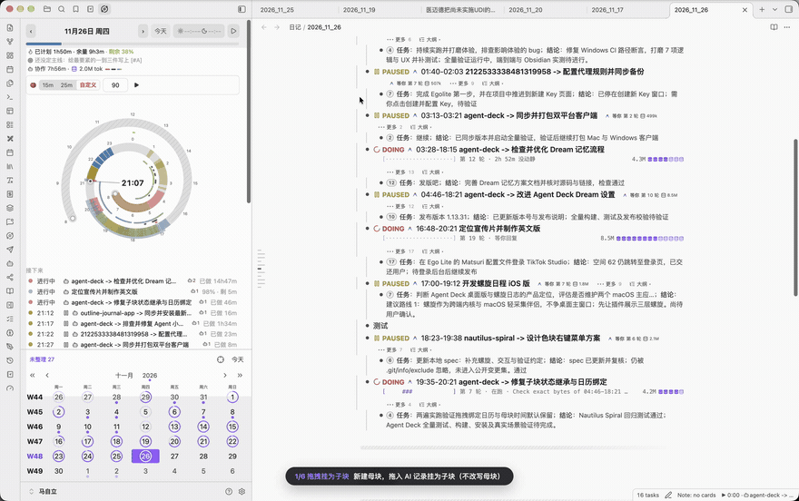

[中文](Workflow-Markdown-Harness) ｜ **English**

# Core Workflow: Markdown as Harness

Agent Deck is built around one core principle: **Markdown, outlines, and journals are the harness**. Instead of locking tasks and conversations inside a proprietary plugin database, your regular Obsidian notes drive multi-agent collaboration and receive all results back in place.

## 1. Notes as Context: What Gets Assembled on Dispatch

When you delegate from any task or subtask (always reading unsaved editor buffers first), Agent Deck automatically assembles:

- **Parent outline chain**: The hierarchy from root heading/task down to the current subtask so the agent understands the bigger picture.
- **Prior Q&A & progress**: Existing `💬` logs, `❓` questions, and `✍️` answers under the same task.
- **Relevant long-term memories**: Up to 5 relevant entries from your memory library, each with a link back to the original journal block so the agent can verify source context.
- **Linked notes**: Excerpts from `[[wikilinks]]` referenced in the task (when there are many links, paths are passed for on-demand reading; notes marked `private` are never sent out).
- **Skill cards**: Mention `[[Skills/xxx]]` in a task to attach a local skill's instructions to that run.

> **Preview before sending**: Run `Delegate: write a draft (do not send)` to materialize the full dispatch payload right under the task line so you can edit it before sending. Actual dispatches also save an immutable snapshot (`Agent Deck/派发/*.md`) for later review.

## 2. Human-in-the-Loop Q&A

- When a background agent ends a turn with a question, a `❓` line is written under the task and surfaced in the sidebar **Reply inbox**.
- Write `✍️ Answer: …` directly in the note or use "Answer and continue" from the task menu to resume the same session without switching back to the external client.

## 3. How to Work with AI Auto-Logged Records in Agent Deck

  

60-second live demo (each workflow shown once) · click for the <a href="https://github.com/MatsuriMW/obsidian-agent-deck/releases/download/1.13.32/ai-record-operations-demo.mp4">HD MP4 with music</a>

Every AI auto-logged journal entry is plain Markdown, so you can organize, highlight, and re-view it like any outline while background tracking keeps syncing cleanly:

- **Drag-bind (nests as a child block by default)**: create a parent outline item (e.g. `- [[Agent Deck]] 开发`), then drag a sidebar session card or an existing AI record's drag handle onto it. It nests underneath as a child block while leaving the parent's prose and time range untouched; hold `⌥` (`Alt`) to directly 1:1 bind or merge into the target line.
- **Group rows shortcut (`⌘⌥↓` / `Ctrl+Alt+↓`) & progressive nesting**: select multiple AI auto-logged blocks and press `⌘⌥↓` (or right-click **Group rows**) to indent the selection under a fresh parent bullet ready for your project name or wikilink. Repeat inside a group to build multi-level **Project → Sub-topic → AI record** outlines. With multiple blocks selected, right-click or click any status badge to bulk-update statuses in one step.
- **Fold/expand & right-click Pin**: older rounds stay folded by default so only the latest conclusion is shown; click `⋯ More N` / `› Collapse N` to toggle. Right-click any round (in Outline, Table, Cards, Timeline, or Reading View) and pick the top item **Pin as key record (stays visible when folded · Dreaming priority)**—pinned rounds stay visible with a subtle accent highlight even when folded and carry higher priority during Dreaming memory distillation. The same menu also copies conclusions, opens the original session, jumps to the parent task, re-delegates that round to another agent/model, or deletes the round.
- **In-place record views & fractal board**: switch any AI record in place between **Outline / Table / Cards / Timeline** (and export the active view) without touching the underlying Markdown. Any parent or sub-topic holding multiple task children gets a **Board N** toggle to open an in-place fractal Kanban board where dragging cards updates statuses.
- **Tidy journal layout (`⌃⌥L` / `Ctrl+Alt+L`) & lossless safeguards**: press `⌃⌥L` or click **Tidy journal layout** to group scattered top-level AI blocks under **Done / Doing / To do**, ordered by status priority and round count, while keeping your grouped parent trees and nested sub-blocks intact. Click any status keyword to manually lock it, press `⌘⇧D` to mark `DONE` and move to Done, and edit any AI title or prose knowing Agent Deck will never overwrite hand-edited text.

## 4. Four Record Views & In-Place Fractal Boards

Inspect the exact same Markdown from multiple perspectives without rewriting the underlying file:

- **Four AI record views**: Outline, Table, Cards, and Timeline (interactive in Live Preview, clean read-only preview in Reading View), with view-aware export to PDF, HTML, Markdown, JSON, or CSV.
- **Pin & re-delegate**: Right-click any round in Outline, Table, Cards, Timeline, or Reading View to pin it as a key record (`<!-- ad-pin -->`, preserved when folded and prioritized by Dreaming) or re-delegate that round to your default agent or a chosen model.
- **In-place fractal boards**: Any block with multiple direct child tasks gets a **Board N** toggle (clean non-editable read-only preview in Reading View) — split by status or by group, drag cards across columns, zoom into nested sub-boards, inspect queued-stage pills, recover failed workers (`Retry failed`) or skip partial failures to start the next batch, re-dispatch `NEEDOK` cards, dismiss finished summary strips, and use mirror cards (`![[Note#^block-id]]`) that write status changes back to the source note.

## 5. Squads, Planning & Workbench

- **Goal → `task.md` → Board**: Run `Plan: turn this line into task.md` to break a single goal line into steps with acceptance criteria; the output automatically opens as a board.
- **Staged squads & Steward loop**: Five built-in squads (full-stack, debugging/refactoring, research & docs, deep report, long-form writing) that skip missing CLIs and disabled/rate-limited agents; switch planner models on demand, validate working directories before launch, stagger file-overlapping tasks into **Batch 1 / 2 / 3** with automatic upstream summary and `Answers/` archive path handoffs, inject direct-execution instructions when "Skip confirm-first" is checked (or hold in `NEEDOK` until answered via reply/desktop/re-dispatch when unchecked), and let the Steward agent synthesize results once complete (with a 15-minute mid-run stall check covering both workers and the Steward).
- **Workbench overview**: Run `Workbench: refresh overview` to generate a single index note listing active boards, memory statistics, and recent plans.
