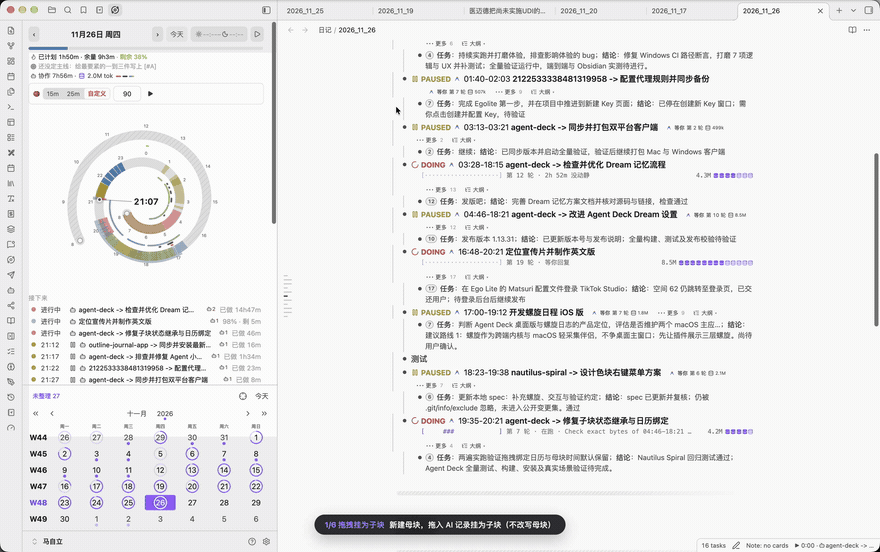

**中文** ｜ [English](Workflow-Markdown-Harness.en)

# 核心工作流：Markdown 即 Harness

Agent Deck 的底层设计理念是 **「Markdown / 大纲 / 日记即 Harness」**：不是把任务和对话关进插件私有数据库，而是让你的日常笔记直接驱动多 Agent 协作，再把所有产出以可读、可改的 Markdown 写回原处。

## 1. 笔记即上下文：派发时会自动带上什么？

当你从某一条任务或子任务发起委派时，插件会自动组装完整上下文（优先读取编辑器里尚未保存的最新内容）：

- **上层大纲链**：从根节点到当前子任务的层级结构，让 Agent 知道「这件事在整体里的位置」。
- **历史问答与进展**：同一任务下已有的 `💬` 回传记录、`❓` 提问与 `✍️` 回答。
- **相关长期记忆**：自动按相关度注入最多 5 条来自记忆库的条目，每条附回原日记链接，Agent 可自行回溯原文核对。
- **关联双链笔记**：自动读取正文中 `[[链接]]` 指向的笔记摘录（链接过多时改为提供路径供 Agent 按需阅读；标了 `private` 的笔记绝不外发）。
- **技能卡注入**：在任务里写上 `[[技能/xxx]]`，即可把对应本地 Skill 的指令附带交给 Agent。

> **先看再发**：运行命令 `委派：先生成草稿（不发送）`，可以把这一趟完整要发送的上下文落盘并挂在任务行下，你修改确认后再正式派发；正式派发时会自动另存一份不可变快照（`Agent Deck/派发/*.md`），事后可随时审计。

## 2. 人机协作问答闭环

- 当后台运行的 Agent 在结尾向你提问时，任务下会自动写入一行 `❓`，同时汇总到侧栏 **「回复信箱」**。
- 你可以直接在笔记里手写 `✍️ 答：你的回复` 并发送，或通过任务菜单「回答并继续」把回答发回同一会话，全程不必切回外部客户端翻记录。

## 3. 在agent deck里你可以如何去对于 AI 自动记录的内容进行操作

  

60 秒实机演示（每项操作演示一次）· 点图观看 <a href="https://github.com/MatsuriMW/obsidian-agent-deck/releases/download/1.13.32/ai-record-operations-demo.mp4">高清原画 MP4</a>

AI 自动写回日记的记录都是普通 Markdown 块，你可以像整理自己的大纲一样顺手归类、高亮与切换视角，底层同步与追踪不会被打断：

- **拖拽绑定（默认挂为子块）**：新建一个手写母块（例如 `- [[Agent Deck]] 开发`），把侧栏会话卡片或日记里已有 AI 记录行尾的拖拽把柄拖到母块上，自动挂成缩进子块而不改写母块原文与时间；按住 `⌥`（Alt）则 1:1 直接绑定或合并到目标行。
- **快捷键一键成组（`⌘⌥↓` / `Ctrl+Alt+↓`）与递进子块**：框选多条 AI 自动记录后按 `⌘⌥↓`（或右键「合并成组」），整组自动降一级并在上方生成空母块，直接输入项目名或双链即可；在组内可继续选中子块再按 `⌘⌥↓`，搭出「项目 → 子主题 → AI 自动记录」的多层递进结构。多选后右键或点任意状态徽章还可一键批量改状态。
- **展开折叠与右键 Pin 关键记录**：历史轮次默认折叠只留最新一条，点击 `⋯ 更多 N` / `› 收起 N` 随时展开或收起；在大纲、表格、卡片、时间线或阅读视图中右键任意轮次，第一项就是 **「Pin 为关键记录（折叠不隐藏 · Dreaming 优先）」**，收起后被 Pin 的关键结论仍保持可见并柔和突出显示，同时在 Dreaming 提炼长期记忆时获得更高权重。同一右键菜单也支持复制结论、打开原会话、跳到母任务、原地把该轮再委派给其他 Agent/模型或删除该轮。
- **原地视图切换与分形看板**：无需改动底层 Markdown，可在 AI 记录行内直接切「大纲 / 表格 / 卡片 / 时间线」并按当前视图导出；包含多条子任务的母块或子主题旁会自动出现「看板 N」，点一下即原地展开分形看板，拖卡片就能改状态。
- **整理日志版面（`⌃⌥L` / `Ctrl+Alt+L`）与无损保护**：按 `⌃⌥L` 或在面板点击「整理日志版面」，会把顶层零散的 AI 自动记录按 **「已完成 / 正在做 / 还要做」** 分区，并在分区内按状态优先级与轮次整理排布；你已经用母块归好组的层级与递进子块会原样保留不被打散。点状态词可手动锁定状态，`⌘⇧D` 一键标 `DONE` 并移入「已完成」，手改过的 AI 标题与手写正文永不被覆盖。

## 4. 四种记录视图与原地分形看板

同一份标准 Markdown，不用改写原文，就能原地切换视角：

- **四种 AI 记录视图**：大纲、表格、卡片、时间线（实时预览下完整交互，阅读视图下只读预览），支持按当前视图导出 PDF / HTML / Markdown / JSON / CSV。
- **右键 Pin 与再派发**：在大纲、表格、卡片、时间线或阅读视图中右键某一轮记录，可把它 Pin 成关键记录（加 `<!-- ad-pin -->`，折叠时不藏、Dreaming 时优先提炼），也可原地把这一轮再派给默认 Agent 或指定模型。
- **原地分形看板**：任意包含多个直接子任务的块，行尾会出现「看板 N」，点击即在当前笔记里展开看板（阅读视图下自动保持纯净只读预览），支持按状态分列或按子组分列、跨列拖拽改状态、批量操作、待接力批次提示、部分失败时「重派失败项」或「跳过失败继续下一批」、`NEEDOK` 右键重派、可收起总结条与镜像卡（`![[笔记#^块号]]` 改状态自动回写原笔记）。

## 5. 项目小队与目标规划

- **目标 → task.md → 看板**：执行 `规划：把当前这一条拆成 task.md`，把一句话目标拆解为带验收标准的步骤文件，并自动设为看板。
- **小队分批并发与管家汇总**：内置全栈开发、排错重构、调研与文档、深度研报、深度写作五套预设，自动绕过未装 CLI、已禁用或撞限额的 Agent；支持切换拆解模型、工作目录存在性预检、`第 1/2/3 批` 分阶段依赖接力（携带前批摘要与 `Answers/` 完整归档路径）与同批文件冲突一键错峰；勾选「跳过首轮反问确认」时附带直接交付指令减少中断，未勾选而队员发起反问时保持 `NEEDOK` 并支持续聊/桌面端回包/重派继续，全部完成后由管家 Agent 汇总推进（波次或管家卡住 15 分钟均由看护提醒并写回子卡）。
- **工作台总览**：执行 `工作台：刷新总览` 生成 `Agent Deck/工作台.md`，一页看清所有看板、记忆统计与最近规划。
